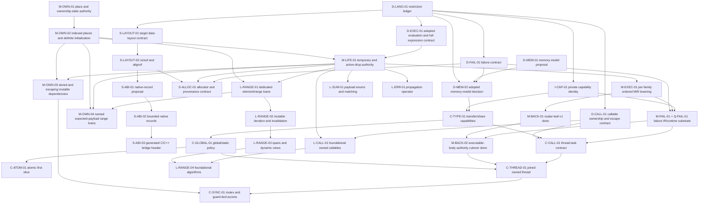

# GTI Dependency-Ordered Implementation Sequence

> **Plan status:** Accepted operational sequencing and status plan. It does not
> define current language semantics or replace the detailed design documents
> for an individual subsystem.

Checkpoint: maintained against current `main`; canonical behavior remains in
`docs/language/` and `docs/architecture/`.

This document turns GTI's architecture reviews, language review, accepted
plans, and current implementation checkpoint into one executable work queue.
It answers three questions for every substantial piece of future work:

1. what must be decided or implemented first;
2. what one coherent change should accomplish; and
3. what evidence allows the next change to begin.

Current behavior remains authoritative in [`docs/language/`](../language/) and
[`docs/architecture/`](../architecture/). The durable release capability map
remains [`roadmap-to-1.0.md`](roadmap-to-1.0.md). Current implementation
evidence belongs in architecture documents and tests; the older
[`compiler-roadmap-status.md`](archive/compiler-roadmap-status.md) is retained
only as a historical checkpoint. Detailed domain decisions remain in the other
files under `docs/plans/`. The documents under
[`docs/third-party-audit/`](../third-party-audit/) are evidence and review
input, not a second implementation queue.

## Everyday Program Stabilization

**State:** implementation and combined release validation complete; prepared
for 0.360.0 delivery. The candidate reconciles canonical `main` through
`0ff67a4e`. This campaign closes
ordinary application composition gaps before adding more advanced surface.
Source diagnostics for invalid programs are part of every row, not a substitute
for implementing valid programs. Existing compiler-owned ownership, failure,
and MIR execution rules remain authoritative.

| Priority | State | Client and exit evidence |
| --- | --- | --- |
| 1 — construction and replacement | complete; combined validation passed | Nested owning objects and optional in-place construction, including mixed-argument fallible emplacement, preserve ordered initialization, exact first failure and partial cleanup. Reduced Tea-style regressions run through the production backend. |
| 2 — borrow composition | complete; combined validation passed | Ordinary helpers, lookup and tree traversal compose checked references/views without representation-only rejection; unsafe escape, overlapping mutable access and use-after-move retain precise source errors. |
| 3 — container/value-wrapper consistency | complete; combined validation passed | Movement, replacement, explicit cloning, emplacement and lambda error mapping work across everyday eligible optional/container/expected combinations, using structural library contracts rather than public-name compiler exceptions. |
| 4 — owning payload transport | complete; combined validation passed | Concrete generic wrappers and collections can carry owning event/message alternatives through verified construction, movement and exactly-once destruction. Unsupported structural boundaries remain explicit and diagnosed at source. |

The final focused pass covers the mixed constructor's 88 native outcomes,
64 direct/pack generated-transport outcomes, lambda mapper/compiler/LSP
matrices, and the constructor mutability advisory. In particular, staged owner
cleanup cannot replace an earlier capacity failure with a later destructor
failure. All compiler targets have been rebuilt with host optimization after
the interrupted session. A broad run exposed a concrete-pack pointer-input
compatibility regression; it was stopped before reconciling the newly merged
practical examples. The existing checked conversion predicate is now shared
by pack lowering and independent MIR verification; the original regression and
new positive/negative coverage pass. The fresh 377-test combined suite passes
with no failures or skips in 1617.18 seconds, including both executable corpus
oracles and the expanded 95-example inventory. All 11 clean staged consumers
and the staged carrier, lambda-mapper and mixed-emplacement probes pass.
Formatting and syntax-tooling checks also pass. Local installation and
canonical Gitea dispatch are the remaining operational delivery steps, not
unfinished implementation. Neither the interrupted run nor prior installed
checkpoints substitute for the final evidence recorded in
[`verification.md`](../architecture/verification.md#combined-03600-release-validation).

The following checkpoint narrative records development history. References to
pending integration below describe that checkpoint, not additional work beyond
the current status above.

Each row requires focused positive/negative tests and relevant compiler/LSP
diagnostic evidence using an optimized compiler. Integrated completion requires
the broader affected verifier, backend, corpus and runtime gates. SIMD and
native-bridge handoff work is independently audited before reconciliation; it
does not replace these four outcomes. The user also transferred structural
relocation into this campaign. Its candidate at `875f288d`, original follow-up
`6cf8e3d8`, and reviewed fail-closed/transactional hardening `596e4264` are
integrated locally. The client is checked transfer between typed-storage
owners and vector/string growth, without user-defined movement or raw-address
APIs. Reconciliation must preserve empty-destination preflight, exclusive
borrows, exactly-once cleanup, conservative relocation traits, and independent
MIR verification. SIMD and relocation's separately proposed serialization and
version changes used combined `mir-v82`/`mir-body-v69`; the accessor follow-up
advances this to `mir-v83`/`mir-body-v70` for exact stored-dependency edges. Integrated validation
is in progress, including nonempty SIMD-vector growth and shrinkage. The
optional consistency audit also reproduced and repaired reset losing caller
cleanup on a failing payload destructor, using the existing MIR removal
recipe. Optional cloning now delegates an engaged payload to ordinary
`std::clone`, with empty-state, owned string/vector, scalar and unrelated
user-defined clone policy checks across C++20/23, O0/O1/O3, no-elide and
sanitizers. Nested optionals and unrelated construction-only envelopes now
move and clone under `std::move_constructible`, without granting assignment.
Finite closed-wrapper traversal no longer loses relocation or leaf concurrency
facts to the generic-growth guard; exact cycles and uninterrupted generic growth
remain bounded. Focused compiler checks and the same eight-mode native matrix
cover these cases. The vector consistency slice now uses move construction,
rather than assignment, for empty-slot transport; concrete borrowed-payload
admission and container/expected integration checks are still in progress.
Exact generated special-member construction from a concrete owned pack now
lowers as a verified copy or transfer, preserving caller/parameter cleanup;
the focused pack matrix and nested optional emplacement checks pass.
The broader library sweep exposed an immobile-field constructor publication
regression after conservative failure edges were introduced. The backend now
proves exact failure-free constructor success chains from MIR while retaining
all original failure and cleanup metadata. Unrelated user-defined records and
the eight-mode once/thread runtime matrix pass; the full combined sweep still
needs to complete.
Fresh owning constructor arguments now reuse their exact prepared slots when
publishing a containing field, and destructor-bearing owners can restore
construction-only fields during rollback. Constructor results also publish
through owned Expected bindings using the existing success-edge obligation
and failure-free generated transfer proof. The reduced nested-owner fixture
preserves its exact success and first-failure cleanup in all eight native
modes: C++20/C++23 at O0/O1/O3, no-elide, and ASan/UBSan. All 66 focused
lifecycle-emitter cases also pass, including independent rejection of lost
constructor target, result ownership, or Expected publication. Broader
reconciliation remains in progress.
The subsequent scalar-initializer repair suppresses duplicate metadata-only
field writes; prefix/postfix increments, compound/plain assignment, and
overflow rollback pass the eight-mode native matrix. Passive error bindings
also use uninitialized Expected storage, including loop reuse, a non-default
constructible inactive success alternative and `void` success. These two
focused fixtures cover 40 executions. The vector construction-only matrix
passes 128 executions in the same modes, including sized construction and
resize with partial-prefix rollback, first/secondary destructor failures and
cleanup nested inside optional storage. These are focused results, not a
combined completion claim. Declaration-initializer admission in
`constructor_nonassignable_fields` and owning Expected temporary-return
representation retirement are repaired and pass their focused gates.
Fallible constructors containing owning Expected fields now pass the original
nested-argument regression and the both-owning-alternative extension. The
five-fixture owning-error matrix passes 160 executions across all eight native
modes, including private-empty-state transport and both cleanup failure kinds.
The separately handed-off constructor-formatter feature is committed at
`96e21754` in `codex/ctor-initializer-format`, with focused formatter/LSP
verification. Its patch is reconciled locally with candidate version 0.360.0;
combined verification remains pending. It has not been published or installed.
The completion audit additionally found two cross-feature gaps: later arguments
after an owning Expected constructor input, and fallible field construction of
an owning enum whose payload cannot be assigned. Expected transport now reuses
the existing owned-argument CFG/cleanup proof and passes the six-fixture,
216-outcome native matrix. Construction-only enum fields reuse exact producer
slots for fresh, moved-parameter, and helper-returned values; the 19-case
C++23/O0 check and malformed-MIR mutation gate pass. Its expanded 152-outcome
matrix also passed in the completion sweep. A staged invalid-payload check
also exposed duplicate publication of class-owned diagnostics during generic
constructor reanalysis. The narrow repair retains distinct constructor errors,
source spans and instantiation notes, and passes the compiler and LSP gates.
The optimized all-target rebuild and all 11 staged external consumers pass.
The first complete 368-test sweep passed 358 checks. It exposed constructor
representation inconsistencies for passive move-only mutex payloads, nested
generic defaults and polymorphic replacement; their focused runtime regressions
now pass after shared structural repairs. Updated negative emitter checks
preserve exact initializer ownership, status-only placement, cleanup proofs and
two-phase borrow ordering. Stale generated-text expectations were replaced with
actual retirement/publication identity checks. The HTTP test passed separately
with loopback access, and the declaration census was refreshed after both
independent corpus checks passed. The supplemental full language audit passed
with the absent GTI/C++ comparison-fixture phase explicitly skipped.
The follow-up standard-library sweep now passes after the mutex repair;
the borrowing-composition LSP gate also passes. The optimized optional compiler
gate now additionally proves that distinct concrete instances retain separate
class/constructor diagnostics at shared generic spans. Its LSP counterpart
preserves every substitution and instantiation site when presentation groups
identical primary errors, and clears them after correction. The executable
corpus tests still need the final all-target relink so their completion evidence
covers the latest constructor-admission hardening.
Final all-target/full-suite and clean staged validation must be repeated on the
completed source. Nonempty fallible vector emplacement with primitive scalar
inputs now retains the checked in-place constructor channel and passes 48
native outcomes in the eight-mode matrix. The fixture verifies the final
element address, heterogeneous scalar inputs, evaluation order, partial field
rollback, prior-prefix/caller cleanup, and first/secondary failure identity.
Focused structural mutations also pass; the final combined gates are pending.
The subsequent completion sweep caught a failure-free scalar constructor whose
HIR arguments were still grouped in a concrete pack during failure-effect
normalization. Normalization now uses the exact semantic-selected constructor,
not the pre-flattening argument shape. The reduced `Pair(int, int)` case checks
`None` propagation and ordinary in-place emission alongside the fallible
constructor route. The CLI workflow, full emitter preflight, and updated
48-outcome scalar matrix pass. After the all-target optimized relink, the fresh
369-test sweep passed in 1416.04 seconds, including the library surface,
MIR/C++ corpus, verifier, LSP, and native runtime gates. All 11 fresh
staged-toolchain consumers and the staged scalar emplacement success/failure
probe also pass against that rebuild. This establishes the existing-candidate
stabilization checkpoint before the accessor follow-up; it does not complete
the remaining campaign or replace validation of subsequent changes. The
interrupted previous sweep is not completion evidence.

The non-scalar in-place input candidate now preserves selected constructor
parameter roles and retains prepared argument obligations through a distinct
`PrefixAppendPreflight`. Its unique success continuation transfers them once at
constructor entry and publishes prefix length only on success. Independent
verification ties both steps to the same storage, target, call inputs and
failure control flow; the storage input's extra non-consuming use is confined
to that pair. Serialization advances to `mir-v84`/`mir-body-v71` and exhaustive
optimizer coverage treats the check as a conservative trapping barrier.
Mixed owning/reference/owner-dependent-text/raw-pointer regressions and forged
pair/cleanup tests are implemented. The first coordinated optimized build is
in progress; these programs are not considered delivered until their full
native matrix and combined gates pass. Controlled backend rejection was not
treated as a completion claim.
At that earlier checkpoint, the campaign was not complete.
No custom copy/move constructor bodies,
module implementation, weakened borrow rules, or unchecked failure paths are
part of this campaign.

### Receiver-accessor lifetime integration (validated and installed locally)

After the 369-test stabilization checkpoint, implement receiver-tied reference
returns to objects that themselves retain borrowed dependencies. The motivating
client is Tea's `client.auth()` accessor, where the contained auth service
borrows a separate HTTP service. The candidate now represents the returned
reference to the service shell and its inherited external-owner dependencies
with separate access authority and loan endpoints. The carrier integration
passed its full 371-test inventory, followed by the optimizer correctness
repair and fresh installed checkpoint described below.
The planning handoff is a proposal to audit against current semantics, not
permission to remove a rejection without the corresponding lifetime proof.
Baseline inspection also found that direct local references to an exclusive
carrier are rejected, while a shared carrier reference is currently attached
to the external owner loan without protecting its physical shell. A reduced
program can consequently move or mutate the shell and then use that still-live
reference without a source error. This is part of the same lifetime repair;
fixing accessor syntax alone would leave the general rule unsound.

The audited design direction keeps physical containment/reborrowing separate
from a shell reference's inherited stored dependency. Reuse the existing
complete stored-owner loan through an explicit checked dependency relation;
do not widen the homogeneous read-only multi-owner source set into unrelated
mixed permissions or infer the relation in the backend. The dependency remains
live for dependent shell references and their descendants. Each access is
bounded by both shell and inherited permissions, without changing the stored
loan's original permission. Entry/return provenance, cross-argument aliases,
normal/failure retirement, and optimizer alias/escape consumers must verify the
relation. The candidate implements this rule with unrelated user-defined
carriers and concrete generic instances, positive/negative semantic,
MIR-verifier, native runtime, and compiler/LSP diagnostic evidence. Preserve
safety for shell movement,
replacement, escape, reborrowing, and conflicting external-owner access.

The focused native matrix passes 32 outcomes across C++20/C++23, O0/O1/O3,
no-elide, and ASan/UBSan. It includes generic accessor forwarding, readonly
carrier copies, iterator reference aliases, checked mutation overflow, and
cleanup failure after provisional reference or copied-value return. The LSP passes accessor
navigation, exact UTF-16 escape diagnostics, invalid-source recovery, and
diagnostic clearing. Broader ownership testing exposed missing dependency
propagation for scalar references returned through carrier references; the
producer now preserves that existing edge. Copied-value return publication
and its independent verifier proof pass, including actual-source MIR mutations
that remove required retirement and must fail at the production lowered
boundary. All 60 ownership compiler cases pass. The first post-integration broad
run exposed an abstract receiver-entry sibling conflict in existing algorithm
and associative-iterator operations; that run was interrupted for focused
repair, not counted as a pass. Exact designated referent chains now distinguish
the abstract declaration authority from a competing physical borrow, with
wrong-field/access/dereference and real-sibling negatives. The unrelated
Cursor/Box/Leaf chain also runs at O3. An audited SSA-producer alias query now
includes inherited owners. The rebuilt compiler passes all seven focused
groups, including the complete algorithm and container regressions, and all
11 fresh staged-toolchain consumers plus four staged accessor cleanup cases.
The complementary 364-test sweep finished with 356 passes and eight failures:
three mutex groups and the stdlib surface exposed an abstract guard entry
incorrectly claiming the caller's release obligation; nested-borrow runtime
and lifecycle emission exposed a prematurely reconstructed, missing-dereference
place; the alias text test expected the superseded shared-loan representation.
The HTTP runtime test separately lacked sandbox permission to bind its local
test server. These were repaired and revalidated, not waived. Source
repairs keep capability ownership and exact projection verification strict;
the representation test now requires physical-reference authority separate
from the external dependency, including checked reference-to-reference aliases.
The fresh optimized full inventory passed 371/371 in 1213.74 seconds, including
the HTTP local-server test with the required permission. All 11 freshly staged
toolchain consumers and four standalone staged accessor cases also passed.
An additional audit then reproduced a pre-existing optimizer wrong-code case:
an exact source call mutating a scalar reference left the caller's old value
fact available to discharge a required overflow check. The pre-accessor SDK
reproduces it too. The repair now invalidates exact mutable call-input origins
and separates proved result facts from opaque effects, while preserving
independently proved object postconditions and supported storage-loop proofs.
All seven focused gates passed, including the 42-outcome native regression.
The fresh optimized full inventory passed 372/372 in 1236.58 seconds; all 11
restaged external consumers, four staged accessor cases, and all 42 staged
optimizer cases also passed. The repository installer then passed archive and
headless Neovim checks and installed 0.360.0 locally. Terminal commands now
use the same toolchain as Neovim, with hash-verified backups of the original
terminal executables and a backup of the prior Neovim configuration. The old
0.359.0 primary-checkout toolchain is unchanged. Standalone installed accessor
execution passes at C++23/O3, and all four installed accessor cases pass at
C++20/O0 without build-tree resource overrides.
The carrier checkpoint does not claim completion of the full stabilization goal.

That standalone check also exposed an advisory follow-up: `GTI-S2096` called
the carrier fixture's mutable owner unnecessary even though its constructor
passes that owner to an exact mutable-reference parameter. Selected constructor
arguments now use the same mutability-use accounting as ordinary calls.
Compiler tests cover three construction spellings, rejection after removing
required `mut`, and a read-only control that must still warn. LSP regression
coverage checks UTF-16 spans and rejects stale fixes after the constructor
becomes mutable. These changes await the final combined build and validation.

The user's requested order is current stabilization, this accessor capability
and its validation, then the repository-supported local install and installed
toolchain smoke tests, followed by any remaining work. That local install is
complete. The user has now authorized finalizing all remaining work and starting
a production release; the previous publication hold is lifted. Tea sources are reproduction
input only: do not edit the application or execute authenticated network calls.

The separate `expected::transform_error` lambda-mapper handoff in Gitea PR 18
(`12e8cc1635277cc5fd0f71d260aa64d73059ca58`) is reconciled into the candidate,
but has not yet passed integrated validation. Its eager conditional inputs, closure
publication, and owned error-parameter cleanup overlap the current HIR/MIR and
backend changes. Reconciliation must retain source-order evaluation even on the
success branch, exactly-once capture cleanup on both branches and on failure,
and the current prepared-input and carrier-lifetime proofs. Audit all HIR value
traversals for the added conditional-input edges, then rerun its compiler,
runtime, LSP, independent verifier, and combined gates; the handoff's separate
branch results are not integrated validation evidence.
The review reproduced a moved named owning mapper reaching `GTI-B0001`:
semantic admission is valid, but the synthesized read invocation stages its
moved receiver as `Value` where the retained-lifetime proof requires
`MoveValue`. The shared staging contract is corrected without changing read-only
invocation or full-expression cleanup. The named non-moved control passes
success/error/later-failure execution, two concrete generic mapper instances
pass, and receiver failure preserves capture-source cleanup order at O0/O3 in
the handoff build. These reduced probes are now integrated regressions, along
with moved-binding reuse rejection, a later successful argument before capture
cleanup, and malformed eager-input HIR plans. The integrated test run remains
required before release.

## Explicit Cloning And Native Bridge Follow-Up

The explicit-duplication slice supplies source-defined `std::clone`,
`member_cloneable`/`cloneable` concepts, and vector element cloning (including
strings and nested vectors). The language prerequisite is a general exact
read-only nullary member-signature requirement, shared by concept facts and
boolean queries; actual calls remain concrete HIR and verified MIR. General
expression probing, borrowed-result requirements, and method-argument/generic
deduction are not implied. Owning behavior is documented in
[`concepts.md`](../language/concepts.md).

The independent bounded native bridge slice admits macOS Objective-C++ `.mm`
sources through existing `cpp-sources`, frameworks and C ABI declarations.
It adds no Objective-C syntax or ownership model to GTI. `.m`, native Objective-C
type import, non-Apple runtimes and structured ARC policy remain outside this
slice. Current behavior and evidence live in the build/driver architecture,
native C interop contract and `objective_cpp_bridge` gate.

## Current Sequential Optimizer Follow-Up

The combined compiler/library work is locally checkpointed at `113e112a` on
top of reconciled `main` `b9609587`. The user subsequently authorized combined
publication after fixing the Tea constructor-emission failures. The held
publication labels below describe the original local-validation checkpoints,
not a continuing release restriction.
These two requested tasks are sequential, not parallel compiler campaigns:

| Order | ID | State | Outcome and exit gate |
| --- | --- | --- | --- |
| 1 | `O-CONFORM-01` | **complete — reconciled locally at 72a8087a** | MIR language growth fails closed across optimizer classification, analyses, edits/replay, and lowered/backend admission. Exhaustive compiler classification, unknown-vocabulary/alias and cache-invalidation regressions, deterministic barrier reasons, canonical docs, optimized-compiler focused tests, MIR/editor/backend/corpus/differential/report gates. No new optimization facility. |
| 2 | `O-MEASURE-02` | **complete — measured bounded facility at 2c8d4561; publication held** | Started from clean reconciled `main` 72a8087a. Five candidate families retain legal proxies and complete-state comparisons. Exact local interface dispatch saves 46.2% in its update kernel, with independent replay, O0/O2/O3 C++20/C++23 parity, 354 broad tests and 16 final focused passes. Runtime, compiler-time, size, and memory controls show no material regression. The performance plan records exact identities, raw evidence, larger unimplemented callback/helper ceilings, and platform/workload limits. |

The second row must preserve exact failure/cleanup/ownership and evaluation/FP
ordering, prove independent replay and O0/O2/O3 C++20/C++23 parity, and retain
fixed-array/vector/scalar/game/thread, compiler-time, size, and memory controls.
The subsequent explicit release authorization covers both completed rows.

### C-TIME-01: Bounded Compiler Latency Investigation

**State:** bounded investigation and small improvement complete; general
compile-time comparability remains an open target, not a claimed plateau.
Nine focused gates and all 355 Release CTest gates pass on local arm64 macOS.

Start from reconciled `main` `a687b0d4` after the two rows above. The client is
interactive development of ordinary GTI container, numeric, and game-update
programs. Compare equivalent idiomatic GTI/C++ workloads at matched native
settings, separately reporting clean, no-op, and edited-build costs. Equal line
counts alone are not a comparison contract.

The provisional small-program band is `GTI <= 2 * C++ + 250 ms`, not a shared
CI gate. The bounded implementation removes unused intermediate safety-state
copies while preserving exact Invoke failure snapshots, proof precision, and
independent replay. It adds a reusable clean-compilation measurement path, not
a new optimizer, persistent semantic cache, weakened verifier, or unchecked
mode. Current measurements and the distinction between comparable performance
and an explicitly incomplete performance target live in
[`performance-tooling.md`](performance-tooling.md). This work is included in the
subsequently authorized combined publication.

### Tea Constructor-Emission Follow-Up

The release fix covers nonassignable empty-field placement and qualified or
unqualified replacement of an initialized owning field from a call result.
The original Tea build and reduced success/failure cleanup cases exercise that
scope. It does not establish arbitrary constructor/capability composition.

The everyday-stabilization campaign has locally fixed the two broader cases
exposed by stress fixtures: cleanup-free nested field construction now retains
its Invoke/publication schedule, and optional emplacement constructs its
payload in ordinary GTI before exact completed-value publication. New partial
construction regressions and the existing field-publication cases pass all
eight C++20/23, O0/O1/O3, no-elide and sanitizer modes. MIR mutations cover the
failure edge and the optional capability's exact operand/constructor boundary.
Broader checks exposed older straight-line native-constructor assumptions after
the wider cleanup-free Invoke rule. Exact success-edge publication now handles
those cases, including prepared-argument obligation handoff. The complete
lifecycle-emitter suite and seven related constructor/optional gates pass
together; malformed argument, field, literal, lifecycle and failure-edge
mutations still reject. Reconciliation and broader campaign verification remain
pending; these results do not establish arbitrary capability composition.

## How To Use This Plan

Ordinary feature work should select one row from this plan, or one explicitly
named bounded sub-slice. The immediate backend-authority recovery campaign is
the deliberate exception: one declared implementation phase may combine the
applicable `M-EXEC-01`, `M-FAIL-01`/`Q-FAIL-01`, and `M-BACK-01/02` slices when
that is required to put a complete body family into production. The phase is
the outcome boundary; it may land as several reviewable commits, but it must
not stop at an IR-only checkpoint when the matching production cutover is
within the declared scope.

Every row has one of these states:

| State | Meaning |
| --- | --- |
| **ready** | All prerequisites are implemented or the row is design-only. |
| **blocked** | A named prerequisite has not passed its exit gate. |
| **active** | One task owns the row and has recorded its bounded scope. |
| **done** | The implementation, tests, and canonical documentation passed the exit gate. |
| **measured defer** | No demonstrated client or payoff justifies the work yet. |
| **later breadth** | No current systems-readiness workload requires the broader form; evidence may move it earlier. |

Readiness role is separate from dependency state:

- **systems-ready** means the capability is required by one or more accepted
  readiness workloads;
- **bounded-first** means the first useful form should ship with its client
  while broader forms remain explicit;
- **design-first** means a cross-cutting contract must be settled before the
  first executable client; and
- **measured defer** means a benchmark, client, or ownership design must exist
  before implementation is scheduled.

Under [ADR 012](../decisions/012-outcome-first-systems-readiness.md), `1.0` is a
soft, revisable systems-readiness goal, not a scheduling horizon. Legacy
pre/post-version labels in superseded evidence do not control this queue.

For each selected row or recovery phase:

1. re-check the prerequisite evidence and current source rather than trusting
   an old audit line number;
2. state the user-facing program/API/workflow, owned files/layers, and explicit
   non-goals;
3. preserve the phase direction syntax -> semantics -> HIR -> MIR -> backend;
4. apply the executable-authority admission rule: new or changed runtime
   behavior must reach production through a verified MIR-emitted family, never
   through a new AST/semantic/HIR-only C++ emission case;
5. add focused positive, negative, structural, and diagnostic tests at the
   owning layer;
6. run the row's focused gate and the broader matrix it names;
7. update every covered row, the checkpoint, and the owning
   architecture/language
   document in the same change; and
8. stop when the declared row or recovery-phase exit gate passes.

## Decisions Made By This Sequence

This plan accepts the following conclusions from the reviews without treating
every review recommendation as a release commitment:

1. **Concurrency semantics are fixed before public concurrency.** ADR 008
   adopts safe data-race freedom, structural transfer/share facts, the concurrent-global
   boundary, sequentially consistent first atomics, and owned automatic-join
   threads. A bounded public profile is systems-readiness work; detach, weak
   memory-order breadth, and advanced reclamation are not.
2. **Concurrency starts from the adopted language model, not a pthread
   wrapper.** Implementation follows the capability, lifetime, ordered-
   execution, failure, runtime, and MIR prerequisites in this plan.
3. **The executable critical path remains places -> initialization ->
   temporaries/drops -> ordered evaluation -> defined-failure edges ->
   MIR-backed emission.** These facts unblock mutable ranges, allocators,
   richer FFI, backend-independent failure, and public concurrency.
4. **Layout queries precede allocator and broad FFI work.** `sizeof` and
   `alignof` may initially support only types whose layout GTI owns; this does
   not imply a stable GTI ABI, packed records, unions, or manual lifetime.
5. **A general pass manager is not a standalone prerequisite.** The first
   transforming MIR slice adds only the editor, repair, and invalidation it
   actually uses. Dominance continues to use full recomputation until a real
   client proves incremental maintenance worthwhile.
6. **A generic MIR dataflow solver does not automatically become semantic
   authority.** ADR 001 still makes semantics own language validity and loan
   endpoint selection. Any migration of ownership-state analysis requires a
   separate authority decision and cross-phase contract.
7. **LLVM remains a required dependency but not a default design answer.** It
   may implement language-neutral algorithms or private storage behind
   GTI-owned interfaces. It does not define GTI identities, semantics,
   serialized forms, public APIs, or cross-phase representations.
8. **Type interning remains deferred.** Types were about three per cent of
   retained semantic memory in the audit workload after the occurrence-table
   fix; snapshot/context ownership and a type-allocation benchmark are still
   missing.
9. **Evaluation is strictly left to right.** ADR 010 fixes receiver, argument,
   operand, assignment-target, initialization, full-expression, temporary,
   cleanup, and program-wide initialization order. M-LIFE/M-EXEC represent the
   rule; production conformance belongs to matching M-BACK migrations.
10. **New executable behavior must be MIR-owned.** New or changed language
    behavior that affects runtime values, effects, control flow, ownership,
    lifetime, cleanup, failure, or initialization must lower through verified
    MIR and pass the general backend preflight. Recording MIR while production
    executes a source-tree interpretation is not completion. AST, semantics,
    and HIR may still supply declaration, identity, layout, ABI, and target
    representation facts; they may not regain executable body authority.

## Immediate Backend-Authority Recovery Campaign

This campaign is **complete for source executable bodies**. The retained phase
list records how the cutover was reached. Follow-on backend work concerns
generated-item representation contracts, not restoration of the removed
AST/HIR executable route.

The campaign maximizes coherent work per phase rather than accumulating more
shadow infrastructure:

1. **First production seam — done (`M-BACK-01`, `scalar-leaf-v1`).** The
   deliberately failure-free fixed-width-integer leaf-function family now
   emits from verified optimized MIR at C++20/C++23 and O0/O1/O3. Ineligible
   bodies remain wholly on the explicit compatibility path; no body mixes MIR
   scheduling with AST/HIR evaluation.
2. **Scalar CFG expansion — done (`M-BACK-02`, `scalar-cfg-v1`).** The
   coherent call-free, failure-free, cleanup-free scalar CFG family now emits
   wholly from verified MIR: scalar locals and parameters, selected scalar
   computations, initialization and assignment, and branch, switch,
   short-circuit, loop, and return CFG. Its dedicated structural and runtime
   gates cover O0/O1/O3 and C++20/C++23 while near misses stay compatible.
3. **Scalar direct-call expansion — done (`M-BACK-02`,
   `scalar-direct-call-v1`).** Exact ordered scalar calls now execute wholly
   from verified MIR across a closed acyclic static-call graph. MIR v20 owns
   the bounded defined-failure summary used to normalize proved-false calls;
   dedicated mutation and O0/O1/O3 × C++20/C++23 gates keep recursion,
   checked/unknown targets, and header near misses compatible.
4. **Class-default cleanup — done (`M-BACK-02`,
   `class-default-cleanup-v1`).** Exact generated-default construction of empty
   concrete class locals, scalar return loading before cleanup, bounded source
   destructors, reverse lexical drops, and one normal cleanup boundary now emit
   wholly from verified MIR through strict raw-storage lifetime slots. Its
   dedicated structural and runtime gates cover O0/O1/O3 and C++20/C++23.
5. **Remaining failure-free closure — done (`M-BACK-02`,
   `owned-lifecycle-call-v1`).** One atomic acyclic free-function graph now
   constructs, moves, passes, transfers, and drops exact passive-scalar-field
   owners wholly from verified MIR. Exact constructor/destructor schedules,
   reverse HIR caller closure, strict lifetime slots, and fail-closed
   source/optimized-MIR coherence keep unsupported connected shapes wholly
   compatible.
6. **Failure-capable closure — done (`M-EXEC-01` +
   `M-FAIL-01`/`Q-FAIL-01` + `M-BACK-02`,
   `scalar-failure-callgraph-v1`).** One bounded hosted no-argument `int32_t`
   component now carries exact checked-integer records through an atomic closed
   call graph, runs verified failure cleanup, reports once, and exits 70. Its
   gate covers O0/O1/O3 and C++20/C++23; broader signatures, lifecycle failure,
   initialization, double failure, embedding, and callbacks remain separate
   work rather than implied completion of M-FAIL-01.
7. **Final authority cutover — done (`M-BACK-02`).** Every source body in the
   reviewed `tests/mir_census_baseline.json` inventory emits through
   `CppMirBodyEmitter` from verified optimized MIR and copied representation
   rows. Functions,
   constructors, destructors, lambdas, class initializers, module
   initialization, hosted startup, generic specializations, ownership,
   failure, storage, callable, and native-boundary forms are covered by the
   general route. The no-MIR `CppEmitter` construction path and executable AST
   statement emission are removed. The exact census, endpoint corpus oracle,
   structural mutation tests, and focused native runtime matrices provide the
   post-cutover evidence described below.

Backward compatibility with retired compiler-route behavior or with
the textual form of generated C++ is not a migration requirement. GTI has no
downstream source ecosystem that justifies preserving those implementation
details. A family that passes its MIR production exit gate deletes its replaced
AST/HIR production route immediately and cannot retain it behind a legacy mode
or fallback flag. No unmigrated source-body family or public direct-emitter API
remains. This does not
permit breaking an explicitly accepted language semantic, runtime ABI, or
native-interoperability contract.

### Post-Cutover Evidence

The differential oracle was removed with the old executable emitter. Keeping
that route callable for comparison would violate the architecture the oracle
was meant to establish. The current evidence is:

- an exact reviewed per-example census in `tests/mir_census_baseline.json`;
- `tests/mir_census_test.py`, which rejects every body-inventory change;
- `tests/mir_cutover_corpus_oracle_test.py`, which builds and runs every
  example at `-O0`/C++20 and `-O3`/C++23, checks exact body ownership, and
  compares observable behavior between endpoints;
- structural verifier and backend tests that mutate MIR and representation
  inventories to prove fail-closed behavior; and
- focused O0/O1/O3 by C++20/C++23 runtime matrices for high-risk ownership,
  cleanup, failure, and call-graph forms.

The census is an inventory contract, not a coverage percentage. Any added,
removed, or changed body count must be reviewed and the corpus oracle rerun
before its baseline is refreshed. Generated C++ text is not a public contract;
marker rows are only an ownership witness.

ADR 016 is complete. Hosted entry, program initialization, structural
operators, callable invocation, lifecycle cleanup, same-thread native callbacks,
and concrete generic function/constructor instances all have exact target-
independent identities, payloads, dependencies, and roots. Ordinary C/runtime
boundaries remain ABI declaration/body rows rather than generated wrappers.
`BackendInput` and the AST/semantic/HIR C++ declaration route are removed; all
production backends receive only an immutable `LoweredProgram` plus explicit
backend policy.

## Systems-Readiness Outcome Lanes

The queue exists to make these programs possible. A prerequisite row should be
scheduled with the nearest lane it unblocks instead of becoming an open-ended
infrastructure project.

| Outcome lane | First dependency path | Acceptance signal |
| --- | --- | --- |
| Real C-library wrapper | `S-LAYOUT-01/02` -> `S-ABI-01/02/03` -> opaque-handle sub-slice of `S-FFI-02` -> `S-FFI-02` families F1/F2/F3; independently `M-LIFE/M-FAIL/M-BACK` -> `S-CALL-01` | Layout-stable records, exact symbols, nominal pointer-only handles, and named same-thread callbacks share one generated C/C++ adapter header. A wrapper can hide C structs or C++ classes behind ordinary GTI RAII. The named acceptance client is GLFW 3.4: all 124 functions, all five records, callback typedefs, opaque handles, and Vulkan-facing declarations bind with no GTI-caused omission and cross a deterministic C harness. |
| Arena or pool allocator | `M-LIFE-01` + failure/layout facts -> `S-ALLOC-01/02` -> one `S-ALLOC-03` client | Application GTI owns allocation policy and one container/value family proves initialization, failure, and cleanup. |
| Multithreaded work queue | `M-LIFE/M-EXEC/M-FAIL` -> `C-MIR/RUNTIME/CALL` -> `C-ATOM/THREAD/SYNC` -> `C-CONFORM` | Owned tasks, ordered scalar atomics with integer fetch operations, mutex-guard access, join, and worker failure work through public GTI. |
| Renderer/game update loop | mutable ranges/views + completed vector/string + exact domain operators + time/files/allocation | A frame/update workload mutates collections and domain values without raw-pointer escape hatches. |
| Compiler-style AST/protocol | `M-LIFE-01` + layout -> `L-SUM-01` | Generic payload cases support exhaustive move/borrow matching and deterministic cleanup. |
| Fallible pipeline | `M-LIFE/M-EXEC` -> `L-ERR-01` plus `expected`/host APIs | Propagation is concise, exact-type, and cleanup-correct across a nontrivial call chain. |

The first four user-facing lanes should normally outrank unrelated
generalization work once their immediate prerequisites are ready. This does
not permit skipping a correctness dependency; it prevents proof machinery with
no named consumer from displacing a bounded executable slice.

## Verified Starting Point

The following foundations are complete and should not be reopened merely to
start a later phase:

| Foundation | Evidence at 0.144.0 |
| --- | --- |
| Numeric semantics | Checked fixed-width operators remain the default; explicit fixed-width wrapping, saturating, and `expected`-returning checked-result add/subtract/multiply share one private `APInt` authority and public `<std/numeric>` API; exact IEEE binary32 and binary64 use GTI-owned width-tagged bits and private `APFloat` computation. |
| Ownership | Shared read-only loan identity, bounded stable-place exclusive reborrows, parent suspension/reactivation, single-origin read-only owner dependencies, and exact single-threaded global/static borrow returns reach verified MIR. |
| MIR integrity | CFG, places, values, loans, drops, effects, use indexes, and deterministic printing exist; fresh GTI-ID dominance verifies value availability. MIR v18 retains bounded `Invoke`/`PropagateFailure` edges, fixed-record parameters, and deterministic failure cleanup while adding caller-owned ordinary-call parameter stages, normal-edge-only initialization for one cleanup-owning result shape, and exact local-detector or ownership-free static direct-call argument edges after an earlier prepared owner. MIR v19 added verifier-owned source/identity-fold provenance for `Compute/Literal` instructions so transformed production emission does not consult the HIR replacement table. MIR v20 introduced function definition provenance and the bounded function `mayRaiseDefinedFailure` vector. MIR v21 makes the canonical effect result cover functions, constructors, and destructors; retains the acyclic closed scalar/static-call proof; adds the exact class-default-cleanup proof; and derives the exact passive-scalar-class constructor/destructor/function closure consumed by `owned-lifecycle-call-v1` after separate source/MIR graph and lifecycle verification. The lowerer verifies an all-conservative provisional program, derives the three-kind result, then lowers and verifies the exact final facts; generic verification accepts conservative true but rejects unproved false claims and exact `None`/`DirectCall` propagation drift. It retains exact borrow origins, synchronization records, conservative `PackFold`, and artifact-local failure identity. |
| LLVM boundary | One mandatory LLVM 18-22 build; installed headers are LLVM-free; only the approved support link surface is used. |
| Compiler performance | LSP HIR-stopped analysis preserves concrete generic diagnostics while skipping failure metadata/MIR; indexed source locations, instance delta analysis, tooling-occurrence opt-out, and HIR instance indexing are implemented. |
| Driver/build | Direct compilation and manifest `build`, `check`, `run`, `test`, `clean`, and `metadata` share compiled compiler/driver libraries; executable/test kinds and direct/project execution-profile selection resolve through driver-owned plans. |
| Tooling | Formatter, Tree-sitter shipped-source parsing, diagnostics, semantic tokens, hover, completion, and definition have tested foundations. |
| Compiler-private capabilities | Source roles distinguish application, prelude, and physical standard-library units; `gti_internal` declarations and presentation are trusted-only, private types bind by exact prelude declaration identity, and application forging is `GTI-S2058`. |
| Transfer/share capabilities | `SemanticTypeTraits` and HIR retain structural transfer/share facts for concrete types; C++-familiar nominal attributes implement safe opt-out, interface requirements, and unsafe positive assertions with `GTI-S2059`. |
| Concurrent global policy | Explicit single-threaded/concurrent selection reaches semantics, HIR, and MIR; `GTI-S2060` enforces immutable share-capable process-wide storage only in the concurrent profile. |
| Synchronization IR | C-MIR-01 gives HIR/MIR backend-independent thread spawn/join, atomic load/store/RMW/compare-exchange, and mutex lock/unlock identities with validated atomic orders, concurrent-profile enforcement, deterministic serialization, and exhaustive non-speculatable/non-removable/non-reorderable effects. |
| Place/ownership authority | M-OWN-01 defines one snapshot/body-scoped value key, exhaustive equal/prefix/disjoint/may-alias relation, finite ownership-state transfer, and semantics -> HIR -> MIR authority/invalidation contract. |
| Temporary/drop authority | M-LIFE-01 gives supported lexical storage and materializing values typed HIR/MIR obligations, exact cleanup descriptors, lifecycle transitions, normal-edge verification, and recursive cleanup-owning global/static rejection. |
| Evaluation design | ADR 010 and Execution Section 4.2 define strict left-to-right evaluation, target-first assignment, direct destination materialization, LIFO full-expression obligations, reverse partial cleanup, and lexical dependency-first program initialization. |
| Target/layout queries | Exact `os`/`vendor`/`arch` facts and supported-triple errors feed one GTI-owned 64-bit little-endian layout. Type-only `sizeof`/`alignof` expose exact unsigned-64 frontend constants for supported scalars, pointers, integral scoped enums, passive unions, aliases, and positive concrete arrays; installed probes check the host facts against each native build target. |
| Performance measurement | A hermetic, threshold-free benchmark runner records strict workload descriptors, correctness digests, exact build commands and tool identities, emitted-code evidence, deterministic raw samples, and a checked-vector GTI/semantic-C++/idiomatic-C++ baseline. |
| Callable design | One accepted concrete identity, exact signature, read/mut/once capability, capture/lifecycle, and confined/owned escape contract serves algorithms, tasks, and callbacks; local copy/move environments plus exact generic return and one-field owner transport implement its current bounded lifecycle. |
| Concurrency design | ADR 008 defines explicit single-threaded/concurrent profiles, safe data-race freedom, transfer/share facts, owned-only automatic-join tasks, ordered scalar atomics, scoped mutex guards, global policy, and contained worker failure. Public managed threads, ordered scalar atomics including integer fetch operations, and mutex guards implement the bounded systems-ready surface. |
| Defined failure | ADR 007 defines allocation-free records, cleanup-preserving propagation, hosted/embedding/task containment, and original-record re-raise at join. Landed M-FAIL-01 slices provide exact outcome/propagation identity, deterministic artifact descriptors and detector sites, plus verified fixed-record failure edges and cleanup for eligible full-expression-root scalar operations and exact later local-detector or static direct-call arguments after prepared owners. |

MIR is the sole executable-body authority. It still has bounded verifier gaps
around complete ordered parameter/result materialization, additional nested or
owning failure edges, partial-constructor rollback, and double failure, but
those gaps cannot select another executable route. Object layout, ABI, and
generated representation are combined with optimized MIR at the complete
`LoweredProgram` frontier. Unsupported contracts fail before backend emission.

## Dependency Map



This is an abbreviated critical-path view. The `M-EXEC-01` edge into M-BACK is
per selected body family, not a requirement to finish the entire row before
production emission starts. Design rows may run in parallel. Rows that edit the
same semantic or lowering authority must serialize even if the graph has no
logical edge between them.

## Ready Queue

This is the sole compiler implementation queue. At adoption, already in-flight
work completed its original scope before the reconciled `main` commit activated
the exclusive structural gate. That gate has now passed; its preserved record
is the
[archived structural-refactor plan](archive/compiler-structural-refactor.md).

The structural sequence completed on 2026-08-28. Its detailed measurements and
exact equivalence evidence are retained in the
[archived structural-refactor record](archive/compiler-structural-refactor.md).

| Order | ID | State | Phase outcome | Exit evidence |
| --- | --- | --- | --- | --- |
| 1 | `R-STRUCT-00` | **complete** | Freeze one exact behavioral, dependency, and build baseline. | Reconciled commit `4d4c8ae2`, the integration broad validation, controlled build measurements, and the complete artifact/MIR/diagnostic oracles are recorded in [`compiler-structural-baseline.json`](compiler-structural-baseline.json). |
| 2 | `R-STRUCT-01` | **complete** | Consolidate semantic request reset and partition compiler/backend tests by ownership. | One request owner/reset passes reuse regressions; the manifest-backed 125-test compiler aggregate, 81-test emitter census, focused suites, and exact-census corpus sweeps pass. |
| 3 | `R-STRUCT-02` | **complete** | Separate lexical-unit/directive ownership, semantic catalog and body/session state, callable authority, constexpr/flow services, and HIR instance access. | Source/cache/recovery and the 125-test semantic aggregate pass; the sealed catalog, explicit callable projection, narrow HIR instance provider, three semantic headers, static boundary test, self-contained compilation, and exact three-object analyzer-facade rebuild prove the ownership/include boundary. |
| 4 | `R-STRUCT-03` | **complete** | Separate MIR model/query, canonical edit/replay, body/program verification, failure effects, body/program lowering, hosted startup, and lowered-program closure. | Separate service/header boundaries, fail-closed component mutation tests, optimizer suites, MIR/lowered census, hosted startup, and the 444-mode cutover oracle pass unchanged. |
| 5 | `R-STRUCT-04` | **complete** | Make one immutable C++ body-emission plan authoritative and separate backend preflight, support text, and output writers. | Pointer-free body/program plans outlive input, preflight remains fail-closed, writer responsibilities are separate, and baseline C++20/C++23 O0/O1/O3 artifacts are byte-identical. |
| 6 | `R-STRUCT-05` | **complete** | Close dependency, include, CMake/test, installed-target, and measured build boundaries. | Exact 444-configuration equivalence, 141/141 CTest, installed libraries/toolchain, formatter/Tree-sitter/LSP/docs, one-object focused rebuilds, -48.9% longest Release edge, and bounded shipped-binary/runtime latency pass; the measured clean-build and compiler-archive costs are explained in the archived report. |

From 2026-08-26 through 2026-08-27, the runtime-performance campaign was the
previous exclusive compiler gate. `O-PERF-00` through `O-PERF-05` and
`O-GAME-01` closed in order. The completed rows and their exact evidence remain
here as the baseline for later measured optimizer work. The later structural
gate is also complete; future rows follow their declared prerequisites and the
permanent executable-authority rule below.

While an exclusive row is active, the only exceptions are correctness or
security fixes, release/CI unblockers, and changes explicitly named as its
prerequisites. An exception must remain narrowly scoped, preserve the campaign
baseline, and state why it cannot wait. Documentation and editor-only work may
continue when it does not change compiler semantics or consume the active
compiler ownership boundary. An exclusive gate never permits unsafe shortcuts,
benchmark special cases, weaker failure semantics, or skipped verification.

During an exclusive campaign, complete one row before beginning the next. A
failed upper-bound proxy can complete a row only when its raw evidence
identifies the next bottleneck or proves the proposed family has no material
value. Update this table and the detailed row together; do not copy the
sequence into another plan.

| Order | ID | State | Prerequisite | Phase outcome | Exit evidence |
| --- | --- | --- | --- | --- | --- |
| 1 | `O-PERF-00` | **complete** | current benchmark runner and reconciled audits | Freeze reproducible attribution workloads and separate GTI optimization effects from native optimization effects. | Exact clean commit `a2bd29dc` records conclusive checked-array, checked-vector, scalar-chain, scalar-FP, control, game-update, and managed-thread baselines; strict generated arithmetic ceilings; and fixed-native O0/O1/O2/O3 attribution. |
| 2 | `O-PERF-01` | **complete** | `O-PERF-00` | Prove bounded loop-carried arithmetic safe with the existing MIR safety/replay architecture. | Exact clean commit `f1a4075f` discharges all five hot arithmetic outcomes and the three hot fixed-array bounds outcomes; GTI measured 1.011x idiomatic C++ at O2 and 0.999x at O3 with no control regression above 0.4%. |
| 3 | `O-PERF-02` | **complete** | `O-PERF-01` | Carry exact range/container facts through one closed static-call family only as required by the checked-vector client. | Exact clean commit `d6374eb9` uses bounded contextual summaries to discharge six overflow outcomes and four arithmetic-domain outcomes; the O2 vector median fell from 1,213.192 ms to 558.336 ms while all conservative near misses and independent replay passed. |
| 4 | `O-PERF-03` | **complete** | `O-PERF-02` | Establish one logical vector length authority and remove only proved redundant prefix-storage checks. | Exact clean commit `eaaea34d` removes vector's mirrored count and discharges seven public-accessor private prefix rechecks. Follow-up exact commit `4dbb50bd` carries the existing scalar envelope through exact indexed return borrows and finite closed-call loop bounds; vector medians are 1.042x idiomatic at O2 and 1.049x at O3. |
| 5 | `O-PERF-04` | **measured defer** | `O-PERF-03` plus a genuinely opaque checked-loop client | Select or reject one exact checked-loop fast path for operations that static analysis cannot discharge. | Exact clean commit `4dbb50bd` records a semantics-preserving source preflight at 538.225 ms versus 540.055 ms checked GTI, only 0.34% available value; checked GTI is already 1.003x idiomatic, so the required 30% entry gate rejects versioning. |
| 6 | `O-PERF-05` | **complete (measured no-op)** | `O-PERF-04` | Remove one measured residual backend/ABI representation cost after safety side exits are addressed. | Exact clean commit `9da44477` measures scalar GTI at 1.005x semantic C++ and the closed-call vector client at 0.109x semantic and 1.044x idiomatic; native hot loops contain no surviving call/failure boundary, so no backend change is justified. |
| 7 | `O-GAME-01` | **complete** | `O-PERF-00` through `O-PERF-05` | Prove the combined result in a deterministic game-style update workload. | Exact clean implementation commit `c5bbfaa8` records 58.503 ms GTI versus 208.126 ms semantic C++ and 58.454 ms idiomatic C++, identical complete-state output, 53 replayed safety discharges, stable generated artifacts, bounded compile/memory controls, and conclusive fixed-array, vector, scalar, and managed-thread controls. |

`P-MEASURE-01` benchmark breadth was consumed by `O-PERF-00`. The end of that
campaign made `A-CACHE-01` and other unfinished rows logically eligible under
their own prerequisites. The later `R-STRUCT` gate then controlled scheduling
until it completed on 2026-08-28. Completed performance and structural rows
remain historical prerequisites and do not occupy the queue.

`M-BACK-02` no longer blocks those outcome rows. After `R-STRUCT-05`, the
permanent executable-authority gate remains: any new executable feature must
extend verified MIR, its verifier, and the general backend preflight; it may
not add an AST/semantic/HIR-only C++ body case.

## Phase D: Cross-Cutting Language Decisions

These rows intentionally produce specifications or decisions before compiler
features. A design row must not smuggle in syntax or a runtime ABI merely to
make the proposal feel concrete.

### D-LANG-01: Restriction Ledger

- **State/role:** done; readiness roles recorded in the maintained
  [`language-alignment.md`](language-alignment.md) restriction ledger.
- **Prerequisites:** none.
- **Scope:** Expand [`language-alignment.md`](language-alignment.md) into a
  maintained ledger. For each current restriction, record whether it is a
  permanent safety/simplicity rule, an unimplemented proof, an unimplemented
  lowering, a library omission, or an undecided language choice. Record the
  readiness role, user-facing client, and the plan row that owns any change.
- **Required coverage:** at least the complete gap list in the external
  language audit, all explicit specification gaps in `docs/language/`, and all
  restrictions that were then justified by the transitional C++ backend.
- **Non-goals:** changing current language semantics or choosing syntax merely
  to complete the classification.
- **Exit gate:** no restriction says merely “deferred”; it names why, the
  current client/role, and what evidence permits reconsideration.
- **Completion evidence:** the ledger covers every external language-audit
  finding, every original alignment area, every explicit language-specification
  gap, and the architecture audit's backend-visible language gaps. Each entry
  has one class, readiness role, user-facing client, owner, and reconsideration
  evidence. ADR 012 supersedes the former version split and makes bounded
  concurrency, native records/callbacks, public allocator capability, payload
  sums, propagation, domain operators, and one associative container part of
  systems readiness.
- **Unlocks:** informed systems-readiness priorities and all other design rows.

### D-MEM-01: Concurrency And Memory-Model Proposal

- **State/role:** done; design-first proposal completed in
  [`concurrency-memory-model.md`](concurrency-memory-model.md). D-MEM-02 later
  adopted it in ADR 008.
- **Prerequisites:** current ownership/execution contracts; completed
  `D-LANG-01` records classifications that agree with this proposal.
- **Scope:** Create a focused plan under `docs/plans/`, not an ADR and not code.
  It must propose answers for:
  - whether safe GTI makes data races unrepresentable/ill-formed and what
    remains undefined inside `unsafe` raw-pointer code;
  - structural transfer and sharing capabilities for primitives, aggregates,
    classes, interfaces, `unique_ptr`, future shared owners, references,
    borrowed-state carriers, raw pointers, globals, and captured values;
  - how cleanup-owning or native-resource types opt out of structural transfer,
    whether user opt-in is permitted, and which opt-in requires an explicit
    unsafe proof because thread affinity is not derivable from fields alone;
  - whether any borrow can cross a thread boundary in the first model, and the
    additional proof required for scoped borrows later;
  - how `mut`, mutable static storage, interior mutability, and synchronized
    access interact;
  - the atomic value domains, initial sequential-consistency baseline, future
    memory-order vocabulary, and happens-before obligations;
  - thread creation, join, detach, thread-local state, initialization,
    destruction, failure, and process termination;
  - synchronization operations and conservative MIR/optimizer effects;
  - native/FFI threads entering GTI, runtime callbacks, and raw-pointer proof
    obligations; and
  - a staged semantic, HIR, MIR, backend, runtime, stdlib, diagnostic, and test
    matrix.
- **Non-goals:** choosing final source spelling where a semantic contract is
  sufficient, implementing `pthread`, adding `std::thread`, or borrowing C++'s
  memory model by reference.
- **Exit gate:** every question above has one recommended answer; genuine
  alternatives are isolated with consequences and a requested decision.
- **Completion evidence:** the focused proposal defined safe data-race
  freedom, unsafe race obligations, transfer/share derivation and nominal
  policy, first-model borrow/global/atomic/thread boundaries, FFI entry,
  synchronization effects, and the staged implementation/test matrix. It
  isolated executable horizon, automatic join, worker failure, and final
  spelling; D-MEM-02 has resolved those choices.
- **Unlocked:** completed `D-MEM-02`; neither design row unlocks concurrency
  code by itself.

### D-MEM-02: Adopt The Memory-Model Boundary

- **State/role:** done; durable decision adopted in
  [ADR 008](../decisions/008-safe-concurrency-memory-model.md).
- **Prerequisites:** `D-MEM-01`, `D-LANG-01`, and `D-FAIL-01`, all complete.
- **Scope:** Resolve the remaining choices in an ADR and update the current
  execution and ownership specifications with the accepted single-threaded and
  concurrent boundary. Adopt the restriction ledger's decision that
  transfer/share facts and concurrent-global policy precede public execution.
  ADR 012 now assigns the bounded public thread/atomic/mutex profile to the
  systems-readiness work-queue lane.
- **Required invariant:** the accepted rule must compose with the existing
  borrow model rather than adding a parallel runtime-only type-trait system.
- **Exit gate:** the ADR, language docs, roadmap horizon, and restriction ledger
  agree; compile-fail examples are specified for values that cannot cross or
  be shared across a thread boundary.
- **Completion evidence:** ADR 008 and canonical execution/ownership semantics
  adopt explicit single-threaded/concurrent profiles, safe data-race freedom,
  structural transfer/share with safe negative and unsafe positive nominal
  policy, owned-only crossing, concurrent globals, SC first atomics, automatic
  join, contained worker failure, native-entry obligations, and the
  bounded-first executable scope. The D-MEM-01 review matrix names
  the required positive and negative implementation cases without inventing
  source spelling before C-TYPE-01.
- **Unlocks:** `C-TYPE-01` design and the concurrency implementation lane.

### D-EXEC-01: Evaluation Order And Full Expressions

- **State/role:** done; prerequisite `D-LANG-01` is done; durable decision
  adopted in [ADR 010](../decisions/010-deterministic-evaluation-and-full-expressions.md)
  and [Execution Section 4.2](../language/execution.md#42-evaluation-order).
- **Prerequisites:** `D-LANG-01`.
- **Scope:** Specify evaluation order for call receivers, arguments, operators,
  assignment targets, initializers, conditional/short-circuit expressions,
  cross-source module/static initialization, temporary destruction, and
  cleanup. State when a full expression ends and when transient loans end.
  Choose a rule GTI can lower deterministically on every supported C++ backend.
- **Non-goals:** implementing emitter hoisting in the same change. Earlier IIFE
  and statement-hoisting sketches are unsound without explicit temporary
  lifetimes and remain rejected as semantic authority.
- **Exit gate:** canonical examples have one required order and destruction
  trace; the plan identifies the exact HIR/MIR facts and the backend migration
  slice needed to realize them.
- **Completion evidence:** strict left-to-right receiver, argument, operand,
  capture, pack, and initializer order; target-first one-time assignment-place
  evaluation; direct destination materialization; LIFO full-expression
  obligations; reverse successful partial cleanup; return publication; ordered
  hosted count/argument setup; and a lexical dependency-first program-
  initialization walk have required traces.
  The decision assigns source boundaries and the program-init plan to
  semantics; `FullExpressionId` and concrete operand roles to HIR;
  temporary/drop obligations to M-LIFE; ordered CFG and invalidation to M-EXEC;
  and production emission to M-BACK. Conservative semantic restrictions remain
  explicit verifier/lowering gaps; the production compatibility emitter no
  longer exists.
- **Unlocked:** `D-COMPAT-01`, `M-OWN-02`, and `M-LIFE-01` are complete, and
  the bounded `M-EXEC-01` ordinary-call and ordinary-constructor input
  schedules are implemented. The
  conservative
  both-argument overlap restriction may be removed per operation family only
  after ordered MIR and its matching production backend migration are
  authoritative.

### D-FAIL-01: Defined Failure And Embedding Contract

- **State/role:** done; prerequisite `D-LANG-01` is done; durable decision
  specified in
  [Execution §4.10](../language/execution.md#410-defined-runtime-failure),
  with rationale in [ADR 007](../decisions/007-defined-runtime-failure.md).
- **Prerequisites:** `D-LANG-01`.
- **Scope:** Decide the stable failure category, source-location token, report
  contract, exit status, cleanup performed, panic/termination hook, behavior
  when embedded, and boundary between terminating checks and APIs returning
  `expected`. Cover allocation failure and future thread failure explicitly.
- **Non-goals:** source exceptions, catch/resume syntax, native exception-ABI
  unwinding, or making programmer contract violations recoverable through
  ordinary GTI source. Compiler-managed non-resumable failure propagation is
  required to reach cleanup-preserving containment boundaries.
- **Exit gate:** all existing checked-integer, conversion, indexing, owner,
  private-storage, and allocation failures map to the contract; the runtime can
  later expose one narrow entry point without erasing categories.
- **Completion evidence:** stable `GTI-R0001` through `GTI-R0014` categories,
  artifact-qualified source tokens, status 70 and exact report framing,
  deterministic cleanup and double-failure behavior, observer constraints,
  program/embedding/task/callback boundaries, expected-versus-terminating
  policy, and every current trap mapping are canonical. Current emitter aborts
  remain an explicit M-FAIL-01/Q-FAIL-01 implementation gap.
- **Unlocked:** D-MEM-02's worker-policy adoption is complete. `M-FAIL-01`,
  public allocation design, hosted concurrency, and a future generated
  embedding boundary remain downstream clients.

### D-CALL-01: Callable Ownership And Escape Contract

- **State/role:** done; prerequisite `D-LANG-01` is done; design-first decision
  recorded in
  [`callable-ownership-and-escape.md`](callable-ownership-and-escape.md).
- **Prerequisites:** `D-LANG-01`.
- **Scope:** Define one GTI-owned callable model covering exact parameter and
  return shape, invocation-count capability, capture ownership, movement,
  destruction, escape, recursive/self-reference restrictions, and generic
  identity. Isolate the smaller contracts needed by range algorithms, consumed
  thread tasks, and native callbacks so those features reuse one representation
  without waiting for every ergonomic callable feature.
- **Non-goals:** choosing all capture syntax, cloning `std::function`, adding
  threads or callbacks, or using a C++ closure type as GTI identity.
- **Exit gate:** algorithm, owned-task, and native-callback examples map to one
  representation and capability vocabulary; unsupported borrowed escape and
  invocation-count cases have an explicit diagnostic contract.
- **Completion evidence:** one concrete lexical/class/function-item identity
  model, exact signatures, read/mut/once invocation capabilities, copy/move
  capture and lifecycle rules, confined versus exact owned transport, generic
  identity, recursion exclusions, cross-phase records, diagnostics, and test
  gates now serve all three clients without choosing final syntax or changing
  current lambda behavior.
- **Unlocks:** `L-CALL-01`, `C-CALL-01`, and `S-CALL-01`.

### D-COMPAT-01: Compatibility And Edition Policy

- **State/role:** done; independent release-policy decision adopted in
  [ADR 011](../decisions/011-language-compatibility-and-editions.md).
- **Prerequisites:** `D-LANG-01`, `D-EXEC-01`, `D-FAIL-01`, and `D-MEM-02`,
  all complete.
- **Scope:** Define how a 1.x compiler preserves old source meaning and how a
  future incompatible memory-model, evaluation, or ownership change would be
  selected. State that the current non-textual, direct-visibility `#include`
  spelling remains supported and how a future edition could introduce a module
  vocabulary without changing old source. Do not add an `edition` manifest key
  until the compiler actually implements and enforces it.
- **Exit gate:** release and deprecation policy is public, testable, and does
  not permit silently ignoring an unknown compatibility selector.
- **Completion evidence:** ADR 011 and Scope Section 1.6 define SemVer behavior
  before and after 1.0, Edition 1's protected meaning, correction and urgent
  safety rules, package/source-graph selection, a permanent Edition 1 default,
  hard failure for unknown selectors, deprecation/removal windows, and the
  stable non-textual direct-visibility `#include` contract. The future
  manifest/direct selectors remain rejected until one coherent implementation
  row can enforce and publish them.
- **Unlocks:** `Q-DEPRECATION-01` after `T-LSP-01`. A second edition requires a
  new bounded selector row; it cannot be introduced as an incidental manifest
  or parser change.

## Phase M: Places, Lifecycles, And Executable MIR Authority

This is the principal implementation critical path. The work should land in
small complete operation families, not as one replacement of semantic
analysis, HIR, MIR, and the backend.

### M-OWN-01: Ownership-State And Place Authority Decision

- **State/role:** done; design-first decision recorded in
  [`place-and-ownership-state.md`](place-and-ownership-state.md).
- **Prerequisites:** existing stable root/field/dereference loan places and MIR
  dominance.
- **Scope:** Define one GTI-owned `PlaceKey`/overlap contract for roots,
  fields, constant fixed-array indices, dynamic indices, dereferences, raw
  addresses, and opaque call results. Decide which flow facts semantics must
  still choose, which facts HIR carries, and which fixed-point properties MIR
  verifies or computes. Preserve ADR 001 explicitly.
- **Non-goals:** implementing every projection, moving semantic validity into
  the optimizer, or introducing a generic solver before naming its first
  client.
- **Exit gate:** examples for equal, prefix, disjoint, and may-alias places have
  one phase owner and one conservative answer; snapshot/body identity and
  invalidation rules are explicit.
- **Completion evidence:** one `PlaceDomain`/value-owned `PlaceKey` contract
  covers program/body/formal/receiver/temporary/materialized/raw/opaque roots
  and named-field, constant/dynamic-index, checked, raw, and opaque
  projections. The exhaustive relation is equal, either strict-prefix
  direction, disjoint, or may-alias. A finite uninitialized/available/moved
  state-set transfer assigns source validity and diagnostics to semantics,
  concrete keys/events to HIR, and reachable CFG fixed-point verification to
  MIR. The example matrix and invalidation table define snapshot, concrete
  instance, lifetime-epoch, projection dependency, and edit boundaries.
- **Unlocks:** `M-OWN-02` and `M-LIFE-01`, which are now complete; bounded range
  and allocator design subsequently became ready, and `S-ALLOC-01/02` are now
  complete.

### M-OWN-02: Indexed Places And Definite Initialization

- **State/role:** done; prerequisite `M-OWN-01` is done; bounded-first
  implementation.
- **Scope:** Add directly owned fixed-array constant-index places first. Track
  available, moved, and restored state across every reachable branch, loop
  backedge, return, and drop. Dynamic indexes remain may-alias until a separate
  proof exists. Extend in prompt-sized families: local arrays, fields containing
  arrays, then supported checked-owner projections.
- **Non-goals:** vector slot extraction, raw-pointer partial moves, or a general
  allocation model.
- **Focused tests:** move one element, reject whole-owner use while partial,
  restore before whole-owner use, preserve exact partial state at a drop
  boundary, disjoint constant elements, dynamic-index conservatism, joins and
  loops, HIR/MIR place identity, forged verifier cases.
- **Exit gate:** semantics and MIR agree on availability at every exit; no
  backend C++ behavior repairs an invalid state.
- **Completion evidence:** one shared `PlaceKey`/relation/state/event vocabulary
  now covers directly owned local arrays and fields containing fixed arrays.
  In-range constant elements move and restore independently; dynamic indices
  remain may-alias. Semantic branch/loop state, concrete HIR domains/events,
  and the reachable MIR fixed point agree. Focused tests cover whole-owner use
  while partial, disjoint elements, branch and loop joins, partial drop
  boundaries, distinct frontend snapshots/incompatible domains, forged event
  identity, missing restoration, use-before-initialization, and double
  initialization; CLI execution passes at O0/O3 and in the supported C++20
  compatibility mode.
- **Unlocks:** `M-LIFE-01`, payload enums, richer storage, and precise range
  elements.

### M-LIFE-01: Explicit Temporary And Drop Obligations

- **State/role:** done; `M-OWN-02` and `D-EXEC-01` are done; systems-readiness
  prerequisite shared by every accepted outcome lane.
- **Scope:** Give lexical storage, MIR temporary places, and owning SSA results
  explicit typed drop obligations. Model ownership transfer, moved-from
  structural destruction, reverse construction order, full-expression cleanup,
  path-conditional initialization, and normal failure-free exits. Retain exact
  destructor identity and active-drop requirements in MIR. Reject namespace
  globals and static fields whose concrete type requires active cleanup,
  including enclosing aggregates and generic instances, because GTI has no
  global/static shutdown authority.
- **Non-goals:** source/native exceptions, failure propagation, partial
  constructor rollback, global/static shutdown, custom move bodies, or
  aggregate drop trees beyond the supported place slice. M-FAIL-01 consumes
  this failure-free drop authority and adds the supported failure edges,
  rollback, and boundary cleanup required by Execution §4.10.
- **Focused tests:** discarded owning call result, nested temporary arguments,
  conditional temporary, short-circuit arms, return transfer, break/continue,
  reverse order, declared-cleanup global/static/aggregate rejection,
  double/missing drop mutations, and join-state mismatch.
- **Exit gate:** a MIR dataflow/verifier proves each supported obligation is
  initialized, transferred, and structurally dropped exactly once on every
  normal edge; cleanup-owning global/static storage is rejected before backend
  entry; runtime behavior matches at O0/O3.
- **Completion evidence:** Semantics now selects AST full-expression roots. HIR
  maps them to body-local identities and exact lexical/value drop descriptors.
  MIR maps those obligations to concrete places and records initialize, move,
  reparent, replace, transfer-out, and drop events; its fixed point rejects
  inactive sources, double/missing or out-of-order cleanup, forged boundary or
  destructor metadata, non-consuming transfer operands, and invalid predecessor
  conditionality. Reached full expressions retain ordered obligation membership
  and one verified cleanup boundary. Logical and conditional branch-local
  temporaries retain path-conditional obligations through their merge and
  clean up at the enclosing full-expression boundary; return,
  break/continue, nested call temporaries, and reverse lexical cleanup have
  focused coverage. Semantics recursively rejects aliases, arrays, bases,
  fields, captures, and concrete generic shapes requiring global/static active
  cleanup with `GTI-S2061`. Compiler tests and default-mode O0/O3 plus C++20
  compatibility CLI traces cover the supported normal-exit slice without
  treating native call argument order as authoritative.
- **Unlocks:** `M-EXEC-01`, allocators, payload enums, owned callables, and
  temporary ranges. It supplies the lifecycle prerequisite consumed by the
  completed bounded `M-OWN-03`; broader generalized scope-join graphs remain
  separately client-gated.

### M-OWN-03: Stored And Escaping Mutable Dependencies

- **State/role:** complete bounded-first systems-readiness proof;
  prerequisites `M-OWN-02` and `M-LIFE-01` are done.
- **Delivered scope:** Extends the existing local parent/child loan graph to
  one stored or escaping mutable dependency with an exact stable origin. It
  defines creation,
  parent suspension, movement, explicit copy/assignment rejection, call/return
  propagation, path joins, child-first cleanup, and reactivation in semantics,
  HIR, and MIR. Start with
  one origin and one carrier shape before considering nesting or multiple
  owners.
- **Non-goals:** raw or opaque origins, dynamic-index precision, multi-origin
  carriers, arbitrary lifetime parameters, mutex syntax, or treating every
  stored reference as safe merely because the backend can represent it.
- **Focused tests:** stored view/guard-shaped carrier, returned mutable carrier,
  move and reassignment, early return, conditional creation, parent access
  while live, exact cleanup on every exit, and forged parent/escape graphs.
- **Exit gate:** satisfied: every supported stored or escaping child has one
  authoritative origin and exactly one path-sensitive end; MIR rejects forged ancestry,
  premature parent access, double end, and escaping unsupported shapes.
- **Completion evidence:** declaration and ownership semantics admit one exact
  direct `mut T&` field, make its carrier move-only/non-assignable, propagate
  exact mutable argument/carrier return summaries, and suspend/reactivate its
  origin. HIR/MIR retain the parent/child graph across construction,
  conditional return, and by-value move relay. Verification admits only exact
  `Construct`/`Call` transfer operands and rejects forged ancestry and double
  retirement. Compiler ownership tests cover owner conflict, child reborrow,
  move, return, unsupported shape diagnostics, and MIR mutation; the dedicated
  runtime fixture passes O0/O3 under C++20/C++23, and example 41 demonstrates a
  source-defined exclusive view. Raw/opaque/dynamic-index, nested, captured,
  global, custom-destructor, reseatable, and multi-origin carriers remain
  rejected.
- **Unlocks:** consumed by `C-SYNC-01` and scoped-thread guards; richer
  one-origin mutable views may build on the completed contract.

### M-OWN-04: Named Expected-Payload Range Loans

- **State/role:** complete bounded systems-readiness integration for portable
  byte-input parsers and serializers; `M-OWN-02`, `M-LIFE-01`, and
  `L-RANGE-01` remain its foundation.
- **Named client:** iterate the owned string returned by
  `std::fread(...).value()` without moving it out of the named
  `expected<std::string, std::io_errc>` solely to satisfy the ownership model.
- **Scope:** Add one exact active-value projection for a successful `value()`
  extraction from an available named local or by-value `expected<T, E>` place.
  Admit that projection only as the source of an existing read-only range
  plan when `T` independently satisfies the range contract. Conservatively
  protect the complete expected root through the loop. Preserve the checked
  extraction, source projection, range/element loan ancestry, endpoints, and
  cleanup from semantics through HIR and verified MIR; keep the LSP a
  diagnostic adapter.
- **Non-goals:** recognizing `std::string` or `std::fread`; general local,
  stored, captured, or returned nested-owner references; mutable payload
  iteration; `error()` ranges; multiple owners; conditional-origin merges;
  lifetime inference in the parser, backend, or LSP.
- **Focused tests:** positive string and non-string nominal payload ranges;
  empty/nonempty traversal; nested reads; `continue`, `break`, `return`, and
  failure cleanup; owner move/replacement/mutation/drop conflicts; element
  escape; unsupported receiver shapes; exact semantic/HIR/MIR identities;
  forged projection/root/order/endpoint/drop verifier cases; O0/O3 and
  C++20/C++23 `<std/cstdio>` execution; LSP publication and clearing.
- **Exit gate:** `for (auto& element : result.value())` is accepted for the
  bounded named read-only case, every owner-changing operation remains blocked
  until all loop exits end the loans, and no accepted source relies on native
  expected/reference lifetime behavior to repair a missing frontend or MIR
  proof.
- **Landed evidence:** semantic, HIR, and MIR identity assertions plus verifier
  mutation tests; nested local/parameter traversal with `continue`, `break`,
  and `return`; wrong-state failure; owner-conflict and escape rejection;
  O0/O3 × C++20/C++23 native execution; `<std/cstdio>` chunk traversal; and
  versioned LSP diagnostic publication/clearing.
- **Design owner:** the exact contract and phase map live in
  [`place-and-ownership-state.md`](place-and-ownership-state.md#9-proposed-m-own-04-named-expected-payload-range-slice).

### M-FAIL-01: Failure Operations And Cleanup Edges

- **In-place storage construction:** the everyday stabilization candidate now
  carries the selected zero-argument or staged scalar/owning/reference/text/raw
  prefix-append constructor's failure
  channel and effects. Capacity preflight precedes construction at the final
  slot; only success extends the initialized prefix. Failure preserves the
  constructor's original record and rolls back completed fields, earlier
  elements and caller owners. The retained client is an unrelated owner with
  optional string storage and a failing default constructor, used by both
  sized vector construction and resize. Combined validation is still in
  progress. Mixed inputs retain exact selected parameter roles and capacity
  preflight before ownership transfer. Insert and sparse storage construction
  retain their separate general propagation gaps; prefix-append support does
  not claim those families are complete.

- **Toy-engine field initialization (Gitea #2):** concrete source constructors
  for owners without a generated-default route now select declaration defaults
  into their own initialization schedule. This supports owning class-value calls
  including `std::make_unique<T>()`, caller propagation, reverse sibling/parameter
  cleanup, and explicit override suppression without duplicate execution.
  **Remaining:** generated/defaulted constructors still have no concrete MIR
  constructor body and retain their declaration schedule; fallible class-value
  calls on that route still report `GTI-B0003`. Materialize that route's exact
  constructor/initializer failure channel before claiming universal support.
  A terminal wrapper is not completion. This remains M-FAIL-01/M-BACK-02 work,
  not a change to source-language validity.

- **State/role:** active for broader failure semantics; `D-FAIL-01`,
  `I-CAP-01`, `M-LIFE-01`, and the source-body backend cutover are done. Exact
  origin/site metadata, propagation and cleanup edges, hosted containment, and
  the versioned runtime record/report/firewall substrate are implemented for
  all currently admitted source forms. Double failure and newly introduced
  operation/result families still require explicit MIR contracts.
- **Scope:** Represent exact local categories/details and canonical frontend
  source anchors in HIR, then assign deterministic artifact-local site IDs for
  MIR through the failure-metadata builder. Represent call-like propagation
  separately so it preserves an existing record without a transitive origin
  set or caller re-siting. Add explicit failure
  successors across direct, virtual, constructor, and expected-observer calls;
  represent cleanup of supported initialized and partially initialized
  invocation-owned shapes and termination at the hosted-program boundary; and
  add reusable fixed-record, observer, reporting, arbitration, and firewall
  primitives for later backend/task/callback/embedding rows. Assemble the
  immutable artifact descriptor before backend entry from frontend source facts
  plus the pre-optimization site table. Extend the frontend/driver/backend
  handoff with SourceGraph, exact source bytes, and direct/project logical-root
  facts rather than reconstructing paths in a backend. Add identity-bound
  trusted public-container bounds origins so ordinary vector/string wrappers
  select their public details without backend call-stack or spelling inference.
  Materialize the owned-entry adapter as a compiler-generated hosted-startup
  HIR/MIR operation with the fixed negative-count and checked-count-conversion
  origins plus the source `main` anchor. Preserve the exact vector/string
  constructor and append calls with their callee-owned allocation records;
  there is no adapter-local owned-argument-allocation origin.
- **Landed bounded slice:** `DefinedFailureOperation` records exact local
  outcome sets at snapshot-local source-unit/line/offset origins and records
  direct, virtual, constructor, and callable propagation separately. Semantics
  classifies the current arithmetic, conversion, bounds, owner, expected,
  storage, allocation, call, construction, and resolved-operator families; HIR
  and MIR retain the identity without absolute paths. MIR verification rejects
  forged vocabulary, origins, duplicates, placement, target, or propagation,
  and optimizer effects preserve every such operation as an observable trap.
  The post-HIR metadata builder now derives logical names, deterministic
  external-unit route identities, definition-site coalescing, one-based
  `FailureSiteId` assignments, canonical descriptor bytes, and the SHA-256
  artifact identity before optimization. MIR retains and verifies exact local
  detector sites while propagation remains un-sited. MIR v17 additionally
  gives eligible full-expression-root scalar operations in function and lambda
  bodies one `Invoke` with distinct normal/failure successors, a body-local
  fixed-record failure parameter, active-loan ending, reverse-construction
  temporary/lexical cleanup, and an exact `PropagateFailure` endpoint. The
  verifier rejects normal predecessors, missing/forged invokes, record rewrite,
  failure-result use, misplaced cleanup, and cleanup-order drift. MIR v18 adds
  caller-owned class-value parameter stages to ordinary calls and initializes
  one eligible cleanup-owning call result only on the invoke success edge; the
  failure edge neither owns nor drops that unconstructed result. An exact local
  scalar `Compute` or `Load` used as a later indexed ordinary-call argument now
  receives an `Invoke` after any earlier class-value stages: failure destroys
  each stage once in reverse construction order before propagation, while only
  the final normal-path call transfers them. The verifier derives eligibility
  from exact value/input identity, dominance, and prepared obligations and
  rejects detached arguments or omitted stage cleanup. An ownership-free static
  direct call used as that later argument now receives the same bounded edge:
  it remains un-sited, forwards its existing record unchanged, unwinds the
  earlier outer stages, and feeds its result into exactly one normal-path
  `CallInput`. A nested call with its own owning parameter remains excluded.
  The co-delivered runtime substrate now fixes the C ABI for ordinary records,
  per-site allowed outcomes, immutable artifact descriptors, and the emergency
  envelope. It provides allocation-free Unicode-15.1 report formatting,
  partial/`EINTR`/broken-pipe-safe report I/O, observer firewalling over the
  original record, one process-terminal winner, and immediate status 70. The
  all-zero
  artifact/site runtime sentinel requires no descriptor; every nonzero record
  requires exact artifact, site, and outcome membership.
  General compound argument evaluation, assignment destinations, borrowed and
  owning results, constructors, partial rollback, hosted origins, generated
  containment, descriptor emission, and executable backend use have since
  landed through the general MIR route. Double failure and any operation shape
  not represented by current MIR remain open.
- **Exit gate:** every current failure family has exact semantic/HIR
  local-origin and source-anchor snapshots plus MIR outcome/site snapshots;
  artifact descriptor/digest tests are stable across optimization levels;
  verifier mutations reject forged outcomes, sites, cleanup, and boundaries;
  allocation-free C/runtime harnesses exercise record handoff and arbitration.
  Its co-delivered Q-FAIL-01 slice owns exact
  hosted report/status/observer and report-I/O tests. End-to-end source
  execution and C++20/C++23 parity are covered by the completed `M-BACK-02`
  route and its focused runtime matrices.

### M-EXEC-01: Ordered Expression And Call Lowering

- **State/role:** in progress; `M-LIFE-01` and `D-EXEC-01` are done. Concrete
  non-intrinsic ordinary calls, concrete ordinary constructors, and concretely
  resolved class `operator()` calls with scalar/reference parameters and
  eligible non-borrowed class-value parameters now retain exact HIR input roles
  and verified MIR receiver/argument/invocation order. Direct self-contained
  class-value construction/call results now also have verified read/mutable
  temporary receiver materialization and full-expression cleanup; the
  remaining families are systems-readiness implementation.
- **Scope:** Decompose one complete expression family into ordered MIR values
  and temporaries, including receivers, arguments, transient loans, and cleanup.
  Remaining work includes operators and one-time assignment places, compound
  expressions, and wider partial-construction/failure schedules. The semantic
  `ProgramInitializationPlan`, `HostedProgramEntryPlan`, closed later-storage
  effect proof, HIR plan copies, exact constant-substitution lowering, merged
  module MIR body, and production verification are landed. New slices extend
  those authorities rather than reconstructing source order or startup targets.
  Add structural verifier mutations for ordering, materialization,
  full-expression boundaries, and cleanup.
- **Landed bounded slices:** Eligible ordinary calls retain one HIR receiver
  and source-ordered arguments; eligible ordinary constructors retain no
  receiver, one exact constructor target, and at least one source-ordered
  argument. A concretely selected class `operator()` retains an exact read or
  mutable receiver borrow, reusable value receiver, or consuming `MoveValue`
  receiver for an explicit move or trailing-`&&` target, including once-callable
  fallback to an exact read/mutable overload. These use exact selected
  parameter types and value/class-copy/class-move/read-borrow/mutable-borrow
  roles. Direct ordinary constructor and by-value GTI call results of concrete
  self-contained class/struct type may additionally use exact read/mutable
  temporary-borrow receiver roles for non-virtual ordinary methods and reusable
  `operator()`, with one producer-matched mutable place and full-expression
  drop obligation. MIR emits
  one-use `CallInput` checkpoints and verifies call-site, role, index, type,
  dominance, and strict receiver-when-applicable, arguments, then `Call` or
  `Construct` order. For ordinary calls, each eligible class copy or move
  materializes one distinct caller-owned prepared-parameter obligation. Copy
  initializes the stage, move reparents its exact active source obligation when
  present, and the final call transfers every stage exactly once as the callee
  begins. Scheduled ordinary constructors use the same prepared-parameter
  handoff and retain their separate partial-field rollback obligations.
  Mutation tests cover wrong sites,
  duplicate/abandoned and bypassed inputs, type drift, reordering, forged
  receiver/copy/move modes, missing or misplaced transfer, and erased target
  identity. Generated/default zero-argument and copy/move special construction,
  packs, unresolved callables, and operators other than concrete `operator()`
  remain outside the original bounded slices; their later slices retain their
  own verification contracts.
- **Landed checked-borrow composition slice:** an earlier mutation may finish
  before a later overlapping lookup creates a borrow in ordinary calls or
  constructions. Generic/free helpers preserve that order and origin. Ordinary
  call and constructor inputs share one HIR classification, including exact
  copied/constructed borrowed carriers and fresh borrowed call-result transfer.
  MIR preserves the unique parameter handoff, retained owner loan, success-edge
  publication and full-expression endpoint. User-defined tree/table and View
  clients cover reallocation, mutation/lookup/invocation failures, source
  diagnostic spans, invalid reverse order/escape, and forged MIR input order.
  This does not shorten temporary loans, permit simultaneous mutable aliases,
  or create a second backend execution authority.
- **Landed generated special-member pack transfer:** one concrete pack element
  selected for exact generated copy/move construction lowers to the canonical
  element `Load(Copy)`/`Move`, not an ordinary constructor call. Generic
  construction helpers now preserve owning entry-to-result transfer and
  cleanup-free result lifetimes; copyable packs remain reusable. User-defined
  payloads cover return transport, later-argument and callee failure cleanup,
  while malformed transfer/copy and repeated move-only expansion remain invalid.
- **Landed program-authority slice:** Semantics preserves ordered configured
  prelude roots and lexical dependency-first/source declaration order in one
  exact data-only/executable-step plan. `GTI-S2068` rejects a later-storage
  access or incomplete transitive effect closure, while exact representable
  value substitutions are retained through HIR and lowered to verified MIR
  constants rather than early loads. HIR exact-compares the semantic/HIR
  analysis seal, initialization/hosted plans, module inventory, and
  provenance. The generated hosted startup executes the merged verified
  `Module/0` body inside the containment boundary; generic static-storage
  scheduling remains a separate open contract.
- **Implemented bounded follow-on (`M-TEMP-ARG-01`; GTI 0.297.0):** A
  direct fresh, self-contained class/struct result may initialize one exact
  read-only `T&` call parameter through a full-expression-owned ephemeral
  loan. Existing exact candidates requiring no ephemeral borrow form the first
  viability tier; the new borrowed candidates are considered only when that
  tier is empty, so an exact owning overload remains preferred without C++
  conversion ranking. Semantics proves freshness and non-escape, HIR retains a
  dedicated argument role, MIR schedules producer/place/`BorrowRead`/call/loan
  end/drop, and production consumes that verified schedule. Mutable borrows,
  local or stored references, explicit moves, borrowed-state or escaping
  results, compound producers, and native calls remain excluded. The detailed
  contract and failure/runtime matrix are in
  [`mutable-temporary-receivers.md`](archive/mutable-temporary-receivers.md#implemented-follow-on-one-call-read-only-temporary-arguments).
- **Non-goals:** broad AST emitter rewrite, production body emission, or an
  IIFE workaround. M-BACK owns production C++ consumption of this schedule.
- **Exit gate:** deterministic HIR/MIR snapshots and verifier mutations prove
  effectful source order, one target evaluation, invocation after parameter
  setup, and balanced full-expression obligations for the selected family.
  Runtime O0/O3/native-compiler traces and compatibility-path removal belong to
  the matching M-BACK closed-body migration. The conservative semantic
  restriction is removed only when that production family is authoritative.
- **Unlocks:** each completed family may enter M-BACK immediately; completion
  of the whole row is not a global prerequisite. Production migration then
  unlocks more precise borrow acceptance, hosted threads, and optimizer control
  of those expressions.

### M-BACK-01: First MIR-Emitted Body Family

- **State/role:** done in 0.143.0. `scalar-leaf-v1` is the deliberately
  failure-free fixed-width-integer leaf-function family.
- **Prerequisite:** the selected family's control flow, values, places,
  lifecycles, and terminators are complete and verified in MIR. Completion of
  the entire `M-EXEC-01` row is not required.
- **Conditional prerequisite:** if the selected family can take a checked
  failure edge, the applicable `M-FAIL-01` and containment slices must also be
  done. The selected first family deliberately avoids that dependency.
- **Implemented scope:** `CppBackend` re-verifies its exact optimized MIR
  snapshot and emits eligible non-entry, non-generic free functions with
  fixed-width-integer parameters/results (plus a no-op `void` result),
  parameter loads, source or verified identity-fold literals, trivial
  full-expression boundaries, and one return. Every ineligible body remains
  wholly on the explicit compatibility path.
- **Exit evidence:** `mir_backend_first_family` and
  `mir_backend_first_family_runtime` prove a single MIR executable authority,
  optimized-instruction control, invalid/stale/forged-snapshot rejection, and
  O0/O1/O3 execution at C++20/C++23 while near-miss bodies remain compatible.
- **Unlocks:** executable use of matching `O-MIR-01` transforms, `O-MIR-03`,
  and the immediate consolidated `M-BACK-02` migration campaign.

### M-BACK-02: Complete MIR Body-Family Migration

- **State/role:** complete for source executable bodies. Every identity in
  `tests/mir_census_baseline.json` uses the verified-MIR production route.
  The named families below are historical migration stages, not current
  selectors or fallback authorities.
- **Completed scalar-CFG scope:** `scalar-cfg-v1` admits fixed-width integers,
  `bool`, and `char` in parameters and results, plus `void` results and
  unprojected scalar binding and temporary places; its verified literal,
  identity, logical-not, bitwise,
  equality, and ordering computations; loads, initialization, plain
  assignment, trivial boundaries; and
  `Branch`/`Goto`/`Switch`/`Return`/`Unreachable` CFG including loop backedges.
  Calls, checked failure, loans, drops, cleanup, construction, projections,
  and non-scalar ownership remain excluded.
- **Scalar-CFG exit evidence:** `mir_backend_scalar_cfg` and
  `mir_backend_scalar_cfg_runtime` prove exact whole-family selection, direct
  emitted-CFG control by verified MIR, compatibility near misses, optimized
  literal control, and O0/O1/O3 execution at C++20/C++23.
- **Completed scalar-direct-call scope:** `scalar-direct-call-v1` admits exact
  ordered scalar `CallInput`/`Call` stages across one closed acyclic static
  source-function graph. Each graph node independently satisfies the production
  declaration and scalar-CFG policy, every target remains coherent across
  semantics/HIR/MIR, and each call is normalized to ordinary continuation only
  under MIR v20's proved-false defined-failure summary. The summary is broader
  than production eligibility: a concrete internal, constrained, or
  `constexpr` body may validly summarize false while remaining compatible. A
  conservative true summary on an independently eligible graph rejects
  production emission as noncanonical; header-, body-, dispatch-, and
  cycle-ineligible graphs remain compatible. Once selected, later graph,
  identity, provenance, or instruction drift also rejects emission.
- **Scalar-direct-call exit evidence:** `mir_backend_scalar_direct_call` and
  `mir_backend_scalar_direct_call_runtime` prove whole-graph selection,
  exact target and ordered-input coherence, summary/provenance fail-closed
  mutations, cross-namespace and heterogeneous scalar calls, void and zero-arg
  calls, branch/loop/nested calls, IdentityFold emission, HIR-`for` and other
  near misses, and O0/O1/O3 execution at C++20/C++23.
- **Completed class-default-cleanup scope:** `class-default-cleanup-v1` admits
  non-entry, non-generic, zero-parameter source free functions with a non-void
  scalar result and one straight-line root scope. Each local is an exact empty,
  base-free, field-free, non-polymorphic concrete class created by
  generated-default `{}` construction with no constructor target. The return
  global is loaded before reverse lexical cleanup. Its exact public source
  destructors contain bounded scalar-literal assignments to mutable top-level
  globals and are proved failure-free by MIR v21. Production C++ uses strict
  raw-storage lifetime slots with explicit construction and destruction.
  Declared constructors, fields or bases, nested scopes, branches, calls,
  loans, and failure-capable destructors remain compatible.
- **Class-default-cleanup exit evidence:**
  `mir_backend_class_default_cleanup` and
  `mir_backend_class_default_cleanup_runtime` prove exact function/destructor
  selection, construction/reparent/drop/cleanup ordering, strict lifetime-slot
  representation, conservative and forged summary handling, HIR/MIR drift
  rejection, return-before-cleanup and reverse-destruction behavior, and
  O0/O1/O3 execution at C++20/C++23.
- **Completed owned-lifecycle scope:** `owned-lifecycle-call-v1` admits one
  atomic acyclic graph of eligible failure-free non-entry free functions plus
  exact concrete, base-free, non-polymorphic passive-scalar-field classes. Each
  class has one exact scalar constructor and destructor and no custom copy/move
  policy. Production emission consumes verified constructor initializer,
  construction, move, call-input, call, transfer, lexical cleanup, and drop
  stages through explicit lifetime slots; exact failure-free reverse callers
  join the same graph. Its bounded statement grammar covers blocks, scalar and
  owned variables, expressions, `if`, and `return`; comma, logical/conditional
  sub-CFG, loops, and switches remain compatible. Checked lifecycle bodies and
  all other near misses also stay wholly compatible.
- **Owned-lifecycle exit evidence:** `mir_backend_owned_lifecycle` rejects
  summary, initializer, same-typed-argument, destructor source/CFG, graph,
  call, transfer, and drop drift. `mir_backend_owned_lifecycle_runtime` runs the
  close-bit/first-close program at O0/O1/O3 under C++20/C++23 and proves moved
  inner cleanup precedes outer cleanup without a native double-destruction
  escape.
- **Completed hosted-failure scope:** `scalar-failure-callgraph-v1` admits one
  unique no-argument `int32_t` hosted entry plus its exact closed acyclic graph
  of `int32_t` source free functions. It reuses only exact v21 lifecycle-proof
  classes, admits checked fixed-integer add/subtract/multiply/divide/remainder,
  both shifts, negate, and dynamic conversion, and emits a private
  bool/out-result/record ABI. Local detectors create the exact artifact/site
  record, calls forward the same record pointer, MIR failure edges run exact
  drops before propagation, and only MIR Return publishes the result. Whole-
  program selection rejects incoming edges or class-representation users from
  every HIR body kind, cycles, native/virtual/normal-ABI edges, checked
  lifecycle bodies, dynamic initialization, and HIR/MIR drift. The single
  hosted boundary reports once through the runtime and exits 70; its catch-all
  immediately exits 70 without forging a GTI record.
- **Hosted-failure exit evidence:**
  `mir_backend_scalar_failure_callgraph` proves exact ABI, record forwarding,
  Return-only publication, reverse cleanup, source sites, complete reverse
  closure, C-linkage/virtual/lambda/initializer/class-use exclusions,
  value-owning array/generic containment with nonowning raw/reference retention,
  and fail-closed mutations. `mir_backend_scalar_failure_callgraph_runtime` runs
  normal and every admitted signed/unsigned detector outcome at O0/O1/O3 under
  C++20/C++23, requiring the exact report and status 70.
- **Completed scope:** Every source function, constructor, destructor, lambda,
  class initializer, module initializer, hosted-startup body, and verified
  native boundary shell is preflighted and emitted from MIR. The public no-MIR
  emitter and executable AST statement route are gone. Program initialization
  executes through its verified `Module/0` schedule and planned hosted adapter.
- **Completed backend frontier:** Generated structural, callable, lifecycle,
  native-callback, and concrete-instance families have exhaustive lowered
  contracts. C++ declaration/source assembly consumes lowered declarations,
  symbols, instances, MIR, and generated items. The transitional backend tuple
  and frontend-backed snapshot/emitter routes are deleted.
- **Historical migration ledger:** The checkpoints below explain how the
  general route was reached. Counts and compatibility references describe the
  state at each named release and are not current architecture.
- **Measured cutover position (0.150.0).** Production emits exactly one body
  from verified MIR across the 57-example corpus, a single `scalar-cfg-v1`.
  The six completed families each select correctly on their dedicated fixtures
  (3-25 bodies) but effectively never match shipped code, because each carries
  a whole-program selection contract rather than a per-body one.
  `CppMirBodyEmitter` reports 1953 of 2429 corpus bodies emitter-ready, but it
  is a fail-closed analysis gate with no text-emission step and no production
  caller, so that figure is a precondition, not emission. The
  `mir_emission_readiness` assertions inside `cpp_mir_body_emitter` now track
  it, including that every example still reaches MIR, since a rejected source
  silently inflates every readiness figure. That gate catches a
  compilation-breaking regression, which is the mode that masked two unsound
  attempts in this campaign, but it does not by itself establish semantic
  correctness: relaxing the loan exclusion in
  `requiresMirFailureControlFlow` alone raises readiness to 2006 with zero
  rejections and zero incoherent bodies, while leaving the enclosing scope to
  end a loan the failed operation never produced. Readiness movement is
  therefore necessary evidence for a cutover step, never sufficient.
- **The declaration gate is the binding constraint, and it is structural.**
  Instrumenting the real `selectedMirScalarCfg` over the corpus shows the
  first-match rejection reasons are operator 1124, member 944, generic 892,
  compiler-private 798, `constexpr` 432, non-scalar parameter type 268, entry
  114, with no function reaching the body-shape gate at all. A previous
  checkpoint recorded the opposite conclusion from an approximate model of that
  gate; the approximation wrongly excluded `Lifecycle`, which the real gate
  already admits as a pure full-expression marker. Treat the instrumented
  numbers above as authoritative.
- **Member and generic admission is not a gate relaxation.** After the
  declaration gate, the selector requires exactly one MIR function instance per
  source declaration with empty type and value arguments, and throws otherwise.
  A member of a generic class has one instance per instantiation, so admitting
  members makes the backend fail with "missing the MIR instance for an eligible
  source function". Emission is currently keyed per source declaration; the
  next increment therefore requires per-instance body emission rather than a
  wider selector.
- **Emitter capability ranked by bodies unlocked.** Of the 899 bodies outside
  the scalar-CFG set: `Lifecycle` 899, `Call` 647, `CallInput` 420,
  failure edges and checked operations 354, drops 47, `Construct` 26, loans and
  borrows 16. `Lifecycle` is required by every one of them and is already
  classified `RepresentedByMir`, so the first emission increment should cover
  `Lifecycle` plus the existing scalar-CFG set, then `Call`/`CallInput`.
- **Wiring landed (0.156.0-0.157.0).** (1) `buildCppMirBodyEmissionMapRows`
  is the production representation-row builder, reusing the extracted
  `cpp_representation` naming authorities. (2) `CppMirBodyEmitter::emitBodyText`
  is the text-emission step; the scalar-leaf, scalar-cfg, and
  scalar-direct-call families delegate their production body text to it, with
  receiver-place handling derived from MIR rather than family flags.
  (3) `CppBackend::generate` builds and owns the rows beside the program
  plan and passes them into the emitter, which no longer derives a spelling
  authority of its own. (4) Scalar-cfg admission is analysis-driven
  (0.159.0): the general emitter's fail-closed readiness plus its
  `supportsBodyText` vocabulary probe decide per body, the HIR body-shape
  walk and its two MIR shape/coherence re-proofs are deleted, and a
  declined body stays on the compatibility path instead of becoming a
  near-miss internal error. Declaration-identity facts, concrete-instance
  resolution, and the HIR/MIR metadata seal remain on the selection path.
- **Scalar-leaf and scalar-direct-call families dissolved (0.160.0).**
  Analysis-driven per-body admission covers every body the two families
  selected, so their selectors, whole-graph verification walkers, and text
  routes are deleted and their bodies publish under the general scalar-cfg
  label. Per-body admission also emits the ordinary callers those
  whole-graph contracts had to reject: constexpr, static-member, and
  internal-linkage callees stay on the compatibility path while calls to
  them emit from verified MIR. The text step asserts literal-value
  fidelity, so a forged out-of-range literal remains an internal error
  rather than implementation-defined C++. The remaining HIR-shaped
  admission lives in the three atomic families (scalar-failure-callgraph,
  class-default-cleanup, owned-lifecycle).
- **Storage locals, allocation, and the narrowed cleanup gate
  (0.197.0).** Storage-typed locals join the lifetime-slot
  representation (the slot classification widens beyond class owners),
  with slot values reaching storage staging, moves, and
  construct-by-move through the slot's checked accessor; allocation
  spells through mir_prefix_allocate_v1 publishing into its
  storage-typed result value; a storage value assigns into its owner
  field by move with the copy echo suppressed; and the blanket
  failure-cleanup gate narrows to its one real hazard — a cleanup
  destructor that may itself raise stays behind the unrepresented
  double-failure envelope, while bodies whose cleanup cannot raise are
  admitted and governed by the vocabulary probe, the MIR verifier
  owning drop-schedule correctness. The do-while fixture body converts
  under the narrowed gate, its compat loop-text pin inverted to the
  verified-MIR marker.
- **ADR 019: the generic-owner transformed-member boundary
  (0.196.0).** A failure-capable member of a generic owner emits per
  concrete instance as an explicit member specialization pair: the
  primary class template declares the transformed sibling
  (definition-free — the fixpoint guarantees only emitted
  specializations are referenced), each eligible instance defines
  `template <> Owner<Args>::name__gti_mir_failure(...)` with the
  general failure body, and the boundary wrapper is the explicit
  specialization of the original member routing failure through the
  runtime terminator — the free-generic pattern (0.182.0) carried onto
  members without friend machinery, receiver respelling, or whole-class
  specializations. The admission fixpoint recognizes generic-owner
  member callees through the same per-instance eligibility. Proven
  end to end behaviorally: the generic vector owner's out-of-bounds
  erase now reports the defined contract (exit 70,
  `index_out_of_bounds in private_storage`, the stdlib site) instead
  of the legacy storage abort, pinned in the runtime suite. Corpus
  markers 1271 -> 1276 with byte-identical defined-program behavior.
- **P-STORAGE-01 slice 4 begins: the storage failure form emits
  (0.195.0).** The general emitter spells prefix-storage operations
  through the shipped mir_prefix_*_v1 checked helpers: a value loaded
  from a storage-typed place is a staging class that never
  materializes (the call spells the field or binding lvalue directly,
  relocation staging a second place), Move instructions stage by-value
  elements, the modeling receiver on storage calls is validated and
  never spelled, and each operation publishes into the standard
  per-detector failure status whose returned outcome the existing
  status-sourced record write already carries — multi-outcome sites
  need no new record form. The first storage bodies leave the
  compatibility route: the concrete string owner's storage mutations
  emit from verified MIR across the corpus with byte-identical
  behavior; the generic vector owner's members remain
  compatibility-bound by the transformed-member boundary, and the
  reserve-class bodies wait on allocation, storage locals, and the
  cleanup drain vocabulary.
- **Write-staged receiver calls (0.194.0).** The receiver-carrying
  call convention gains the mutable form: a receiver staged as a write
  borrow reaches exactly a mutable member, a read borrow exactly a
  read-only member, with the same staged-place spelling and qualified
  member name in emission. This is the storage vocabulary's
  prerequisite — every container mutation begins with a write-staged
  receiver call — and the Chooser fixture pins the convention
  behaviorally through a mutable forwarding member.
- **P-STORAGE-01 wrapper migration: vector and string on prefix
  storage (0.193.0).** Both containers' internals moved wholly onto the
  prefix capability — fields, the iterators' storage borrows (the
  default-library borrow-carrier rule admits the prefix kind), and
  every operation: construction loops and push/emplace append at the
  live length, pop/clear/resize-down pop the last element, reserve and
  shrink relocate the complete prefix, and insert/erase use two new
  sealed invariant-preserving primitives (`prefix_storage_insert`,
  `prefix_storage_erase`) whose element shift and construction or
  destruction happen inside one runtime operation — strictly stronger
  than the sparse shift-then-construct pair, which exposed a
  partially initialized gap between two calls. The native evidence
  battery grew matching editing scenarios and guards across the same
  standard/optimization/sanitizer matrix. The example corpus stayed
  byte-identical in stdout and exit codes, the checked-vector
  benchmark workload passes on the migrated containers, and the
  emission-gate census keeps every body coherent. Sparse `storage<T>`
  remains the arbitrary-slot capability with both families rejecting
  each other's storage.
- **P-STORAGE-01 slice 3 (capability evidence): the native battery
  (0.192.0).** A dedicated suite compiles trusted generated programs
  natively and proves the prefix contract end to end: the behavioral
  fixture passes at C++20/C++23 across native -O0/-O2/-O3 and runs
  clean under dedicated generated-program ASan/UBSan builds — append
  order, logical-prefix reads and mutation through the borrow, pop
  destroying exactly the last element, relocation transferring the
  complete prefix while the moved-from shells correctly skip user
  destructor bodies (the lifecycle flag cleared by move), move
  transfer, and reverse destruction at scope exit, all pinned through
  a destructor-order checksum — and all five runtime guards trip
  their exact diagnostics. The comparative benchmark gate and the
  construction-failure rollback interplay bind at wrapper migration.
- **P-STORAGE-01 slice 2: the prefix-initialized storage capability
  (0.191.0).** A distinct compiler-private capability for
  vector/string-shaped owners: `gti_internal::prefix_storage<T>` binds
  by trusted declaration identity to its own type kind and a
  seven-intrinsic family (allocate, append, pop, read, read-mut,
  length, relocate) whose contract is the prefix invariant —
  construction appends exactly at the live length, destruction removes
  exactly the last live element, relocation transfers the complete
  prefix into an empty destination, and reads check the logical prefix
  structurally, with no per-slot initialization bitmap in the backend
  representation. Semantics, HIR, MIR (schema `mir-v31`), the
  optimizer effects tables, and the compatibility backend all bind the
  capability; borrows present as place-category element values exactly
  like the sparse reads; sparse `storage<T>` remains for
  arbitrary-slot owners, and each family rejects the other's storage
  type. Trusted-prelude fixtures pin frontend acceptance, the mutual
  rejection, and the emitted backend representation; the public
  wrappers stay unmigrated until the slice-3 evidence battery passes.
- **P-STORAGE-01 slice 1: the identity-bound public logical-size check
  (0.190.0).** A new trusted prelude intrinsic —
  `gti_internal::index_bounds_check(index, size)`,
  `IntrinsicKind::StorageBoundsCheck`, a pure two-scalar comparison
  whose only effect is the defined index_out_of_bounds failure — guards
  every public `vector` and `string` accessor (`at`, `operator[]`,
  `front`, `back`) against the logical size before the storage read.
  The outcome detail is identity-bound: semantics names the enclosing
  trusted default-library container, so the sites report
  `index_out_of_bounds` in `vector`/`string`, and an empty container's
  public indexing reports the logical bound ("container index out of
  logical bounds") rather than leaking the private storage invariant
  (`GTI-R0010` uninitialized access) — the cli scenario that pinned the
  leak migrates to the defined contract. Sparse `storage<T>` remains;
  the prefix-initialized capability, its evidence battery, and the
  backend capability row are the remaining P-STORAGE-01 slices.
- **Initializer bodies join general MIR emission: field and static
  slices (0.189.0).** A concrete class whose verified
  field-initializer body is passive — one straight-line block ending in
  Exit whose only work is literal materialization, bare
  default-initialization, and lifecycle boundaries — hands its in-class
  initializer spelling to the general route: staged literals spell from
  the MIR schedule through the shared range-asserting literal writer,
  bare defaults spell no initializer text, and the class publishes a
  field-initializers-instance marker after its definition. The
  verified-empty static-field-initializers body publishes its own
  marker. Fail-closed declines keep every other shape with
  compatibility: checked detectors (the in-class negative-literal
  initializers), storage reads, generic owners (template text is
  instance-shared), C-ABI records and unions (token-equivalence with
  the bridge header), and unsupported literal representations — the
  raw-pointer literal initially threw instead of declining, caught by
  the suite. Corpus markers 1072 -> 1261 (65 field + 124 static
  initializer bodies) with byte-identical stdout and exit codes; the
  Module bodies and checked field initializers remain for the next
  slice of this row.
- **Constructor bodies join general MIR emission, success form
  (0.188.0).** A constructor projects onto the shared scalar body facts
  like a mutable-receiver member — its receiver is inherently mutable
  under construction — and spells its verified initializer schedule
  inside the constructor body with no C++ member-initializer list.
  Fail-closed selection keeps every shape the body form cannot
  preserve: generic declarations keep their compatibility template
  (native compile on the length-parameterized constructor caught the
  missing gate), bases, unions, polymorphic and C-ABI owners decline,
  failure-capable construction stays with the rollback machinery, the
  family routes keep precedence, and the owner's in-class field
  initializers must be observation-free (bare default-initialization
  and literal stores only) so running them under the body form is
  indistinguishable from initializer-list suppression. Corpus markers
  1048 -> 1072 with byte-identical stdout and exit codes across all 57
  examples.
- **Receiver-carrying calls: borrow-staged call inputs and qualified
  member-call spelling (0.187.0).** A receiver or by-reference argument
  stages as a read borrow of a spellable place; the call spells the
  staged place followed by the qualified member name in both the
  success and the transformed defined-failure conventions, pinned
  behaviorally by a member chain whose transformed receiver call
  propagates the leaf record (exit 70, the member's own line). The
  failure selector admits operator members and reference parameters for
  concrete owners; the admission fixpoint sharpens member-callee
  availability to the selector's actual decision, so a member of a
  generic owner — which never emits a transformed form — correctly
  drops its callers; and the failure-free effect proof admits reference
  parameters with scalar field loads through their dereference carriers
  (v0.177's lesson: flip the summary, do not teach call sites to
  compensate). A staged receiver reached only through an implicit owner
  dereference declines — caught fail-loud by the native sweep before
  the type-identity rule closed it. Corpus markers 1038 -> 1048 with
  byte-identical stdout and exit codes; READY-NOVOCAB function bodies
  72 -> 46, retiring the iterator-comparison pool except the
  string-owner operators the storage fixpoint correctly withholds.
- **Loan erasure slice 1b: reference parameters, dereference chains,
  operator members (0.186.0, ADR 018).** A reference parameter keeps its
  C++ reference at the signature boundary and binds a pointer carrier in
  the body (`const auto *__gti_mir_p_N = &__gti_mir_arg_K;`); a
  dereference-projected place spells through its base carrier with field
  chains (`(*__gti_mir_p_N).field`); and operator members of generic
  owners join the member-specialization path — the friend adapters
  dispatch through the member unchanged, so the exclusion was
  unnecessary. The signature boundary admits single-argument reference
  parameters, and the fixture's reference-reader sibling
  (`compatibility_reference`) converts, inverting its old compatibility
  pin. Corpus markers 1030 -> 1038 with byte-identical stdout; the
  member fixture pins the pointer-carrier binding and dereference chain
  end to end.
- **Loan erasure slice 1a implemented (0.185.0, ADR 018).** The general
  emitter carries the core loan machinery: one hoisted pointer local per
  MIR loan identity (`const` follows access mode), `Borrow` as address-of
  through a composable place expression (bindings, storage globals,
  receiver fields, receiver field elements, sibling-array elements, loan
  carriers), `EndBorrow` as a boundary comment, and a returned loan as
  `return *__gti_mir_loan_<id>;` under the reference-returning ABI
  signature. The Borrow capability row ships as `mir_loan_pointer_v1`.
  Local and Return loan kinds are admitted; call-result, stored, and
  parameter loans decline until their slices. The first production
  consumer is a loan-returning accessor emitting as a generic-owner
  member specialization, pinned corpus-wide in the byte-agreement
  census; remaining slice-1 shapes (reference parameters, dereference
  projections for the iterator operators) follow.
- **Loan erasure representation ratified (ADR 018).** Loans erase to
  typed pointers with deref-at-use inside lowered bodies and C++
  references at ABI boundaries — the same lowering a production compiler
  applies to references — with compile-proven endpoints emitting as
  boundary comments and the Borrow capability row naming the contract
  (`mir_loan_pointer_v1`). The measured pool splits 49 storage-free
  failure-free bodies (slice 1), 31 storage-free checked bodies
  (slice 2), and 100 storage-bound bodies sequenced behind
  `P-STORAGE-01`. Success-edge loans cross the transformed failure ABI
  as pointer out-parameters when a measured pool demands it.
- **Member specializations for generic owners (0.184.0).** The
  specialization machinery extends to member functions of generic
  classes: each admitted concrete instance publishes as the explicit
  member specialization (`template <> RET Owner<Args>::name(...)`)
  holding the general body text, declared immediately after the class
  definition so no use can instantiate the member first, with the
  deferred template definition remaining for unadmitted instantiations.
  Owners whose representation collapses to a native alias decline (their
  spelling is no template-id), and a leading global qualifier is dropped
  after the return type to avoid maximal-munch misparsing — both caught
  fail-loud by the native sweep during development. The historical
  single-generic-instantiation hazard (substituted HIR bodies regressing
  examples 07/17 under declaration-keyed emission) does not apply to the
  per-instance form, and its old boundary pin inverts. Corpus markers
  1020 -> 1029; success-form only, since a transformed sibling cannot be
  specialized into a template.
- **Expected-returning checked intrinsics in the general vocabulary
  (0.183.0).** A checked-result arithmetic intrinsic produces its failure
  inside the Expected value with no edges, and now spells as the shipped
  `::gti_internal::backend::checked_*` helper with the error type as its
  template argument; the signature boundary admits an Expected of a
  scalar payload and an enum (or scalar) error as a passive
  value-semantic sum. The entire checked_add/sub/mul wrapper cohort
  converts through the specialization machinery: corpus markers
  948 -> 1020 with byte-identical stdout, and the byte-agreement census
  pin inverts from "no checked helper may appear" to "at least one
  must".
- **Per-instance template specializations from verified MIR (0.182.0).**
  A generic free-function declaration keeps its compatibility C++
  template, and every admitted MIR instance with concretely spellable
  substituted types additionally publishes per instance: a success-form
  instance as the explicit `template <>` specialization holding the
  general body text, a failure-form instance as its transformed
  suffix-named overload (parameter types disambiguate instances of one
  declaration) with the boundary wrapper as the specialization; both are
  forward-declared beside the primary template. Pack instances and
  parameter-typed substitutions stay on the primary template — the first
  cut leaked unsubstituted pack types into specializations and every
  variadic example failed native compile fail-loud before any test pin.
  The integer print chain now runs from verified MIR end to end
  (`println(42)` emits three specializations, the transformed
  array-walking digit printer, and byte-identical output — pinned in a
  new runtime scenario). Corpus markers 942 -> 948: the corpus prints
  strings far more than integers, so the chain's corpus footprint is
  honest but small; the machinery converts template-generic instances
  wholesale as later vocabulary lands.
- **Fixed arrays, the void failure ABI, and detector constants
  (0.181.0).** The general vocabulary gains fixed-array places
  (`std::array` rows), empty `Aggregate` value initialization, one-Index
  element places spelled as subscription on their sibling array,
  bounds-checked element loads and stores through the new shipped
  `mir_checked_array_read/write_v1` helpers (exact
  `INDEX_OUT_OF_BOUNDS`/`FIXED_ARRAY` record data), proven-safe dynamic
  indexes as plain subscription, unchecked `Convert` as `static_cast`,
  `numeric_cast` conversion intrinsics, constant operands on checked
  detectors, and the void transformed ABI (no out-parameter; the wrapper
  returns through the boundary). The Bounds and Aggregate capability rows
  now name genuinely shipped surfaces, the analysis retires its blanket
  dynamic-index rejection in favor of per-instruction vocabulary, and the
  effect proof admits string-view literals (the digit-printing chain's
  last conservative link). Corpus markers 880 -> 942 with byte-identical
  stdout; a dynamic out-of-bounds read reaches the defined contract at
  exit 70 (pinned end to end); the integer print chain is fully
  probe-admitted and awaits per-instance specialization emission for
  template-emitted generic prelude bodies — the next campaign.
- **Transformed-callee calls in the failure form (0.180.0, ADR 017
  slice 2).** A failure-form body may call a failure-capable GTI callee
  through the callee's own transformed body: the call assigns a
  per-call success bool, forwards the caller's record pointer unchanged,
  publishes into the scalar result (or a typed discard), and the paired
  `Invoke` branches on the success bool with no record write of its own.
  Admission becomes a greatest fixpoint: locally supported bodies drop
  out until every may-raise callee's transformed body is inside the set,
  so mutual recursion survives and hosted-family callees (a different
  spelling of the same convention) decline this slice. The first-family
  fixture proves the protocol end to end — a caller chain whose leaf
  overflow surfaces the leaf's own site through the caller's edge and
  the boundary wrapper at exit 70 — and its behavioral check caught a
  real miscompile during development (a stale result-assignment prefix
  clobbering the out-parameter after the call returned). Corpus markers
  hold at 880: the corpus's remaining failure-capable chains end in
  fixed-array or ownership vocabulary, so this slice's corpus yield
  arrives with those; the machinery is consumed and pinned by the
  fixture chain today.
- **Member bodies join the defined-failure boundary (0.179.0).** The
  per-body failure route admits ordinary non-operator members of one
  concrete non-generic class instantiation, mirroring the success route's
  member boundary: the transformed member and its same-signature wrapper
  are declared side by side in the class and defined through the deferred
  qualified form, with receiver constness following the declared
  mutability and the seal requiring exact receiver-mutability agreement.
  The prelude's `file_handle::release` cohort converts in every program
  (corpus markers 820 -> 880, failure-form bodies 4 -> 64, stdout
  byte-identical). The hosted suite's single-termination pin re-scopes to
  the hosted main, since each boundary wrapper now legitimately carries
  its own termination call.
- **String-view literals in the general vocabulary (0.178.0).** The probe
  and text step admit `std::string` literals of `StringView` type, spelled
  through the new single authority `cppMirStringViewLiteralSpelling`
  (`std::string_view{"…", N}` with escaped data and explicit length); the
  compatibility emitter's two literal sites delegate to it and its local
  `quote` helper is gone. This unlocked `println`, `print_decimal_digit`,
  and their instantiations across every program: corpus markers
  704 -> 820, stdout byte-identical, suite and oracle green (fixture
  prelude lists gain both names; first-family count 19 -> 21).
- **Failure-free effect proof widened to views, native calls, and
  intrinsics (0.177.0).** `deriveMirFunctionDefinedFailureEffects` admits
  passive string views throughout its function component, accepts
  C-linkage/runtime-binding call targets by their `None`-propagation
  language contract, and accepts wrapping/saturating intrinsic calls.
  Prelude I/O bodies whose may-raise summaries were purely conservative
  (`write_stdout`, `print`, and their chains) now prove failure-free at
  the MIR layer, their callers re-lower without Invoke edges, and the
  bodies convert through the existing success route — the phase-correct
  resolution of the transformed-callee question for conservative chains,
  produced at the layer that owns effect facts. Corpus markers 647 -> 704
  with byte-identical stdout; suite and oracle green; fixture prelude
  lists gain `print` (first-family count 18 -> 19).
- **Per-body defined-failure boundary, first slice (0.176.0, ADR 017).**
  The general emitter gains the failure form of its vocabulary: checked
  detectors spell as `mir_checked_*_v1` status helpers through one shared
  spelling authority, `Invoke` branches on the status and writes the exact
  MIR-owned record (site from the instruction, artifact identity from the
  program's failure metadata) on the failure edge, `PropagateFailure`
  returns false after its cleanup block, and `Return` publishes through
  the transformed out-parameter. A leaf failure-capable free function
  emits the transformed private body plus a same-signature boundary
  wrapper that routes failure into `gti_rt_failure_terminate_v1` — the
  structured report and exit 70 of the defined contract — so callers stay
  unchanged and no call-graph closure is required. Calls inside the
  failure form are admitted only toward proved-failure-free targets;
  failure-capable callees await the transformed-callee slice, and member
  receivers await the member site. Migrated behavior: leaf checked
  arithmetic now reports through the defined contract instead of the
  legacy abort (cli scenarios moved to the structured table; the
  first-family fixture pins the transformed body, wrapper, and a
  failure-path run at exit 70). Corpus markers 643 -> 647 with stdout
  byte-identical; the larger yield arrives with the follow-up slices.
- **String-view signatures and the C marshalling boundary (0.175.0).** The
  scalar-CFG signature gate admits `SemanticType::StringView` parameters
  and returns — a passive value-semantic view spelled `std::string_view`
  by its representation row — and the general vocabulary marshals view
  arguments to C-linkage targets through the shipped `to_c_string_view`
  converter, byte-identical to compatibility call sites; a view result
  from a C-linkage call stays declined (no reverse converter is
  modelled). The gap census that chose this slice also recorded the
  admitted-vs-marked truth: 355 of the previously admitted bodies are
  extern C-linkage declaration skeletons (phantom admissions with no GTI
  body), and the failure-record ABI pool now stands at ~480 Ready bodies
  awaiting its design release. Corpus markers 529 -> 643; program stdout
  byte-identical across all 57 examples; suite and oracle green. The
  first widening attempt shipped no marshalling and every example failed
  native compile — the fail-loud native boundary caught it before any pin.
- **Arithmetic-intrinsic vocabulary and constexpr admission (0.174.0).**
  The general emitter spells the six wrapping/saturating integer-arithmetic
  intrinsics as their shipped `::gti_internal::backend` helpers through one
  spelling authority shared with the compatibility call-site emission
  (`cppIntegerArithmeticIntrinsicSpelling`); the three checked kinds stay
  declined per body because their `Expected` result is outside the scalar
  vocabulary (pinned corpus-wide). The scalar-CFG declaration gate also
  stops rejecting `constexpr` declarations — GTI constant contexts are
  frontend-evaluated and the emitted monomorphized definition was never
  C++-`constexpr` on either route; the coherence seal keeps exact
  HIR/MIR/semantic constexpr agreement. Together these convert the
  admission census into production markers: corpus markers 385 -> 529 and
  general admission 881 -> 1,025 of 2,429 bodies, native sweep and
  differential oracle green. The `constexpr_target` fixture pins migrate
  from the compatibility list to the selected list.
- **NativeInterop and Intrinsic capability rows shipped (0.173.0).** The
  backend boundary now names the two shipped helper surfaces the analysis
  was withholding: `gti_rt_c_symbols_v1` (the runtime's C prototypes,
  declared by every emitted artifact and linked from gti_runtime) and
  `gti_internal_backend_helpers_v1` (the intrinsic lowering family). The
  honesty survey found exactly four native symbols emitted inside MIR
  bodies across the corpus (`gti_rt_write_stdout_byte`,
  `gti_rt_read_stdin_byte`, `gti_rt_read_file_byte`, `gti_rt_close_file`),
  each spelled through its body-name row byte-identically to compatibility
  emission; no intrinsic body emits because the text vocabulary declines
  what it cannot spell. Yield measured by the body census: general
  admission 186 -> 881 bodies and production corpus markers 157 -> 385,
  with the differential oracle and full native sweep green. The census
  also established the remaining large buckets: 362 Ready function bodies
  blocked on the failure-record ABI, 266 on deeper capabilities, and the
  initializer/module kinds are mostly empty Exit-terminated skeletons
  (137 non-empty field-initializer bodies) whose authority migration is a
  representation change, not a body-text slice.
- **Class-default-cleanup destructor route dissolved (0.172.0).** The
  general emitter admits `MirBodyKind::Destructor` bodies: the probe and
  text step share one body-facts projection (a destructor has no
  parameters and an inherently mutable receiver), and the store path
  learned to spell Symbol-rooted destinations through storage rows — the
  probe had always admitted global stores, but the text step previously
  emitted an undeclared binding for them (caught fail-loud by the fixture's
  native compile). The lifecycle-cleanup site now consults the general
  route first, and the family's destructor selector, body emitter, and
  every remaining `class-default-cleanup` predicate are deleted (~360
  lines); the label no longer exists in the compiler. Per-body admission
  also emits the ordinary destructors the family had to reject
  (`ExplicitDefault`, `FieldOwner`, and two empty corpus destructors),
  while the checked-arithmetic near miss stays compatible.
- **Mutable-receiver field writes admitted (0.171.0).** The scalar-CFG
  declaration gate no longer rejects mutable receivers: a member storing to
  its own scalar fields through `this` emits from verified MIR, with the
  field place bound as a non-const reference exactly when the declared
  receiver is mutable. The store direction is fail-closed at the vocabulary
  probe — an `Initialize` or `Assign` destination rooted at `This` under a
  read-only receiver declines the body — and the failure-free function
  proof drops its read-only-receiver restriction, since a scalar store
  through the receiver cannot raise.
- **Class-default-cleanup function route dissolved (0.170.0).** The
  general emitter gains the lifetime-slot vocabulary — sealed slot
  declarations spelled from the LifetimeStorage capability row,
  argument-less generated-default `.construct()`/`.destroy()`, storage
  reads through symbol rows, reparenting Initializes, and cleanup-boundary
  markers — and the family's function selector, its HIR/MIR body walks,
  and its text route are deleted. Per-body admission also emits the
  ordinary lifetimes the whole-family contract had to reject (declared
  zero-argument constructors, field-initialized classes, scoped and
  conditional locals), with the argument-carrying Construct bound
  fail-closed because `.construct()` cannot spell constructor arguments.
  The destructor-definition route remains the class-lifecycle authority
  until general Destructor-body emission lands.
- **Failure-free effect proofs widened (0.168.0).** The function proof
  admits read-only receivers' scalar field loads (the projection carrier
  plus one trivially droppable projected field cannot raise), and the
  destructor proof grows from the single-block literal/assign shape to the
  scalar-CFG shape: receiver field reads, loads, the scalar operation set,
  and Goto/Branch/Return control flow over proven values, with writes still
  confined to storage places. The owned-lifecycle fixture's scalar user
  destructor now summarizes provably failure-free, so its categorical
  double-failure flag never fires; the native-closing prelude destructor
  legitimately keeps its containment flag, so the double-failure envelope
  remains the path for native-cleanup destructors specifically. The emission probe and text step reject
  receiver-carrying calls at both layers, closing the hole the widening
  would otherwise open (a member call spelled without its receiver).
- **Construction readiness measured and pinned (0.167.0).** The rows now
  carry every function instance's emitted name (runtime bindings and
  C-linkage declarations included), the executable module body's own row,
  executable field-initializer body rows, and the DefinedFailure sealed
  helper the artifacts already ship. Under production rows, every
  constructor and field-initializer body of the owned-lifecycle fixture is
  analysis-Ready — pinned in the body-emitter suite — leaving exactly the
  destructor double-failure envelope, the withheld capability families,
  and the Stage-E containment proofs between the atomic families and
  dissolution.
- **Default-field rollback now composes into source constructors.** Every
  unoverridden active-cleanup field completed by the verified per-instance
  initializer body enters the constructor as an initially active
  `ConstructionRollback` on its exact This-rooted place. Program verification
  matches owner, field binding and symbol, type, cleanup descriptor, uniqueness,
  and declaration order; explicit constructor initializers suppress the
  corresponding default entry state. Failure drains the inherited obligations
  with later stages, while normal completion transfers them to the object.
  This closes the concrete `std::filesystem::path(std::string_view)` backend
  gap without source-name recognition or backend-inferred cleanup. State-bearing
  bases and the destructor double-failure envelope remain separate work.
- **Field-initializer bodies joined failure control flow (0.166.0).**
  Owning declaration initializers arm ConstructionRollback obligations on
  their field binding places at the persistent-storage Initialize site,
  FieldInitializers bodies route defined-failure edges under the same
  body-wide unarmed-transfer suppression (with the unarmed definition
  sharpened to attached transfers without ownership continuation), failure
  edges drain through the merged global reverse-order sequence, and the
  emission analysis retires MissingConstructionScheduleMir exactly for
  fully armed bodies. Remaining before family dissolution: base
  subobjects, static-field initializer bodies, and the destructor
  double-failure envelope.
- **Owned-parameter class fields unified onto rollback (0.164.0).** The
  stage branch admits owned-parameter initializers, the moved value's
  obligation reparents into the armed rollback obligation (the verifier's
  owned-move contract accepts that consumption beside the legacy transfer),
  and constructor failure edges now drain temporaries, scope bindings, and
  rollback as one globally reverse construction-ordered sequence behind a
  single boundary — the phase-ordered drain could not satisfy the
  primary-chain rule once parameter bindings sat below armed rollback.
  Unique-owner fields joined the staged form in 0.165.0; remaining legacy
  transfers cover only shapes outside the single-owning-argument stage.
- **Unarmed constructor transfers fail closed (0.163.0).** A constructor
  with any silent subobject transfer into `this` (owned-parameter and other
  unstaged forms) routes no defined-failure edges: lowering prescans the
  initializer list before placing any edge, `mirBodyRoutesFailureEdges`
  holds the body-wide verifier rule, and the emission analysis retires its
  categorical rollback issue exactly when a constructor's verified MIR
  carries complete rollback coverage (no state-bearing bases, no unarmed
  transfers, every non-trivially-droppable field armed).
- **Partial-construction rollback represented (0.162.0, schema v30).**
  Ordinary constructors stage each class field completed from one owning
  temporary as an Initialize that reparents into a ConstructionRollback
  obligation on the This-rooted field place; constructor bodies are admitted
  to MIR failure control flow, failure edges drain the armed set in reverse
  stage order, normal completion retires it, and the verifier rejects a
  forged leaking edge (pinned with a mutation test). Remaining before the
  atomic families can dissolve: base subobjects, owned-parameter stage
  unification, initializer-body schedules, and the destructor double-failure
  envelope.
- **Rows for the next dissolution measured and landed (0.161.0).** The
  production rows now carry namespace-global storage spellings,
  constructor/destructor body names, and the sealed lifetime-slot helper,
  which makes every non-entry scalar function body of the
  class-default-cleanup fixture analysis-Ready (pinned by the body-emitter
  suite). Dissolving the three remaining families is blocked on MIR
  authority, not representation: their constructor and destructor bodies
  still carry the partial-construction-rollback and double-failure
  structural gaps the atomic contracts currently license, so those
  families keep their selectors until that authority lands.
- **Admission widened per body (0.158.0-0.159.0).** The scalar-cfg gate no longer
  excludes compiler-private declarations, so standard-library scalar bodies
  select per body through the same fail-closed walk (corpus production
  emission 35 -> 150 bodies). A constexpr relaxation was measured to yield
  zero selected bodies and was reverted rather than kept as unexercised
  risk.
- **Exit gate:** all reachable GTI bodies have one executable authority; every
  current checked family preserves exact record, prior effects, and cleanup at
  O0/O1/O3 and C++20/C++23; native expected/assert/abort paths and duplicated
  emitter failure helpers are gone; closed-call-graph and verifier mutations
  prove that no failure channel crosses an unconverted caller.
- **Unlocks:** the backend-independent systems-readiness execution gate, generated embedding,
  native callbacks, and managed threads.

## Phase S: Systems Substrate — Layout, FFI, And Allocation

The external language review correctly identifies these as blockers for a
complete systems-language claim. Systems readiness requires real records,
callbacks, opaque handles, and an application allocator, not every C ABI or
manual-lifetime feature. The foundations are sequenced so those useful slices
do not expose C++ object layout as GTI semantics.

### S-LAYOUT-01: GTI Target Data-Layout Contract

- **State/role:** done; systems-readiness substrate for C interop and allocation.
- **Prerequisites:** existing `TargetInfo` triple, pointer width, and
  endianness.
- **Scope:** Define the target-property vocabulary, triple interpretation,
  unknown-property and supported cross-target behavior, then introduce a
  GTI-owned immutable data-layout description for the scalar domains and
  representation categories GTI actually supports. Include size, ABI
  alignment, preferred alignment where meaningful, pointer width, endianness,
  and unsupported-target diagnostics. The native compiler and any private LLVM
  query may populate it, but neither representation crosses the interface.
- **Non-goals:** stable GTI class ABI, vtable layout, packed records, unions,
  bit-fields, or copying LLVM `DataLayout` into public headers.
- **Exit gate:** supported target triples produce deterministic facts checked
  against the native ABI in installed-toolchain tests; unsupported layouts fail
  before code generation.
- **Completion evidence:** `TargetDataLayout` is an LLVM-free immutable scalar
  fact value with byte size, ABI/preferred alignment, 64-bit pointer width, and
  little endianness. `llvm::Triple` remains a private normalizer mapped into
  exact `os`/`vendor`/`arch` vocabulary; detailed parsing distinguishes
  malformed, architecture, endianness, and OS failures. `GTI-S2062` rejects an
  explicitly unsupported selected layout before parsing/semantics/backend, and
  the installed compiler-library smoke compares every current scalar domain
  with the native ABI. Cross-compilation toolchain selection and aggregate
  layout remain explicit non-goals.
- **Unlocks:** `S-LAYOUT-02`, atomic capability checks, native records, and
  allocator alignment.

### S-LAYOUT-02: Bounded `sizeof` And `alignof`

- **State/role:** done; prerequisites `D-LANG-01` and `S-LAYOUT-01` are
  complete; bounded systems-readiness substrate.
- **Scope:** Add grammar, semantic, constexpr, HIR, MIR, formatter,
  Tree-sitter, LSP, and backend support for types whose layout is already a GTI
  fact: primitives, one-level raw pointers, transparent aliases, and recursive
  fixed arrays with positive concrete extents. The source form is the reserved,
  type-only `sizeof(type)` or `alignof(type)` operator; both have exact
  `uint64_t` type and `alignof` reports ABI alignment. Reject incomplete,
  direct symbolic type parameters, zero-sized or symbolic arrays, overflowing
  arrays, nominal values, and backend-dependent types rather than asking
  emitted C++. Pointer layout does not require its pointee to have a layout
  contract. `S-ABI-02` now consumes the same facts for the explicit passive
  native-record family.
- **Non-goals:** `alignas`, packing, a stable layout for every ordinary class,
  expression operands, direct query expressions in array-extent grammar, or
  using host `sizeof` as a semantic proof.
- **Exit gate:** values are frontend constants and match native probes across
  all supported targets; invalid categories get stable diagnostics.
- **Completion evidence:** `LayoutQuery` retains the type-only syntax;
  semantics resolves aliases and derives checked recursive array facts solely
  from `TargetDataLayout`, recording `GTI-S2063` on unsupported types, symbolic
  or zero extents, and overflow. HIR preserves a layout-query value plus its
  exact constant; MIR lowers it to a literal; the C++ backend emits that number
  and never a native query. Formatter, Tree-sitter, Neovim, LSP, dedicated
  pipeline tests, synthetic supported-target checks, native ABI probes, and an
  installed compiler-library consumer cover the boundary.
- **Unlocks:** allocation contracts, serialization, bounded C records.

### S-ABI-01: Native Record And ABI Proposal

- **State/role:** done; design-first systems-readiness contract recorded in
  [ADR 013](../decisions/013-bounded-native-c-records.md).
- **Scope:** Decide how a source declaration opts into C-compatible record
  layout, which fields/types are allowed, padding and alignment, by-value versus
  pointer passage, ownership prohibition, target dependence, and diagnostics.
  Keep ordinary GTI classes out of the C ABI.
- **Non-goals:** C++ ABI, arbitrary inheritance, bit-fields, packed access,
  unions, or automatic headers/importers.
- **Exit gate:** the proposal defines source opt-in, target dependence, layout,
  allowed signatures, ownership exclusions, diagnostics, and a C-oracle test
  matrix without claiming implementation.
- **Completion evidence:** ADR 013 selects `[[c_abi]] struct`, a closed passive
  field family, source-order checked layout, by-value and one-level-pointer
  passage, recursive unsafe classification, and a native C oracle without
  importing ordinary class ABI.
- **Unlocks:** `S-ABI-02`.

### S-ABI-02: Bounded Native Record Implementation

- **State/role:** done; bounded systems-readiness implementation.
- **Scope:** Implement the accepted closed record family through syntax,
  semantics, HIR, MIR, backend, headers/runtime, and tooling.
- **Exit gate:** a C-compiled layout/call oracle agrees with GTI on every
  supported target; unsupported fields/signatures fail before backend entry.
- **Completion evidence:** syntax, semantic layout, `GTI-S2064`, layout-query
  composition, extern-C validation, HIR/MIR retention and verification,
  backend layout assertions, formatter, Tree-sitter, LSP, installed-library
  smoke, and the O0/O3 x C++20/C++23 C oracle are integrated. Pointer-to-pointer
  out parameters, callbacks, and ownership transfer remain separate rows.
- **Unlocks:** `S-ABI-03`, C struct APIs, platform address records, and broader
  networking.

### S-ABI-03: Generated C/C++ Bridge Header

- **State/role:** done; bounded systems-readiness tooling and representation
  refinement.
- **Scope:** Emit one compiler-owned header from checked `[[c_abi]]` records
  and source `extern "C"` declarations. Its C17 branch uses deterministic C
  record names and strict prototypes; its C++20/C++23 branch preserves exact
  GTI namespaces and declares the same symbols with C linkage. Both branches
  retain semantic size/alignment/offset assertions. Make native records pure
  representation declarations by rejecting field initializers, canonicalize
  their emitted C++ field spellings, and keep GTI lifecycle policy out of the
  cross-translation-unit definition. Expose the artifact through
  `NativeHeaderBackend`, the installed compiler library, and direct
  `--emit-native-header` mode.
- **Non-goals:** importing or parsing foreign headers, general C++ ABI,
  exceptions across C, callbacks, pointer-to-pointer out parameters, ownership
  transfer, or automatic project include-path publication.
- **Exit gate:** one generated header compiles unchanged as C17 and
  C++20/C++23; C and C++ implementations link together with a GTI caller at
  O0/O3; a namespaced record preserves C++ identity; emitted GTI and header C++
  definitions agree; installed consumers can construct the backend.
- **Completion evidence:** `native_header_pipeline` covers deterministic
  header shape, namespace/name mapping, canonical definitions, strict empty C
  parameter lists, and layout assertions. `native_header_c_cpp_oracle`
  generates the artifact through the CLI, compiles separate C and C++ shims,
  uses a private C++ class behind the adapter, and executes all four
  O0/O3-by-C++20/C++23 combinations. `GTI-S2064` rejects representation-field
  initializers before backend entry.
- **Unlocks:** checked adapter authoring for existing C and C++ libraries and
  the independent pointer-only opaque-handle sub-slice. Callback and annotated
  ownership-transfer families remain gated.

### S-CALL-01: Function Items And C Callback Boundary

- **State/role:** done for the bounded same-thread C-library client.
- **Scope:** A namespace-scope `using` declaration names an exact nullable
  native function type. The type may appear in passive native records and C
  parameters/results. Contextual conversion selects exactly one non-generic,
  non-member namespace GTI function with a body and exact parameter/result
  types. Semantics owns selection, HIR owns concrete target identity, and MIR
  owns adapter identity, target failure effect, `TerminateInvocation` policy,
  and native-exception firewall. The backend emits one process-lifetime
  `extern "C" noexcept` thunk, so same-thread native retention cannot outlive
  code or captured state.
- **Initial boundary:** the complete recursively bounded C ABI family,
  including fixed-width scalar/pointer, `c_string`, passive native records,
  and nested named callback aliases.
- **Non-goals:** direct callback-value invocation, C varargs, arbitrary casts,
  lambdas/captures, closure-to-`void*` erasure, inferred userdata ownership, or
  foreign/native-thread GTI entry. The latter still requires runtime attachment
  and the adopted concurrency capability rows.
- **Completion evidence:** `native_callback_pipeline` covers syntax,
  contextual exactness, null state, record fields, callback returns, HIR/MIR
  adapter verification, failure containment, C/C++ header shape, formatter,
  and negative forms. `glfw_3_4_c_oracle` exercises retained same-thread
  callbacks and the complete GLFW callback surface. A failing callback exits
  through status 70 without returning across C; LSP and Tree-sitter gates cover
  the same syntax and diagnostic.

### S-FFI-02: Additional C ABI Families

- **State/role:** done for the selected bounded families and GLFW 3.4
  acceptance client. The independent pointer-only opaque-handle family landed
  in 0.119.0. The demonstrated C-library API this row's families are selected
  against is **GLFW 3.4**: a real, widely used
  C library whose surface is broad enough to exercise records, strings,
  out-parameters, and callbacks, and small enough to bind completely.
  Callbacks remain owned by `S-CALL-01` rather than blocking handle identity.
- **Implemented sub-slice:** `[[c_opaque]] struct Name;` creates one nominal,
  incomplete, nongeneric, baseless handle usable only behind a one-level raw
  pointer. `[[c_abi]]` records and `extern "C"` signatures admit those pointers;
  the generated C17 branch emits an incomplete typedef and the C++20/C++23
  branch an exact namespaced forward declaration. C or C++ may complete the
  private representation, while GTI infers no layout, ownership, nullability,
  transfer, or cleanup. `GTI-S2065`, formatter, Tree-sitter, LSP, compiler
  library tests, and the mixed C/C++ native oracle cover the boundary.
- **Layering contract:** The `extern "C"` surface is a faithful mirror of the
  C declaration and makes no safety claim; safety is a wrapper written in
  ordinary GTI over that surface, per ADR 004. A family is admitted when the C
  declaration can be spelled exactly and its obligations stated, not when the
  declaration is provably safe. Restricting what may be *declared* pushes the
  problem outside the language, where GTI can say nothing about it at all.
- **Completed families, ordered against the GLFW binding.** A binding attempt
  at 0.199.0 bound 3 of 5 records and roughly 90 functions; GLFW 3.4 has 124
  public `GLFWAPI` declarations. The measured blockers below are now complete.
  Each family states
  initialization, retention, aliasing, nullability, cleanup, and unsafe
  obligations. A selected ownership family must build on the opaque identity
  rather than retroactively making raw handle pointers owners.
  Diagnostic codes are retained beside the family that owns them.

  - **F1 — fixed-array `[[c_abi]]` fields (complete).** Admit `T[N]` fields of otherwise
    admissible element types. ADR 013 already anticipates this: it excluded
    them only until their backend representation is defined directly rather
    than inherited from `std::array`. C array layout is unambiguous, so no
    layout proof is lost, and element access keeps GTI's existing bounds
    checking. Cheapest family; do it first.
    - *Diagnostics.* `GTI-S2064` stops naming fixed arrays. Two replace it:
      `GTI-S2069` a fixed-array `[[c_abi]]` field has a zero or negative
      extent; `GTI-S2070` its element type is itself outside the C ABI field
      set. Both name the field and its written type, as `GTI-S2064` does.
    - *Obligations.* Initialization: the array is inline record storage and
      follows the record, adding no per-field step. Retention: none; the
      elements are stored, not referenced. Aliasing: element access aliases
      only within the enclosing record, introducing no relation the record did
      not already have. Nullability: not applicable; an array field is not a
      pointer. Cleanup: none, because the admitted element types are exactly
      the passive ones already required. Unsafe: none; element access is
      ordinary bounds-checked GTI indexing, so an out-of-range read is a
      defined `GTI-R0007` failure rather than C's silent overread. F1 is the
      cheapest family precisely because every obligation is already discharged
      by the surrounding record.
    - *Acceptance.* `GLFWgamepadstate` (`uint8_t buttons[15]`,
      `float axes[6]`), which unblocks `glfwGetGamepadState`. Its measured C
      layout is size 40, alignment 4, `buttons` at 0, `axes` at 16; that
      target is pinned in `tests/native_record_c_oracle_test.py`. The C oracle
      now proves layout plus C-to-GTI and GTI-to-C element access at O0/O3
      under C++20/C++23, while native-header tests prove direct C declarators
      and reject a `std::array` representation.
  - **F2 — the C-string boundary (bounded boundary and owner-production
    slices complete).** `char` stays excluded from `[[c_abi]]`
    records for the implementation-defined-signedness reason already recorded
    in `R-NATIVE-RECORDS`. The gap is that a C API's `const char*` means
    *pointer to NUL-terminated bytes*, and spelling it `const uint8_t*` loses
    that meaning and forces hand conversion at every call site. Define one
    boundary type carrying the NUL-terminated contract. The completed core
    maps `c_string` to `const char*`, converts complete static string views at
    exact call-input boundaries, supports nullable returns and `c_string*` out
    parameters, preserves exact-overload preference, and exposes no unchecked
    dereference or index operation. C17/C++20/C++23 oracle coverage exercises
    all of those forms.
    - *Diagnostics.* Owner-derived values reuse the existing retained-loan and
      invalidation diagnostics (`GTI-S2017`) and owner-dependent storage/escape
      diagnostic (`GTI-S2045`) rather than introducing a second vocabulary for
      the same rule. `try_c_string()` reports an embedded terminator as a null
      value instead of a compile-time diagnostic.
    - *Owner obligations.* Initialization from an owner is never
      inferred from its C++ representation and never from a bare pointer
      outside `unsafe`. Retention is a borrow, and its loan is tracked
      against the owner, so the dangling `c_str()` that C++ permits silently
      is rejected. Aliasing: read-only, with no mutation through the
      view. Nullability: a `c_string` received from C may be null and reading
      one remains outside this bounded read-free surface;
      `std::string::c_string()` never returns null, while
      `std::string::try_c_string()` uses null to reject an embedded terminator.
      Cleanup: none, as it is non-owning. Unsafe: required to build one from a
      raw pointer, not required to obtain one from a GTI string. A native
      callee's hidden retention cannot be inferred and remains a binding-level
      contract.
    - *Acceptance.* `glfwGetVersionString`, `glfwGetMonitorName`,
      `glfwGetWindowTitle`, `glfwSetWindowTitle`, `glfwCreateWindow`,
      `glfwWindowHintString`, `glfwGetKeyName`, `glfwGetJoystickName`,
      `glfwGetJoystickGUID`, `glfwUpdateGamepadMappings`, `glfwGetGamepadName`,
      `glfwSetClipboardString`, `glfwGetClipboardString`, and
      `glfwExtensionSupported`.
  - **F3 — out-parameter and returned pointer-plus-count (complete).** C's "returns an
    array, writes the length through an out parameter" idiom. Admit it as one
    bounded boundary form rather than admitting `T**` generally, which would
    import pointer nesting and aliasing that `R-RAW-POINTERS` excludes as a
    durable rule.
    - *Diagnostics.* `GTI-S2073` `[[c_array]]` names something that is not an
      integer out-parameter of the same declaration; `GTI-S2074` a two-level
      pointer appears outside an annotated `[[c_array]]` boundary, which keeps
      the general `R-RAW-POINTERS` rejection intact and explains the one
      exception.
    - *Obligations.* Initialization: GTI's ordinary definite-initialization
      rule still requires storage for the count before its address is passed;
      the native call may overwrite it, and the returned pointer exists only
      after the call completes. The attribute does not create a hidden pair
      value. Retention: the returned array is owned by the C library and its
      lifetime is that library's contract; GTI infers nothing and each binding
      states it per function.
      Aliasing: elements may alias anything, and GTI makes no claim.
      Nullability: the array pointer may be null when the count is zero, and
      the wrapper must handle that rather than index it. Cleanup: none by GTI;
      an API that requires freeing the result belongs to a separate
      ownership-transfer family, not this one. Unsafe: every element access
      requires `unsafe`, and the intended shape is one `unsafe` block in the
      wrapper that converts the pair into an ordinary GTI view.
    - *Acceptance.* `glfwGetError`, `glfwGetMonitors`, and
      `glfwGetRequiredInstanceExtensions`.
    - *Completion evidence.* `[[c_array(count)]]` resolves one exact writable
      fixed-width integer out parameter and admits either one C ABI pointer or
      the bounded two-level return whose inner pointer is independently
      admissible. Semantics, HIR, MIR, the MIR verifier, C++ emission, native
      header generation, formatter, Tree-sitter, LSP hover/definition/tokens,
      and C17/C++20/C++23 oracle coverage agree. Explicit nested-pointer locals,
      parameters, fields, and unannotated returns remain rejected.
  - Callback semantics remain owned by completed `S-CALL-01`; this row consumes
    that type family when exact callback aliases occur in records and C
    parameters/results.
  - The surface these families are built against is written out in
    [`c-interop-target-surface.md`](archive/c-interop-target-surface.md): the raw
    mirror, the safe wrapper, and the acceptance program.
- **Later breadth:** C varargs, unions, bit-fields, and packed records remain
  separate proposals. `printf` alone is not sufficient justification for
  importing C's least checkable call surface.
- **Exit gate for each family:** the selected family passes a real C oracle across supported
  targets, has explicit initialization/retention/cleanup diagnostics, and adds
  no backend-derived type or ownership authority.
- **Row exit gate:** complete. With F1 through F3 and `S-CALL-01`, the GLFW 3.4
  header binds all 124 functions, all five records, every callback typedef, and
  the Vulkan-facing declarations without omission. The generated header
  compiles as C17 and C++20/C++23, all 124 function names are exact-compared
  with the official header inventory, representative calls link and run at
  O0/O3, and callback failure is contained. The fixture is regression-covered
  under `tests/fixtures/`; a real display/window smoke belongs to a downstream
  GLFW package because headless CI should not define language correctness.

### S-ALLOC-01: Allocator, Provenance, And Initialization Proposal

- **State/role:** complete; adopted by
  [ADR 022](../decisions/022-safe-typed-allocation.md) after `M-LIFE-01`,
  `D-LANG-01`, `D-FAIL-01`, `S-LAYOUT-02`, and `M-OWN-02`.
- **Scope:** Define allocator ownership, byte/typed provenance, size and
  alignment, allocation failure, zero-sized requests, initialization state,
  placement construction, destruction, deallocation, and interaction with
  `unsafe`. Start from safe typed storage and arenas rather than exposing
  source-level `new`/`delete`.
- **Exit gate:** the proposal can express an arena and pool without duplicate
  destruction, uninitialized safe reads, hidden owner creation, or C++ layout
  assumptions.
- **Completion evidence:** ADR 022 defines a typed move-only allocation origin,
  owner-carried release authority, checked per-slot lifetime state, receiver-
  tied borrows, failure-atomic `expected` allocation, minimum alignment,
  overflow/exhaustion separation, successful zero capacity, reverse cleanup,
  and the homogeneous arena/pool composition boundary without public raw
  addresses or manual deallocation.

### S-ALLOC-02: Narrow Public Allocator Capability

- **State/role:** complete first public slice; `S-ALLOC-01` and `I-CAP-01` are
  done; systems-readiness implementation.
- **Scope:** Implement one GTI-owned allocator interface over narrow trusted
  operations, plus a recoverable factory returning `expected` and a typed
  partial-storage owner on which an arena, pool, or container can build policy.
- **Non-goals:** global replacement allocation, manual raw deletion, polymorphic
  allocator hierarchies, or changing `std::vector` in the first slice.
- **Exit gate:** ownership, partial initialization, failure, and cleanup are
  visible in HIR/MIR and pass sanitizer/runtime failure tests.
- **Completion evidence:** `<std/memory>` implements ordinary source-defined
  `std::allocator`, `std::storage<T>`, `std::alignment`, and
  `std::alloc_errc` over exact trusted allocation/state operations. HIR/MIR
  retain recoverable allocation, observer, construction, borrow, destruction,
  lifecycle, failure-origin, and effect facts. The public owner requires
  `std::movable T` without borrowed state. The executable fixture covers
  zero size, invalid/over-alignment, byte overflow, resource exhaustion,
  sparse construct-by-value, checked read/mutation/destruction, movement,
  reverse clear/drop, and structured failure across C++20/C++23 and O0/O3,
  including cleanup when construction of an input value fails. Public forging,
  copying, variadic emplacement, and mutation during a receiver-tied borrow are
  rejected.
- **Unlocks:** `S-ALLOC-03` container integration.

### S-ALLOC-03: Bounded Arena And Pool Clients

- **State/role:** complete first composition slice; prerequisites
  `S-ALLOC-02` and `L-RANGE-02` are complete; bounded-first systems-readiness
  evidence for source-owned allocation policy.
- **Scope:** Implement fixed-capacity homogeneous arena and pool policies over
  typed storage without C++ allocator-traits complexity. Define movement,
  allocation/insertion failure, reset/erase invalidation, and cleanup before
  generalizing to allocator-aware growing containers.
- **Non-goals:** stateful allocator propagation, public raw storage, growth,
  heterogeneous allocation, or generation-bearing pool handles.
- **Exit gate:** the selected clients prove allocator lifetime, move-only
  propagation, failure, cleanup, reuse, and receiver-borrow invalidation across
  C++20/C++23 and O0/O3 without recognizing a public allocator name in compiler
  code.
- **Completion evidence:** `<std/memory>` implements ordinary source-defined
  `std::arena<T>`, `std::pool<T>`, and recoverable `try_make_*` factories over
  `std::storage<T>`. Arena insertion is monotonic until reset; pool insertion
  reuses the lowest empty position. Both are move-only, support successful zero
  capacity, distinguish allocation from full-policy errors, retain checked
  receiver-tied access, and destroy live values in reverse slot order. Runtime
  evidence covers reset/erase/reuse, bounds and empty-slot failures, cleanup
  while producing an input value fails, and deterministic teardown. Compile
  evidence rejects copying, nonmovable elements, forged storage adoption, and
  mutation during a retained element borrow. The compiler recognizes only the
  pre-existing exact private storage operations.

### S-FREE-01: Freestanding Target Profile

- **State/role:** later breadth; `S-LAYOUT-01`, `D-LANG-01`, and `D-FAIL-01`
  are done. A concrete embedded/kernel workload may move it earlier.
- **Scope:** Define a smaller prelude and explicit required runtime services for
  a freestanding target without changing core expression, ownership, or
  cleanup semantics. The first bounded sub-slice inventories current hosted
  runtime services and proposes the target profile; later sub-slices diagnose
  unavailable allocation/output/thread services at the source/runtime boundary.
- **Non-goals:** kernel support by merely omitting libraries, implicit target
  feature probing, or a stable ABI.
- **Exit gate:** the adopted profile enumerates every required runtime service;
  one installed freestanding smoke either builds using exactly those services
  or fails early with a target-capability diagnostic, never a native link
  surprise.

## Phase C: Concurrency And The Language Memory Model

D-MEM-01 is complete as design evidence. D-FAIL-01 selected contained worker
failure with cleanup and original-record preservation, and D-MEM-02 adopted
the complete boundary in ADR 008. ADR 012 assigns its bounded public profile to
the systems-readiness work-queue outcome. The rows below make the
implementation dependency explicit; their
presence is not authorization to skip a named capability, lifetime, runtime,
or MIR prerequisite.

### I-CAP-01: Secure Compiler-Private Capability Identity

- **State/role:** done in 0.97.0; prerequisite `D-LANG-01` is done; architecture
  fix and prerequisite for every new private atomic/thread
  capability.
- **Scope:** Reserve `gti_internal` against ordinary application declarations
  and references, while allowing the trusted prelude/runtime units that own it.
  Bind compiler-private types by trusted declaration identity rather than
  qualified spelling. Cover aliases, source-unit visibility, LSP presentation,
  and forged declarations.
- **Non-goals:** making public wrappers compiler-known or adding source
  attributes that grant intrinsic authority.
- **Exit gate:** applications cannot forge or directly consume private
  capabilities; ordinary GTI stdlib wrappers continue to work by selected
  identity.
- **Completion evidence:** source-unit roles grant trust only to the implicit
  prelude and physical configured standard-library units; root `gti_internal`
  declarations, direct references, and alias targets in application source
  produce `GTI-S2058`. Private owner/storage/text-view types bind through exact
  trusted-prelude class identities, aliases and public-signature publication
  preserve privacy, the backend consumes semantic capability facts, and shared
  completion/hover/definition/semantic-token queries filter application
  presentation. Focused application-forging, trusted-wrapper, source-role, and
  LSP tests pass.
- **Unlocks:** `C-TYPE-01`, atomics, threads, and a later allocator capability.

### C-TYPE-01: Transfer And Sharing Capabilities

- **State/role:** done; `I-CAP-01` and `D-MEM-02` are done; durable concurrency
  foundation.
- **Scope:** Add compiler-owned structural facts equivalent to the accepted
  transfer/share concepts without importing Rust spelling by default. Derive
  them through fields and concrete generic instances. Cover primitives,
  aggregates, classes, interfaces, unique owners, borrowed-state carriers, raw
  pointers, destructors, cleanup-owning resources, and native thread-affine
  handles. Implement the adopted explicit or unsafe opt-in/opt-out rule rather
  than deriving thread affinity from fields. Keep capabilities in semantics
  and HIR so library constraints query one authority.
- **Initial conservative boundary:** references, mutable borrowed-state values,
  raw pointers, and borrowed/reference captures of local storage do not cross a
  thread boundary;
  `unique_ptr<T>` transfers only when `T` does; no type is shareable merely
  because C++ can copy it.
- **Exit gate:** focused generic/nominal/recursive positive and negative tests,
  thread-affine cleanup and opt-in/opt-out cases, deterministic diagnostics,
  and no backend name recognition.
- **Evidence:** `SemanticTypeTraits`, `ClassTypeInfo`, lambda/binding records,
  and concrete HIR class instances retain the independent facts. Public
  `std::transferable`/`std::shareable` concepts query them. Declaration
  attributes implement safe negative policy, interface requirements, and
  unsafe positive assertions; `GTI-S2059`, formatter, Tree-sitter, hover, and
  semantic-token regressions cover the source/tooling boundary. Compiler tests
  cover primitives, arrays, expected alternatives, concrete generics,
  recursive unique ownership, borrowed views, raw pointers, cleanup, native
  handles, interfaces, and callable captures.
- **Unlocks:** atomics and thread APIs.

### C-GLOBAL-01: Global And Static Shared-State Policy

- **State/role:** done; adopted concurrent-profile policy.
- **Scope:** Apply the adopted policy to namespace globals and static class
  fields, including aliases, generic instances, native wrappers, cleanup-owning
  types, and internal linkage. Current semantics permits mutable globals, so
  diagnostics and migration notes must make any new restriction explicit.
- **Non-goals:** public threads, atomics, mutexes, a target `threads`
  capability, or a second initialization mechanism. D-EXEC-01's single
  program-initialization contract remains normative; M-LIFE/M-EXEC and the
  matching backend migration still own its executable schedule and the
  general single-threaded cleanup-owning-global restriction.
- **Exit gate:** safe source cannot create unsynchronized shared mutable global
  state; immutable/shareable values and approved synchronization wrappers
  follow one initialization-before-entry rule.
- **Evidence:** `TargetInfo::executionProfile` is selected explicitly by
  direct `--execution-profile` or a project profile's `execution-profile`
  field before frontend entry and is retained in `SemanticModel`, HIR, and
  MIR. `GTI-S2060` rejects mutable or non-share-capable namespace globals and
  static fields only in the concurrent profile, with nominal opt-out,
  cleanup, base, stored-reference, and field causes when available. Compiler,
  project-model, direct-CLI, and project-CLI tests cover aliases, concrete
  generics, raw/borrowed state, native-like opt-outs, cleanup, internal
  linkage, default compatibility, and explicit overrides.
  Concurrent selection creates no alternate initializer path; accepted values
  remain subject to the one D-EXEC-01 initialization-before-entry contract.
- **Unlocks:** the global-policy prerequisites of `C-ATOM-01` and
  `C-THREAD-01`; their MIR, runtime, lifetime, failure, callable, and backend
  prerequisites remain.

### C-MIR-01: Synchronization Operations And Effects

- **State/role:** done in 0.133.0; systems-readiness concurrency foundation.
- **Scope:** Represent atomic and synchronization operation categories in HIR
  and MIR, including the ordering dimensions selected by the memory-model
  decision. Extend the existing conservative operation-effect table first.
  `O-MIR-02` remains the sole owner of per-function summary computation and
  consumes these facts whenever that row is done. Unknown/native/user-code
  calls remain synchronizing until proven otherwise.
- **Non-goals:** reordering optimizations, LLVM IR atomics, or weakening the
  current conservative effect table.
- **Exit gate:** exhaustive enum/effect tables, HIR/MIR verifier tests, and
  optimizer tests proving synchronization operations are never speculated,
  removed, or reordered. Summary propagation tests remain owned by `O-MIR-02`.
- **Evidence:** `SynchronizationOperation` is carried from HIR calls into MIR
  v14 with thread spawn/join, atomic load/store/RMW/compare-exchange, and mutex
  lock/unlock identities. The MIR verifier enforces operation-specific order
  legality and rejects represented operations under the single-threaded
  profile. The completed public thread slice later added the narrow dormant
  trusted-wrapper exception required by the complete source-library inventory;
  it accepts only exact private thread intrinsics and never a task adapter.
  Exhaustive names/effects and mutation tests cover propagation,
  malformed orders, misplaced metadata, profile rejection, and optimizer
  barriers. No public wrapper or backend lowering was introduced.

### C-ATOM-01: Sequentially Consistent Atomic Scalars

- **State/role:** done; `C-MIR-01`, `C-GLOBAL-01`, and the target thread
  capability substrate in `C-RUNTIME-01` are complete. Exact backend lowering
  and the public source-defined wrapper now close the systems-readiness slice.
- **Scope:** Introduce an ordinary GTI standard-library atomic wrapper over a
  closed scalar allowlist with construction, load, store, exchange, and one
  compare-exchange shape. The first executable contract is sequentially
  consistent and makes no lock-free or stable-layout promise.
- **Non-goals:** relaxed/acquire/release spelling, atomic references,
  wait/notify, floating atomics, or arbitrary trivially-copyable classes.
- **Exit gate:** semantic type/capability tests, exact HIR/MIR operations,
  native multithreaded runtime tests through a controlled harness, TSAN where
  available, and optimizer barrier tests.
- **Unlocks:** `C-ORDER-01` and safe synchronized shared-state building blocks.
- **Completion evidence:** `<std/atomic>` provides move-only
  `std::atomic<T>` for `bool` and every fixed-width signed/unsigned integer,
  with construction, load, store, exchange, and strong compare-exchange. Exact
  declaration identity selects the compiler-private storage capability and
  intrinsics; semantic analysis, HIR, MIR verification, representation
  sealing, and the C++ backend all validate the operation and SC order. The
  `atomic_semantic_ir`, `atomic_end_to_end`, `atomic_lsp`, `atomic_tsan`,
  optimizer, corpus, standard-library surface, and installed nightly/release
  checks cover domain rejection, private forgery, target rejection, strong-CAS
  observed values, modification order, a deterministic SC store-buffer
  litmus, O0/O3, C++20/C++23, and ThreadSanitizer where supported.

### C-CALL-01: Thread-Task Transfer Contract

- **State/role:** initial exact `void()` task slice done in 0.309.0; exact
  owned-result transport completed in 0.313.0.
- **Scope:** Bind the GTI-owned callable representation to one consumed task
  shape. Prove transfer/share capabilities for the callable and every capture,
  record exactly-one invocation and task-entry metadata in HIR/MIR, and define
  return/failure behavior without adding a second callable representation. The
  implemented shapes are consumed `void()` task objects and exact
  context-required `Result()` task objects supported by the existing callable
  foundation; general callable storage and broader capture ergonomics do not
  block them.
- **Non-goals:** general callable storage, additional capture syntax, type
  erasure, implicit reference capture, coroutine frames, or native callback
  ABI; those remain owned by `L-CALL-01` or `S-CALL-01`.
- **Exit gate:** accepted task values transfer and drop exactly once; borrowed
  or non-transferable captures cannot enter a task; generic invocation retains
  exact calls and conservative effects.
- **Completion evidence:** `CallableOwnedTransportKind::ThreadTask` extends the
  existing owned-callable contract only for an exact private spawn identity.
  Fresh or explicitly moved exact `void()` and context-required `Result()`
  lambdas and nominal callables are accepted; borrowed, raw-pointer,
  non-transferable, mismatched-result, parameterized, copied named, and
  repeated-use tasks fail with `GTI-S2084` or ordinary move diagnostics.
  HIR/MIR retain one exact once-invocation adapter, exact result type, and
  optimizer synchronization barrier per spawn.

### C-THREAD-01: Joined Owned Thread With Owned Arguments

- **State/role:** initial source-defined owned thread slice done in 0.309.0;
  public `std::thread` spelling and `std::thread_result<Result>` completed in
  0.313.0.
- **Scope:** Make ordinary source-defined `std::thread` GTI's normal public
  managed-thread model. Move a transfer-capable callable and arguments into the
  thread, define join result/failure, and make handle destruction automatically
  join under the adopted contract. Do not add a separate C++-style
  detach-capable `std::thread` or a detach operation. References cannot cross
  unless a later scoped-borrow proof is designed.
- **Exit gate:** move-only argument transfer, rejection of borrow/raw/global
  violations, join cleanup on every normal edge, original-record re-raise
  distinct from recoverable native join error, runtime stress, and sanitizer
  coverage. Automatic join has the same re-raise behavior as explicit join.
  Initialization sequenced before spawn must happen-before task entry, and task
  completion must happen-before a successful join.
- **Unlocks:** owned thread convenience APIs and later scoped borrowing.
- **Completion evidence:** `<std/thread>` owns move-only handle policy,
  recoverable `start`/`join`, `joinable`, destructor autojoin, and the typed
  `std::thread_result<Result>` owner in ordinary GTI source. Exact
  HIR/MIR/Lowered task adapters and verified-MIR C++ lowering preserve
  spawn/join synchronization, once invocation, exact result transport,
  explicit result take or automatic abandon, creation cleanup, reverse worker
  cleanup, exact ordinary failure re-raise, and `GTI-R0014`. Direct/project and
  C++20/C++23 O0/O3 matrices cover noncapturing lambdas, owned move capture,
  nominal callables, handle movement, typed named and closure tasks,
  explicit/automatic join, deterministic result cleanup and failure output,
  and repeated spawn/join stress.

### C-RUNTIME-01: Target And Runtime Thread Capability

- **State/role:** done for the shared thread runtime capability; managed
  threads, atomics, and mutexes retain their own operation rows.
- **Scope:** Add an explicit target/runtime `threads` capability, private
  owning handle, generated task-entry thunk contract, thread-safe runtime
  diagnostics/allocation, fixed failure-record handoff, platform linkage, and
  early unsupported-target diagnostics. Classify existing output, file,
  socket, native-handle, and other
  hosted services for thread safety, output interleaving, handle transfer, and
  synchronization effects before public tasks can invoke them.
- **Non-goals:** public C function pointers, detach, or importing pthread types
  into GTI source.
- **Exit gate:** installed-toolchain runtime/library smoke tests pass on every
  platform that advertises the capability, captured worker records survive
  handoff without allocation or native unwinding, and unsupported targets fail
  before backend invocation.
- **Completion evidence:** `TargetInfo::RuntimeCapabilities::threads`, the
  concurrent profile check, identity-bound private handle operations, the
  version-one opaque C runtime ABI, native platform thread linkage, and exact
  ordinary/emergency worker record handoff are implemented. Runtime fault seams
  prove creation cleanup exactly once and recoverable join-state preservation;
  stdout calls are serialized, task capture never observes/reports on the
  worker, and installed nightly/release workflows run the public end-to-end
  matrix.

### C-SYNC-01: Mutex And Guard-Tied Mutable Access

- **State/role:** done; `C-THREAD-01` and the bounded `M-OWN-03` owner-tied
  carrier are complete.
- **Scope:** Model a mutex guard as an owner-tied capability whose lifetime
  gates mutable access. Integrate failure cleanup according to `D-FAIL-01`.
- **Non-goals:** poisoning, public manual unlock, recursive/read-write mutexes,
  fairness, or condition-variable wait/reacquire.
- **Exit gate:** unlock occurs exactly once on every edge; protected access
  cannot escape the guard; two threads pass race/stress tests.
- **Completion evidence:** source-defined `std::mutex<T>` and move-only,
  non-transferable `std::mutex_guard<T>` use sealed private storage/token
  capabilities. Semantic owner dependencies exclude relock/owner move and
  prevent temporary/local guard loans from escaping. HIR/MIR retain exact
  lock/unlock identities, guard-read loan origin, move transfer, and reverse
  cleanup. `mutex_semantic_ir` includes verifier mutations;
  `mutex_end_to_end` covers C++20/C++23 at O0/O3, move-only payloads,
  contention, and unlock-before-failure-propagation; `mutex_tsan` covers the
  shared counter on supported hosts. No poisoning is introduced: deterministic
  cleanup preserves the primary GTI failure and permits a later lock.

### C-ORDER-01: Explicit Atomic Memory Orders

- **State/role:** done; the validated `C-ATOM-01` client is complete.
- **Scope:** Add only the orderings accepted by `D-MEM-02`, with operation-
  specific legality and happens-before tests. Keep sequential consistency the
  simple default.
- **Exit gate:** every accepted load/store/RMW/CAS order has semantic and MIR
  legality coverage plus deterministic message-passing/litmus tests; forbidden
  combinations fail before backend invocation.
- **Completion evidence:** distinct source-defined
  `std::memory_order_relaxed`, `memory_order_acquire`,
  `memory_order_release`, `memory_order_acq_rel`, and `memory_order_seq_cst`
  tag types make operation legality an overload property rather than a runtime
  enum branch. Default operations remain SC. One-order strong CAS derives its
  standard failure order; the two-order form exposes exactly nine legal pairs.
  `atomic_semantic_ir` proves the complete HIR/MIR matrix and forbidden source
  combinations, optimizer and backend checks preserve/map exact metadata, and
  `atomic_end_to_end` proves release/acquire publication plus every order at
  O0/O3 under C++20/C++23. `atomic_tsan`, LSP, stdlib surface, corpus, and
  installed nightly/release checks cover the remaining boundaries.

### C-ATOM-02: Integer Fetch Read-Modify-Write Operations

- **State/role:** done; `C-ATOM-01` and `C-ORDER-01` provide the sealed atomic
  identity/order substrate, and production generic callable emission supports
  the source-defined update loops.
- **Scope:** Add `fetch_add`, `fetch_sub`, `fetch_and`, `fetch_or`, and
  `fetch_xor` to every fixed-width integer atomic, with every accepted
  read-modify-write order. Keep `bool` outside the integer-only family.
- **Required invariant:** each operation returns the value before its successful
  update. Add/subtract use defined checked-overflow failure before publication,
  rather than inheriting C++ wrapping. Public policy remains an ordinary
  source-defined strong-CAS loop with exact MIR synchronization metadata.
- **Exit gate/evidence:** the complete operation/order matrix and bool negatives
  pass semantic/HIR/MIR verification; O3 preserves every load/CAS barrier;
  C++20/C++23 O0/O3 runs prove prior-value behavior and defined overflow;
  concurrent increments, LSP discovery, installed stdlib surface, and TSAN
  cover the integration boundary.

### C-CONFORM-01: Concurrency Conformance Gate

- **State/role:** complete for public `std::thread`, ordered scalar atomics
  including integer fetch operations, and scoped mutex guards; active again
  when scoped threads or another public concurrency family is added.
- **Scope:** Add litmus tests, stress tests, TSAN jobs where supported,
  optimizer-ordering tests, native-entry tests, and documentation examples.
  No timing-sensitive test may be the sole correctness oracle.
- **Exit gate:** every public concurrency operation selected by `D-MEM-02` has
  deterministic semantic/IR tests, O0/O3 runtime equivalence, installed-
  toolchain coverage on each advertised target, sanitizer coverage where
  supported, and no unexplained reliance on native C++ ordering.
- **Current evidence:** `managed_thread_semantic_ir`,
  `managed_thread_runtime`, `managed_thread_end_to_end`, `atomic_semantic_ir`,
  `atomic_end_to_end`, `atomic_lsp`, `atomic_tsan`, `mutex_semantic_ir`,
  `mutex_end_to_end`, `mutex_tsan`, `lsp_protocol`, the stdlib surface/corpus
  gates, installed workflows, and sanitizer runs cover the shipped thread,
  ordered scalar-atomic/fetch, and mutex surfaces. Timing is never a
  correctness oracle.

### C-CTHREAD-01: C-Style Threading Library Completion

- **State/role:** deferred outside the current standard-library completion and
  1.0 goal at the user's request (2026-09-24). Preserve and regression-test the
  implemented surface; thread-specific storage and explicit exit/detach are
  not completion gates for this campaign. The existing safe managed-thread,
  atomic, and mutex APIs remain in scope.
  This is a separate C-style surface, not a rename of `std::thread` and not
  completion of a module merely because its include or yield operation works.
- **First executable slice:** `std::thrd_yield()` permits cooperative backoff
  on the initial or a managed worker. It uses existing native-call MIR effects
  and supplies no synchronization edge, resource, failure result, delay, or
  fairness guarantee. Focused runtime and exact-call-retention tests own it.
- **Create/join outcome:** ordinary unsafe wrappers now create one C-style
  worker from a named `int32_t(void*)` callback and join its integer result.
  Exact trusted native identities and resolved call-graph requirements enforce
  concurrent-profile/target admission. HIR/MIR retain registered callback
  attachment, spawn/join synchronization, and hosted startup/shutdown calls.
  Raw context retention and manual join lifetime are explicit unsafe
  obligations. The generated callback terminates with the original defined
  failure after verified cleanup; it does not adopt managed-thread failure
  re-raising. Remaining lifecycle/synchronization families below still prevent
  declaring the module complete.
- **Caller-contract prerequisite:** namespace-scope GTI `[[unsafe]]` functions
  make the raw-context/manual-lifetime obligation visible at direct calls and
  forbid erasing it through safe callable conversion. This does not complete
  create/join by itself: attachment, concurrent entry, synchronization,
  shutdown, and lifetime/failure containment are supplied by the integration
  above, not by an unsafe annotation alone.
- **Native runtime prerequisite implemented:** source-private create/join now
  has never-reused handle identities, retained context obligations, integer
  results and join publication, recoverable creation/join errors, exact
  once-only registered callback entry, and initial-thread-owned shutdown that
  closes creation while preserving outstanding joins. The separate archive
  member leaves the existing yield-only boundary unchanged. Focused native
  tests cover repeated/nested/competing joins, stale and self handles,
  unregistered/mismatched/replayed entry, in-flight shutdown, and native
  exception/incomplete-adapter firewalls under C++20/C++23 O0/O1/O3 plus
  ASan/UBSan and TSAN on macOS. The private header is not installed; this
  foundation did **not** itself expose a new GTI operation or relax concurrent callbacks.
  The create/join integration above now connects that foundation through the
  stable C boundary, exact trusted declarations, hosted/callback MIR contracts,
  synchronization verification, and ordinary unsafe wrappers. Focused public
  tests cover result/context publication, nested workers, owned-argument entry,
  callback failure cleanup, unregistered entry, and outstanding-handle shutdown.
- **Local integration evidence:** the public create/join matrix passes at
  C++20/C++23 O0/O1/O3 plus ASan/UBSan and TSAN, including a fresh installed
  compiler with resource overrides removed. The actual runtime implementation
  passes its separate instrumented matrix. All nine installed-library consumers,
  C-thread semantic/MIR/LSP checks, the 3,907-body emitter corpus, and the
  82-example native corpus pass. The new conditional runtime-header dependency
  and textual MIR operation ordinals have focused regressions. These are macOS
  results, not cross-host evidence. Publication remains pending the inherited
  class-allocation regression recorded below; the stdlib campaign is not done.
- **Identity/equality implemented locally:** safe ordinary GTI wrappers now
  expose stable `thrd_current()` and total `thrd_equal()` in both profiles.
  Manual workers observe their exact create handle; initial, managed, and
  foreign native threads share the never-reused identity space without gaining
  callback-entry or manual-join permission. No compiler opcode, new syntax,
  backend public-name recognition, or synchronization meaning is added.
  The 40-case public yield/identity matrix passes at C++20/C++23 O0/O1/O3
  plus ASan/UBSan and TSAN, both in-tree and through a fresh installed compiler
  with workspace resource overrides removed. The actual native runtime passes
  the same eight modes; all nine installed-library consumers pass, including
  the C11 identity/create-handle check. Ten focused regression gates pass,
  including the compiler aggregate, default-profile/no-thread-capability
  identity admission, concurrent-profile forged-join rejection, complete stdlib
  surface run, include sweep, and C-thread editor checks. The independent
  create/join matrix also passes after the shared identity allocator change.
  The stale yield-only README/reference descriptions are corrected; all 68
  page-owned examples, 11 content/highlighting tests, type checking, and the
  single-worker static-site build/render checks pass. These are local macOS
  results, not Linux/Windows evidence or completion of the C-thread/stdlib
  campaign. Full campaign publication and branch reconciliation remain pending.
- **Relative sleep implemented locally:** ordinary `std::timespec` values and
  value/reference plus unsafe pointer `thrd_sleep` overloads use existing
  verified-MIR native calls. Input is snapshotted for in-place retry; only
  interruption publishes a normalized remainder. Invalid duration, null input,
  unrepresentable host time, and host errors return -2 without changing the
  output. Zero duration needs no host wait. No new synchronization, callback,
  compiler intrinsic, or profile requirement is introduced. The separate scalar
  runtime ABI uses one POSIX sleep attempt or a Windows alertable relative
  timer; it never exports native `timespec` layout.
  The local macOS matrix passes eight native configurations and 24 GTI
  executions across C++20/C++23 O0/O1/O3 plus ASan/UBSan and TSAN. It covers real
  host interruption as well as deterministic native/result-publication oracles,
  safe/raw aliasing, null handling, invalid inputs, and managed/manual workers.
  Six focused CTest gates pass, including semantic admission without thread
  creation support, unsafe-pointer rejection, C ABI, manifest, and CMake
  ownership. The same eight-mode sleep matrix passes using a fresh installed
  compiler with all workspace resource overrides removed, and all nine
  installed-library consumers pass, including C11 sleep calls. Seven broader
  regression gates pass: yield/identity, native runtime boundary/firewall,
  create/join, complete stdlib surface, include sweep, and C-thread LSP.
  Reference API generation, type checking, all 11 content/highlighting tests,
  all 69 page-owned examples, and the single-worker static build/render checks
  pass. The real signal-interruption test drains pending signals before
  restoring the caller's handler, and Windows test headers suppress `min/max`
  macros. Windows and Linux execution are not established by these macOS
  results. Full campaign release gates, publication, and branch reconciliation
  remain outstanding.
- **Manual mutex family implemented and locally verified:**
  `mtx_init`/`mtx_destroy`, `mtx_lock`, `mtx_trylock`, `mtx_timedlock`, and
  `mtx_unlock` now cover plain, recursive, timed, and combined flags. Exact
  trusted native identities enforce concurrent-profile/target admission and
  retain acquire/release records through HIR/MIR and detached declarations.
  Program serialization advances to v68; the ordinary native-call body schema
  remains v59. The runtime registry prevents reuse and in-flight retirement,
  checks recursive ownership, handles spurious wakes, and validates exact
  signed-nanosecond UTC deadlines. Output-preserving allocation failure and
  invalid/busy destruction are independently tested. No native `mtx_t` layout,
  public-name intrinsic, automatic manual-resource cleanup, or backend-only
  synchronization semantics are introduced.
  The final eight-mode matrix passes actual native runtime and terminal
  destruction tests plus 24 public GTI runs at C++20/C++23 O0/O1/O3 with
  ASan/UBSan and TSAN, both in-tree and through the installed toolchain with
  resource overrides unset. Deterministic blocked-waiter tests cover ordinary
  and timed acquisition, and injected post-wakeup failure hands notification
  to another waiter without claiming ownership. Semantic/verifier gates cover
  unsafe/profile/target admission and erased/reversed/forged synchronization.
  All 20 selected cross-phase/regression CTests and all nine clean-stage
  library consumers pass; the final wakeup fix was followed by rerunning the
  native/public mutex matrices and all installed consumers. Reference API
  generation, type checking, all 12 content/highlighting tests, all 70
  page-owned examples, and static build/render checks pass. The page-owned
  mutex example selects an
  explicit concurrent execution profile; the reference runner now accepts only
  the two compiler profile values and displays the selected option. These are
  macOS results, not Linux or Windows execution evidence. Full campaign
  release gates, publication, and branch reconciliation remain outstanding.
  Condition variables and the other full-library families below remain incomplete.
- **Manual condition variables implemented and locally verified:**
  `cnd_init`/`cnd_destroy`, signal/broadcast, and wait/timed-wait now have ordinary
  unsafe GTI wrappers over exact private native declarations. Program v69/body
  v60 retain `ConditionWait` and `ConditionNotify` identities and optimizer
  barriers. Waiting atomically enrolls/releases exactly one mutex acquisition
  and reacquires before success, timeout, or recoverable wait-error return.
  Native waiters retain both resources through reacquisition; invalid input
  preserves ownership, notifications are not saved, and in-use destruction or
  failed reacquisition terminates. No scoped-owner or automatic-unlock contract
  is implied. Seven initial focused checks pass, including semantic/verifier,
  optimizer, LSP, C ABI, manifest, native boundary, and the eight-mode native
  plus 24-public-program matrix. The final matrix includes injected terminal
  reacquisition failure and runs both in-tree and through a fresh installed
  toolchain with resource overrides unset. All 21 selected compiler/concurrency/
  stdlib regression CTests and all nine external library consumers pass.
  Reference API generation, type checking, 12 content/highlighting tests, all
  71 page-owned examples, and the one-worker static build/render checks pass.
  Formatting checks cover 335 first-party C/C++ files. These are local macOS
  results; Linux/Windows execution and the remaining full-campaign release
  gates are not established here. No syntax, AST, formatter grammar, Tree-sitter
  grammar, or backend-only execution path was added. Once/TSS and explicit
  thread lifecycle remain unfinished. Publication and branch reconciliation
  remain outstanding, with the canonical host's TLS error recorded below.
- **Once implementation locally verified (2026-09-24):** `once_flag` owns an
  ordinary GTI atomic state machine, with a separate verified callback role for
  `() -> void` initializers. Semantic/verifier, native registration, C ABI, LSP,
  and all eight runtime modes pass locally: C++20/C++23 O0/O1/O3, ASan/UBSan,
  and TSAN, covering 72 public-program executions plus native boundary probes.
  Global `ONCE_FLAG_INIT`, nested distinct flags, initial/manual/managed callers,
  null/foreign/unregistered callbacks, and original-diagnostic terminal cleanup
  are covered. Successful callback return restores managed failure handoff.
  Fresh immobile construction, canonical module-storage views, and passive
  by-value argument staging remain MIR-owned; a later argument mutation cannot
  change the earlier copied value. Checked scalar conversions in nested
  constructed-field initializers remain a separate backend admission gap.
  This is not completion of the C-thread or full standard-library campaign;
  installed/release and other-platform evidence is tracked separately.
- **Following families:** thread-specific storage;
  explicit exit/detach with their adopted ownership and shutdown contracts.
  `thrd_exit` must not call native termination in a way that bypasses GTI's
  verified cleanup schedule. Thread-specific destructors and callback failures
  must not unwind across C or silently discard the original failure.
- **Authority:** public API policy in ordinary GTI; irreducible attachment,
  thread exit, synchronization, and lifetime facts selected by semantics,
  retained through concrete HIR and verified MIR, and consumed by the backend.
  Host handles stay behind a narrow runtime ABI with no public-name intrinsic.
- **Exit evidence:** deterministic invalid-profile/lifetime/entry tests,
  semantic and verifier mutations for every new executable boundary, exact
  normal/failure cleanup, native create/join and mutex/condition clients at
  O0/O3 under C++20/C++23, installed headers/stdlib/runtime, and sanitizer
  coverage where supported. Timing and scheduler fairness are not correctness
  oracles. `C-CONFORM-01` reopens for the new families as they land.

The following remain blocked beyond the initial concurrency profile: detached
threads; scoped borrowed captures; recursive/read-write locks; condition
variables before guard release/reacquisition is modeled; cross-thread shared
ownership before shared/weak ownership is specified; pointer atomics before
public pointer provenance; native callbacks before `S-CALL-01`; volatile/MMIO,
signals, coroutines, lock-free guarantees, atomic aggregates, and reclamation
schemes.

## Phase L: Owner-Dependent Library And Language Completion

These rows validate the execution/lifetime foundations in ordinary GTI. Public
containers and algorithms remain source-defined and must not gain compiler
name recognition.

### Active Request: Complete The Existing Standard Library

The forward-list emplacement work is in progress and unpublished. The current
vertical slice adds constructor-local packs and ordinary GTI node construction,
including immovable elements. It repairs plain-enum initializer publication,
unpublished return-loan cleanup, and borrowed bare-local receivers across
conditional scalar arguments. A fallible element is constructed at its final
field address, with success-only rollback publication, rather than assigned
from a temporary. Address-stability and exact success/failure cleanup pass
C++20/C++23 O0/O1/O3 and ASan/UBSan. The final 63-case forward-list runtime
matrix, 10 compiler/optimizer/MIR/backend gates, and the 259-case source-
destructor cleanup matrix pass locally.

This does not yet complete emplacement. Forwarding an owned `std::string`
through the pack to an element constructor taking `std::string&` now retains
the selected reference type and read-borrow role in MIR, rather than moving
the element. The declarations test checks the exact pack projection and rejects
forged move roles and out-of-bounds projections. The retained
`forward_list_emplacement_borrowed.gti` still fails the C++ constructor-field
representation gate; it is not in the passing runtime matrix.
The forwarding audit also repaired a pre-existing ownership defect, reproduced
with the installed 0.338.0 compiler. An unused owning pack previously lacked
explicit MIR drop obligations: native parameter destruction skipped the
caller's cleanup after a destructor failure and could replace an active
failure instead of reporting the required secondary-failure envelope.
Concrete pack elements now retain distinct HIR drop identities, entry-active
canonical MIR lifetime places, and explicit reverse normal/failure cleanup.
Forwarding moves transfer the exact element obligation into a prepared input;
copies preserve it and initialize a separate prepared owner. Repeated
expansions share the entry place without forging expression provenance.
Read-only folds use that same live slot, not a moved native parameter shell.
The original `pack_parameter_cleanup_failure.gti` now preserves the caller's
`9` cleanup on a first failure and reports `GTI-R0014` on a second failure.
The `pack_parameter_runtime` matrix covers empty/single/mixed owning packs,
move forwarding, repeated copied allocation arguments, and repeated borrowed
folds in 56 executions across C++20/C++23 O0/O1/O3 plus ASan/UBSan. Verifier
mutations cover exact element coverage/order/activation, copy provenance, and
unowned projection aliases. Initial broader checks found a copy-input verifier
regression in class allocation; that was repaired, and the compiler,
optimizer, and class-allocation gates passed again.
After the fold-place repair, all 14 selected CTest gates pass locally,
including the 56-case pack, 63-case forward-list, and 259-case destructor-
cleanup matrices. The 12-way build, focused pack lifetime mutations, formatting
check, and `git diff --check` also pass. Full corpus, surface/reference/editor,
and fresh-installed verification remain outstanding for this unpublished
emplacement slice; these focused results are not release-completion evidence.

`pack_constructor_copies.gti` now passes direct `T(args...)` construction
with copied elements through the shared prepared-parameter protocol. All eight
focused C++20/C++23 O0/O1/O3, no-elide, and ASan/UBSan runs produce the expected
repeated copies. This supersedes its prior `GTI-B0001` report; it is additional
focused evidence, not a fresh full pack-matrix run. Allocation through
`std::make_unique<T>(args...)` retains its separate coverage.

The remaining work includes the reference-parameter composition above, the complete constructor-
pack ownership/constraint and mutation matrix, allocation-failure evidence,
surface/reference/editor synchronization, and corpus/installed-toolchain
validation before release. No claim of complete generic forwarding, complete
standard-library coverage, or another-platform execution follows from the
passing scalar and immovable-element cases.

The storage-swap slice implements vector, string, and forward-list swap in
ordinary GTI and makes path swap delegate to string. Receiver-local replacement
helpers avoid consuming borrowed references. The C++ backend now preserves
private storage return handles and exactly staged member-call class results
through their existing MIR return/replacement/cleanup schedules. General
swap/exchange, array swap, and the remaining ownership/container families below
are still incomplete; this checkpoint does not close the campaign.
Local macOS evidence includes the seven-mode build-tree and fresh-installed
swap matrix, zero-allocation observations, exact normal/failure cleanup,
borrow rejection, and malformed backend result-record rejection. The full
224-test CTest run plus focused reruns validates 223 gates in the working tree;
the project workflow passes in an isolated HEAD snapshot with this stdlib
overlaid because the working tree's game-engine example was user-deleted.
Three pre-existing generated-C++ assertions reproduced on 0.337.2 and now
check the existing cleanup-before-publication success/rollback paths explicitly.
The reviewed corpus adds six helper bodies without changing generated-item
counts; all 82 examples pass both endpoints. All 72 reference examples,
static-site checks, and nine fresh-installed library smoke tests pass (the
system-LLVM install uses its matching Homebrew LLVM CMake package).
No Linux/Windows execution is claimed.

The numeric-boundary repair completes the existing gcd/lcm/midpoint operations'
edge semantics in ordinary GTI: signed inputs, zero lcm, full-width midpoint,
floating overflow/subnormals, and unrepresentable-result cleanup. It also
corrects the existing MAX_UINT64 constant. The independent boundary oracle,
surface fixture, and failure matrix own this evidence; this is not completion
of the remaining ownership, container, iterator, utility, or hash families.
Local macOS validation passed all seven numeric configurations in both the
build tree and a fresh installed toolchain, 20 selected compiler/library
CTest gates, the CLI workflow, and all 72 reference examples plus the static
site checks. The project workflow passed in an isolated HEAD snapshot with
the numeric changes overlaid; its original worktree run could not find the
user-deleted game-engine example. Linux/Windows execution is not claimed.

The current user-requested campaign includes **every operation already present
in the shipped stdlib, except further C-style thread completion**, not merely
the executable entries in the surface manifest. Declaration-only functions,
placeholder constructors, and currently
unsupported compositions remain completion work. The manifest is an evidence
ledger, not permission to exclude a declared API. Required language capabilities
must ship through verified MIR with their real library clients.

The initial remaining families are generic swap/exchange and container swaps;
safe linked-node traversal and the declared forward-list/list operations;
shared/weak ownership; the remaining iterator/algorithm forms; primitive hash
implementations; and any incomplete declared string, optional, span, and other
library operations revealed by source-by-source review. Existing placeholder
bodies require behavior tests, not just successful linkage. This campaign does
not claim completion from an include-only or manifest-only pass.

**Current scope override (2026-09-24):** the user removed further C-style
thread work from this goal because it is not a core 1.0 requirement. This
supersedes the earlier request to complete `stdlib/std/cthread.gti` and the
historical checkpoints below that list full C-thread completion as remaining
campaign work. Do not remove existing APIs, tests, or their safety contracts;
their regressions still matter. Defer TSS, detach, and exit under
`C-CTHREAD-01` without claiming that module complete. The safe managed-thread,
atomic, and mutex APIs are unaffected. Prioritize the core ownership,
container, iterator, algorithm, and utility families listed above.

The first local executable slice adds `std::thrd_yield()` for cooperative
scheduling/backoff in ordinary or managed code. It has no resource, failure
result, synchronization edge, delay, or fairness guarantee. Both execution
profiles use ordinary verified-MIR native calls over a narrow runtime entry;
this does not add a thread-creation or callback permission. Its initial and
managed-thread tests and exact native-call oracle pass C++20/C++23 at
O0/O1/O3 plus ASan/UBSan, including the complete matrix against a clean installed
toolchain. The managed fixture also passes ThreadSanitizer. All 35 stdlib
surface cases, the include sweep, direct CLI workflow, eight installed-library
consumers, 66 reference examples, content/type checks, and single-worker static
site build/render checks pass locally on macOS. Other host platforms still
need their own execution evidence. Subsequent create/join, identity, sleep,
mutex, condition, and once evidence is recorded in `C-CTHREAD-01` above.
Explicit lifecycle and thread-specific storage are still unimplemented but,
under the current scope override, no longer block this campaign. Yielding
alone was not module completion.

Binary32 mathematics is the first completed slice: all 18 previously
bodyless `<std/cmath>` functions now have ordinary GTI wrappers over a scalar
host ABI. Local macOS evidence covers `cmath_runtime` at O0/O1/O3 under
C++20/C++23 plus ASan/UBSan, all 32 stdlib surface cases, C header compatibility,
installed-toolchain execution and seven installed-library checks. All 65
reference examples and the production reference-site build/render checks pass.
Canonical meaning is in Standard Library §7.3.1. No new public-name intrinsic
or AST/HIR backend path is introduced; other host math libraries still need
their platform test runs.

The same request requires reconciliation of outstanding branch work before
branch cleanup. A verified full-history bundle is retained locally at
`out/stdlib-branch-history-20260918.bundle`. Thirty-five local branch tips
already contained in `main`, and 88 remote branches already contained in
`origin/main`, have been removed. Their commits remain reachable from `main`
and the backup. Ten more remote branches with zero unique patches and no
unmerged merge commits were removed after exact patch-equivalence checks;
their original tips remain in the backup. Twenty-one additional remote branch
names were removed after reviewing the integrated/reconciled patches, checking
their exact tips against the bundle, and publishing the coverage merge below.
Ten further remote names were removed after reviewing their mainline
replacements, confirming each exact remote tip against the bundle, and
retaining the one missing conditional-reference-return regression in
`c321e93c`. That expanded runtime matrix passed all nine cases under C++20
and C++23 at O0 and O3. The reviewed mappings are:

- Inline capturing-lambda arguments and symbolic `auto` locals: `d3ee9e34`,
  preserving canonical MIR dominance and per-instance semantic type ownership.
- Reference-parameter returns: `f2d9d9f0`, with conditional-return coverage in
  `c321e93c`; MIR publishes a fresh return loan instead of backend repair.
- Mutable-reference retained chains: `871ecbec`.
- Nested subscript reference forwarding: `3355ab56` and the mainline
  call-result-to-return-loan publication path.
- Prvalue assignment to bindings, array elements, and mutable referents:
  `56848951`, `be0be7eb`, and `1f485c49`.
- Public allocator storage: `7f25d552`, preserving the stricter mainline
  reference-return producer and access checks.
- Forward iterators and callable/movement iterator capabilities: `39f483fb`
  and `d59f9c0d`.
- Owning payload-enum callable transport, its contract, and admission tests:
  `f7a7085c`, `a3eceb69`, and `7e70e171`.

The local `merge-c04` tip was also removed after proving its tree and both
parents exactly match the published merge `001ac978`, with no additional
conflict-resolution changes. Its original `06452d83` tip remains in the bundle.
The class-scoped alias branch was also removed after matching its handwritten
implementation, grammar, and tests to `c1fbca4b`; generated parser differences
belonged to its older grammar baseline. Its `347e2901` tip remains in the bundle.
At the former GitHub remote, the cumulative cleanup was 36 local and 130
remote branch names, with eight remote topic branches still to reconcile.
These are historical counts, not an audit of the subsequently selected Gitea
remote; `main` remains the only local branch. The
repository-wide pointer/reference-formatting branch requires a style decision;
its different formatting policy is not assumed to be redundant.
The outstanding tests-only stabilization branch was reviewed and merged into
`main` as `e9b0848d`. Its opt-in matrices were syntax-checked; the retained
findings describe the historical compiler they audited, not a current
acceptance baseline. Production compiler and runtime code were unchanged by
that merge.

The canonical remote is now
`https://git.internal.howetotech.dev/gti-lang/gti.git`. Its prepared
`codex/gitea-primary-migration` branch is integrated with the newer stdlib
checkpoints, retaining their changes and advancing the installer/release fix
to 0.333.1 instead of restoring the branch's older 0.331.1. Gitea owns release
dispatch; the former GitHub remote is no longer a publication destination.
The Gitea topic branches require their own reachability and patch review before
cleanup. Their presence is not evidence that the previous cleanup was undone.
The 0.334.1 publication includes the first Gitea cleanup batch: 20 topic tips
are ancestors of the validated `main`, and 11 more have zero unique patches
and zero unmerged merge commits. All 31 exact tips are retained in the verified
complete-history backup `out/stdlib-gitea-history.OFwGKI/branches.bundle`.
Publication pairs their deletion with the checkpoint in one atomic push,
guarding each deletion against its reviewed tip; the remaining 32 topic refs
required the individual reconciliation recorded below. `main` is the only
local branch.
The hosting, release-asset synchronization, release-version policy, CMake test
ownership, C ABI, and stdlib manifest gates pass. Workflow YAML and embedded
shell syntax checks pass, as does the complete Neovim installer/editor smoke
against a fresh macOS system-LLVM 0.333.1 archive. The latter exposed and fixed
a test setup assumption: regex highlighting must be explicitly enabled while
checking the fallback after Tree-sitter has disabled it. Both highlighting
assertion sets remain intact. Remote Actions and other native runner platforms
are not local validation evidence, and publication does not wait for them.

The second Gitea audit reconciles 31 of those 32 remaining topic refs against
`f26f304b`. All of their unmatched commits are accounted for below, their
mainline replacements are ancestors of `main`, and none contains an unreviewed
merge commit. Every exact topic tip is present in the same verified
complete-history bundle. The table records original branch tips, not new
cherry-picks: restoring their old `VERSION`, generated-parser baseline, corpus
counts, or superseded lowering would regress the reconciled mainline.

| Gitea branch | Reviewed tip | Mainline disposition |
| --- | --- | --- |
| `claude/callable-range-capabilities` | `5e571602` | `d59f9c0d`, following the iterator foundation in `39f483fb`; current corpus baselines retain subsequent features |
| `claude/fix-class-move-assignment-emission` | `619f0a49` | `90f604d9` |
| `claude/fix-cross-argument-borrow-conflict-ice` | `b4973a56` | `b4331a04` |
| `claude/fix-disjoint-field-projection-emission` | `6ff0c62c` | `e697f71e` |
| `claude/fix-field-through-subscript-store` | `0c8180a5` | `634e5181` |
| `claude/fix-implicit-destructor-field-drop` | `13100a1a` | `98fe9258` |
| `claude/fix-inline-capturing-lambda-argument-ice` | `16542303` | `d3ee9e34`; uses canonical dominance/loop analysis rather than a separate reachability implementation |
| `claude/fix-mixed-capture-template-representation` | `143047d8` | `870ffd80`; differing aggregate test-count comments are historical |
| `claude/fix-moved-loop-local-lifetime-rearm` | `6b894d9f` | `a160fcef` |
| `claude/fix-multidimensional-dynamic-index` | `68050e9d` | `ba09844b` |
| `claude/fix-mut-cursor-read-receiver-loans` | `29b3f857` | `9e02ffd7` |
| `claude/fix-mut-reference-retained-chain` | `9caac444` | `871ecbec`; preserves the exact returned address and parent-loan lifetime |
| `claude/fix-nested-borrow-argument-loan-ordering` | `4adfa833` | `b8d7f5b0` |
| `claude/fix-nested-subscript-loan-emission` | `000192dd` | `3355ab56` plus the existing MIR-owned call-result/return-loan transfer |
| `claude/fix-owner-tied-local-by-value-argument` | `9ff1b05b` | `95d86778` |
| `claude/fix-owner-tied-reference-argument-loan-emission` | `4e983389` | `388b50ca` |
| `claude/fix-prvalue-assign-into-projection` | `7582c5e3` | `1f485c49`; predecessor fixes `92536d53` and `e673b595` are retained by `be0be7eb` and `56848951` |
| `claude/fix-prvalue-assignment-into-binding` | `dfd28067` | `56848951`; this older Gitea mirror tip lacks the later checked-array/same-block refinements |
| `claude/fix-readonly-reference-binding-argument-return` | `1c966f1f` | `f2d9d9f0` |
| `claude/fix-reference-parameter-return-loan` | `3b6c202a` | Superseded by fresh MIR return-loan publication in `f2d9d9f0`; conditional-return regression retained in `c321e93c` |
| `claude/fix-retained-borrow-result-place-typing` | `f7a4e4ba` | `5ff8bbf5` |
| `claude/fix-silent-fixed-array-oob-write` | `e477e7b3` | `1b9795f4`; MIR schema advanced over intervening changes instead of restoring the branch's old version |
| `claude/fix-symbolic-auto-local-ice` | `b40308a6` | `d3ee9e34`; concrete generic types remain instance-owned, not written into shared declaration symbols |
| `claude/l-op-01-domain-operators` | `e9933beb` | `e56abf6b`; preserves the already-expanded iterator constraint inventory |
| `claude/payload-enum-ownership` | `d09e1035` | `1df1f893` |
| `claude/pr-queue-merge-order` | `9713f1db` | Historical ordering for the old 0.321.0 PR queue; retained in the bundle, not imported as a current implementation plan |
| `codex/class-scoped-using` | `347e2901` | `c1fbca4b`; handwritten implementation, grammar, and tests retained against the current generated-parser baseline |
| `codex/fix-gitea-actions-deps` | `c245b488` | `4ceaca7d` and subsequent canonical-Gitea workflow changes retain Clang and sanitizer runtime packages |
| `codex/owning-payload-enums` | `e92a82ff` | `87e1d602`, followed by field containment in `3325d94d` |
| `codex/payload-enum-transport` | `8420baa5` | `7e70e171`; predecessors `a1d93c26` and `ee378508` retained by `a3eceb69` and `f7a7085c`, including the existing function-item exemption |
| `codex/public-allocator-storage` | `431d1cd7` | `7f25d552`; retains stricter return-loan producer, access, and carrier checks |

The old queue's verifier warning remains relevant: a builder and verifier
sharing a predicate can agree on an incorrect rule. Independent malformed-IR
mutations and observable runtime results remain required evidence; structural
assertions alone previously preserved the invalid entry/return-loan shape.

Local validation passes all 37 selected CTest gates: the 141-case compiler
aggregate, optimizer and MIR emitter contracts, the affected ownership,
reference, assignment, iterator, allocator, domain-operator, and payload-enum
runtime matrices, LSP, query consistency, and hosting/release policy checks.
Native regressions cover C++20/C++23 at O0/O3. The focused Tree-sitter
class-scoped alias corpus case also passes against the current parser. Checks
run serially at low priority. This is a documentation-and-ref cleanup: the
compiler corpus, installed toolchain, and reference-site matrices from the
0.335.0 checkpoint are not repeated, and no other-platform or CI result is
claimed.

Publication pairs these 31 deletions with this audit record in one atomic push,
with an exact expected-tip lease for each deletion. No compiler behavior changes
in this checkpoint, so `VERSION` remains 0.335.0. The sole retained Gitea topic
is `codex/engine-embedding-sequence` at `827fe75b`: it contains genuinely new
engine ABI design and dormant compiler/driver roots, not redundant stdlib work.
It remains intact pending the user's integration decision and its own review
and validation. This cleanup does not complete that integration or the stdlib
campaign, including the explicitly requested full C-style thread API.

The 2026-09-22 condition-variable pass could not refresh this branch audit:
`git fetch origin` and a separate HTTPS HEAD request to the configured Gitea
host both failed during TLS negotiation with `tlsv1 unrecognized name`, before
authentication. No TLS verification override, remote rewrite, push, or branch
deletion was performed. The retained local tracking ref still contains four
unmerged engine-embedding commits, but is not evidence of current server state.
Local stdlib implementation and validation continue; remote reconciliation and
publication need a working canonical HTTPS endpoint.

The 2026-09-24 publication follow-up uses the user's replacement canonical
endpoint, `https://git.internal.howetotech.dev/gti-lang/gti.git`.
Fetching now succeeds and the destination was reconciled before publication;
the retained engine-embedding branch remains untouched. Repository CI fixes
cover build-tree resource discovery in release tests, Linux linker wrapping
for the C-thread yield oracle, the scalar CFG `char8_t` expectation, and bounded
compile/test worker counts. ASan/UBSan preflights fail early on incompatible
runner hosts. The reported Linux TSAN mapping failure is now represented as an
explicit runner capability: the generic Docker workflows disable TSAN
execution, mixed matrices retain ordinary and ASan/UBSan coverage, and
dedicated TSAN CTests report skipped rather than passed. A compatible dedicated
runner must pass the TSAN preflight and enable the CMake option before its
result counts as race-checking evidence. No host configuration or security
policy was changed. The supplied runner's capacity four and three-hour timeout
also need operator review (recommended capacity one and six hours).

The local macOS Neovim installer stages a checksummed toolchain through the
existing plugin installer and writes a backed-up local Lazy specification.
Its unit checks and dry run passed; its end-to-end installation was not run,
at the user's request. The serial Release build, focused C-thread/CLI checks,
macOS sanitizer preflights, formatting, and workflow syntax checks passed.
The broader serial CTest run passed its first 90 of 217 selected tests before
being stopped to wrap up at the user's request; this is not a complete-suite
pass. Fresh installed-consumer and reference-site gates were not repeated in
this follow-up. These delivery fixes do not complete the stdlib campaign or
establish a successful Linux CI run.

The temporary-receiver/backend failure reproduced by constructing a path and
calling an owning-string-returning method in one expression has a local repair
admitting the existing MIR constructor-argument transfer when the outer result
is a verified temporary receiver or read-borrowed argument, not only a named
binding. The production path remains verified MIR; no source syntax, ownership
rule, or AST/HIR emission path changes. The focused regression covers original
owning-string output, read/mutable receiver and read-borrowed argument forms,
success activation, exact transfer, and normal/failure cleanup. Focused and
corpus checks pass. The broad CLI workflow timed out twice with the Debug
compiler, then passed in 92.34 seconds with the optimized compiler; that
validation blocker is resolved. All 12 selected compiler/MIR/runtime/project
checks pass with the optimized compiler, including the new sanitizer matrices.
Isolated C++ emission of the reported path program measured 0.67 seconds with
a locally optimized compiler versus 6.48 seconds with Debug, with byte-identical
output. These are single-run local measurements, not a benchmark guarantee or
evidence of a crash cause. Validation now uses one low-priority job at a time
and the optimized compiler; broad Debug suites are not being restarted.

The indexed string constructor also had a silent placeholder body. Its local
source-defined repair copies `[begin, end)` after checking both interval
ordering and the source extent, and does not retain the source borrow. The
focused C++20/C++23 O0/O1/O3 and ASan/UBSan matrix passes independent copies,
empty/end ranges, embedded zero and UTF-8 code units, source-lifetime
independence, and seven invalid-range cleanup cases. The checked-in surface
ledger now includes the constructor and its executable fixture. All 33 stdlib
surface cases pass against the intended-file snapshot; all 65 reference
examples, 11 content tests, registry type checks, and the single-worker static
site build/render checks pass. That snapshot did not count the then-empty
`cthread` module as implemented. These two fixes complete one checkpoint, not
the full standard-library campaign or the separate constructor rollback work.

The broader failure tests exposed a separate incomplete composition, retained
as `tests/fixtures/temporary_constructor_argument_user_drop_gap.gti`: a
fallible constructor owning a field with a user-written destructor. The
backend's aggregate rollback representation cannot simply admit this shape:
it needs correct field construction state and explicit failure-aware cleanup
that retains the original failure if field destruction also fails. The
body-ordered move-parameter initializer proof also still requires a generated
empty-state owner; an enclosing source destructor plus a moved owning field
and later constructor failure needs its own coherent extension. These remain
language-completion work, not reasons to narrow the campaign's scope.

The forward-list checkpoint implements both `resize` overloads, `reverse`,
stable `merge`/`sort`, `remove`, and adjacent `unique` in ordinary GTI. They
detach and reattach exclusive nodes without retained traversal aliases;
clear and ordinary destruction drain iteratively. This also repairs missing
member-restoration ownership events, checked-arrow store projection, bounded
local/loan owner-field replacement, and mixed passive/active node-constructor
publication. MIR itself proves when a moved parameter's explicit shell drop
cannot invoke its source destructor. Zero-argument class-field construction
can precede an independently proved generated empty owner default; source
calls and observable defaults do not gain that representation permission.
The 23 focused compiler/MIR/optimizer/runtime gates pass locally, including
scalar, move-only, and destructor-bearing defaults, stable ordering, 30,000-node
cleanup, and defined-failure cleanup at O0/O1/O3 under C++20/C++23 plus
ASan/UBSan. The 18 broader stdlib/CLI/constructor/inventory gates pass, including
all 36 surface cases. The emitter corpus proves 3,907 ready bodies; all 82
examples also build and run with unchanged MIR ownership at the C++20/O0 and
C++23/O3 endpoints. Eight clean installed-library consumers and the complete
installed list runtime matrix pass. All 67 reference examples, 11 content
tests, type checks, and the single-worker static build/render checks pass.
The full optional language audit also passes: 24 generated differential
programs, four generated compositions, 100 malformed-source mutations, 83
public examples in four configurations, and the paired C++ comparison suite.
These are local macOS results, not evidence of asynchronous CI or other host
platforms. No syntax, token, query, or native ABI changed; grammar/editor
contracts remain on their existing paths. Iteration, emplacement, swap, and
all other remaining campaign families—including the selected C-style thread
API—remain open.

The 0.334.1 owner-access checkpoint replaces the legacy terminal accessor
with a local MIR detector, mandatory failure edge, and success-only reference
publication. The original reproducer now lives at
`tests/fixtures/unique_ptr_empty_access_cleanup.gti` as a passing regression.
Read-only/mutable dereference and arrow access preserve their trusted lexical
site, run ordinary cleanup before `GTI-R0008`, and clean an already completed
right-hand owner if checked destination formation fails. Failure while already
cleaning preserves the primary record and takes `GTI-R0014`. The separate
custom fallible-arrow fixture remains independent coverage, not a substitute
for the real unique-owner path. All 45 selected compiler/MIR/optimizer,
runtime/stdlib, CLI, and inventory gates pass, including all 36 stdlib surface
cases. The strengthened emitter lifecycle assertions also pass after rebuilding.
The new runtime matrix performs 21 builds and 63 runs across C++20/C++23 at
O0/O1/O3 plus ASan/UBSan, against both the build-tree and fresh installed
compiler. Eight installed-library consumers pass. The emitter corpus retains
3,907 ready bodies, and all 82 examples build and run at both C++20/O0 and
C++23/O3 with identical MIR ownership. All 67 reference examples, 11 content
tests, type checks, and the single-worker static build/render checks pass.
The optional audit's 23 contract cases also pass; its generated, composition,
mutation, comparison, and full public-example searches were not repeated in
this checkpoint. These are local macOS results, not CI or cross-host evidence.
No syntax, token, query, or native ABI changed.

The 0.335.0 scalar `make_unique` checkpoint accepts the exact/default primitive
initialization family and explicit plain-enum, null, raw-pointer, and
native-callback values.
The private MIR allocation retains a mandatory status edge, success-only owner
activation, and original-record cleanup propagation. Concrete callback pack
inputs retain their passive native signature through HIR/MIR. C++ representation
also preserves distinct `char`/`uint8_t` generic arguments instead of emitting
colliding native member specializations. Focused verifier mutations, exact
semantic diagnostics, and injected-allocation runtime tests own this boundary.
At that checkpoint, class allocation still used a terminal helper; exhaustion
cleanup and fallible class-constructor rollback remained open. This did not
close the broader stdlib campaign, including full C-style threads and remaining
list operations.

All 45 selected compiler/MIR/optimizer, runtime/stdlib, native ABI, CLI, LSP,
and inventory gates pass after the focused regression reruns. The scalar
runtime matrix performs 21 builds and runs across C++20/C++23 at O0/O1/O3 plus
ASan/UBSan, against both the build-tree and fresh installed compiler. It covers
exhaustion, primary-record preservation during failing cleanup, native callback
transport, and distinct character/byte owners plus lossless byte-alias
conversion. Eight clean installed-library consumers pass. The emitter corpus
retains 3,907 ready bodies, and all 82 examples build and run at both endpoints
with unchanged MIR ownership. All 68 reference examples, 11 content tests,
type checks, and the single-worker static build/render checks pass. The optional
audit's 23 contract cases pass; its broader generated and mutation searches
were not repeated. These are local macOS results, not CI or cross-host evidence.
No syntax, token, query, or public native ABI changed.

The 0.335.1 selected class `make_unique` checkpoint separates allocation from
ordinary constructor entry in verified MIR. It fixes the missing native
constructor call for a fallible pointee and preserves caller cleanup on
allocation exhaustion. Copied and moved class arguments occupy prepared slots
before allocation; constructor entry transfers them only after allocation
succeeds. Raw storage has its own failure cleanup and cannot be borrowed,
aliased, or published as an owner before construction succeeds. Constructor
failure preserves the original record, and allocation failure during cleanup
preserves the primary failure under `GTI-R0014`.

All 65 selected CTest gates pass, including the compiler aggregate, 14 malformed
allocation-protocol mutations, optimizer/backend contracts, all 36 stdlib
surface cases, standalone includes, constructor and owner regressions, CLI,
LSP, and managed threads. The new failure matrix performs 14 builds and 56 runs
across C++20/C++23 at O0/O1/O3 plus ASan/UBSan, using both the build-tree and a
fresh installed compiler. Eight external installed-library consumers pass.
The emitter corpus retains 3,907 ready bodies; all 82 examples build and run at
both native endpoints with unchanged MIR ownership. All 68 reference examples,
11 content tests, type checks, and the single-worker static build/render checks
pass. All compilation and test coordinators ran serially at low priority. The
unrelated project-CLI aggregate was not rerun because it hard-codes parallel
four-target builds; the optional
full language audit was not repeated. These are local macOS results, not CI or
cross-host evidence. Syntax, tokens, language queries, and the public native ABI
are unchanged, so editor grammar regeneration is not part of this slice.

The existing bounded constructor rollback proof remains unchanged. This does
not admit arbitrary user-destructor/subobject rollback, migrate targetless
generated default/copy/move allocation, or complete the full C-style thread API
and remaining standard-library campaign. The separate engine-embedding branch
remains preserved pending the user's scope decision.

The subsequent C-thread validation exposed a concrete remaining allocation
regression in `examples/game-engine/gti`: `std::make_unique<game::App>()`
reached the new split allocation/constructor MIR schedule, but the C++ status
constructor proof rejected its owning `psych::Application` base. The project
CLI gate therefore failed with `GTI-B0001`. Supporting the base's fallible
initialization and rollback was required to restore this existing application;
relaxing the backend gate or silently terminating instead of consuming the MIR
failure edge is not a fix. This prerequisite remained open at that checkpoint;
the bounded base-status follow-up below resolves the reproduced project failure.

Investigation of that prerequisite also found and fixed an existing field
rollback ordering defect: the C++ emitter deferred completed-field `Drop`s
until caller-side representation destruction, after constructor parameters had
already been cleaned. It now consumes the exact MIR field drops in place and
recreates only their proved empty native states. The shared field-state proof
also permits body-ordered owned parameters with a disarmed enclosing source
destructor, without granting an empty-value constructor to that class.
The strengthened class-allocation matrix covers success, exhaustion, failure
after two completed fields, failure before the second field completes, and
the existing secondary-allocation-failure case: 35 runs across C++20/C++23
O0/O1/O3 plus strict ASan/UBSan. The enclosing destructor runs only on success;
completed fields clean in reverse order before earlier-created parameters.
The MIR lifecycle gate checks both generated and declared enclosing cleanup
and rejects a missing lifecycle guard. All 20 selected local gates pass,
including the compiler aggregate, allocation/failure metadata, constructor and
temporary-owner matrices, forward-list cleanup, C-thread create/join, and the
driver. This is field-schedule evidence, not completion of base rollback or
arbitrary fallible subobject cleanup.

The project runner now accepts `--jobs 1`, including its cached multi-target
build; default CTest/CI runs retain the four-job scheduling comparison. A
serial project rerun reproduced the same game-engine failure. The next
compiler step at that checkpoint was explicit base initialization and success-only rollback,
including cleanup before earlier-created parameters. The field replacement
helper cannot be applied to C++ base subobjects. No publication or branch
cleanup has occurred; the fresh installed/corpus evidence recorded above
predates this field fix and must be refreshed before delivery.

The next local slice introduces explicit `InitializeBase` MIR and its
success-only rollback obligation (program v58/body v50). It admits the
parameterless owning-base/cleanup-free-derived-field family needed by
`std::make_unique<game::App>()`, including passive integral-enum defaults.
The C++ backend consumes the exact native base status and does not construct
a standalone base value or apply field placement replacement to a base
subobject. The admitted family has no earlier owning constructor parameters
or owning derived fields, so caller-side destruction of the unpublished
representation finishes the last base cleanup without crossing their order.
Base arguments, owning derived fields, declared base/derived destructors, and
general secondary failure during aggregate cleanup remain separate work.

The inherited-allocation runtime matrix passes success, base failure, derived
failure, and exhaustion before base entry across C++20/C++23 O0/O1/O3 plus
ASan/UBSan (28 runs), with exact original failure sites and cleanup traces.
The headless game-engine application now builds and completes successfully,
and the complete project workflow passes with `--jobs 1`. Independent MIR
mutations and emitter tests bind the base identity, constructor, status-only
route, activation, cleanup, retirement, and absence of a field alias. The older
terminal-only derived-constructor expectation is updated to require its new
explicit failure edge. Broader and installed/corpus validation must use the
refreshed compiler before publication; no commit, push, or branch deletion
has occurred in this slice.

Review additionally found that the new base operation was missing from exact
interprocedural effect composition. It now follows the selected constructor,
and the independent mutation matrix rejects a derived summary that hides the
base's allocation effect. The initial broad batch passed 39 of 40 gates; its
only failure was the missing registration of the new lifecycle test in the
emitter manifest, now corrected. Those results predate this effect fix, which
was then rebuilt successfully. All 12 refreshed compiler, optimizer, failure
metadata, lowered-contract, backend-rejection, emitter, and inherited-allocation
gates pass, including all 17 malformed-base mutations and the 28 native runtime
runs. Formatting and patch checks are clean. Installed and corpus evidence
were then refreshed as recorded below.

The refreshed emitter corpus passes all 82 sources and 3,907 ready bodies;
the native corpus passes all 82 examples at C++20/O0 and C++23/O3 with unchanged
ownership. A targeted probe of the documented secondary-cleanup gap then
confirmed an admitted miscompile, retained as
`tests/fixtures/inherited_constructor_cleanup_failure_gap.gti`: derived
construction fails, then its base's unique-owned pointee destructor fails, but
the report contains only the secondary `GTI-R0002` instead of `GTI-R0014` with
both records. The generated allocation caller invokes `std::destroy_at` on
the unpublished object without passing the primary failure into the nested
destructor wrapper. This must be fixed before publishing the constructor slice;
the success/first-failure matrices and corpus do not establish this contract.
The next implementation step is failure-aware aggregate rollback that consumes
the MIR cleanup obligation and preserves the primary record through nested
subobject destruction, not another relaxation of backend admission.

The same cleanup-record failure reproduces at all four C++20/C++23 O0/O3
endpoints with the freshly installed compiler. All nine external installed-
library consumers pass, including the C11 C-thread runtime consumer. Their
initial configure needed the same explicit local LLVM/Clang package paths as
the build tree; configuration, serial compilation, and all consumer tests
then succeeded. These are macOS local results, not CI or other-platform
evidence. The new failed-runtime reproducer is intentionally not registered as
a passing gate; the constructor change remains unpublished and incomplete.

The follow-up introduces a MIR v59/body v51 cleanup descriptor for a
generated single-owner field/base chain ending in a lifecycle-guarded leaf
destructor. The actual stdlib path includes a source-defined `unique_ptr`
class wrapper, so handling only the primitive unique owner was insufficient.
Each shell now retains its immediate subobject identity; independent MIR
derivation checks the complete descriptor, and `Drop` uses the existing
`Invoke` and primary/secondary failure protocol. C++ only spells those steps
and tears down empty native owners. No AST/HIR fallback or ambient failure
context was introduced.

The full serial build passes. `failure_metadata` passes six malformed-
descriptor/control-flow mutations per selected drop. The newly registered
`unique_pointee_cleanup_failure_runtime` passes all 49 runtime cases across
C++20/C++23 O0/O1/O3 plus ASan/UBSan, including empty owners, first cleanup
failure, primary failure with successful cleanup, and double failure through
ordinary, field, and inherited-base cleanup. The original reproducer is now
`tests/fixtures/inherited_constructor_cleanup_failure.gti` and is a passing
regression. This does not establish multi-owner aggregate cleanup or pointees
with their own active-cleanup fields. Broader validation and an admission
probe for the multi-owner base boundary are in progress; publication remains
pending, and the full stdlib/C-thread campaign remains active.

The refreshed 38-gate serial batch passes, including compiler/driver,
optimizer, failure metadata, lowered/backend contracts, emitter lifecycle and
census, C-thread runtime/semantic/LSP, class and inherited allocation,
temporary constructor arguments, stdlib surface/include sweep, and repository
release-policy checks. Formatting and patch checks pass. The adjacent admission
probe then confirms that a two-owner base still loses the primary record at
all four C++20/C++23 O0/O3 endpoints. The exact regression is retained as
`tests/fixtures/inherited_multi_owner_cleanup_failure_gap.gti`; every run
exits 70 with `cleanup` and only the destructor's `GTI-R0002`.

The next required implementation replaces the single-target assumption with
an ordered MIR-owned aggregate cleanup schedule. It must represent every
active field/base step and each step's effects, preserve the first failure
while draining remaining cleanup, and terminate immediately with both records
on a second failure. The existing `MirClassInstance::fieldDropOrder` supplies
field order, but a list of types alone is not the failure CFG or proof that
the backend consumes it. Keep leaf cleanup, owner release, and native
representation teardown distinct; do not reuse the first leaf's destructor
identity to stand for a multi-target cleanup or solve this by narrowing the
requested library outcome. The ordinary/field/base matrices and independent
missing/reordered/retargeted-step mutations must cover the resulting protocol.
No commit, push, or branch deletion occurred. A new corpus/project/installed
refresh is deferred until this known cleanup defect is fixed, since it would
otherwise have to be repeated after the required compiler change.

The next local implementation replaces that single-target assumption with
MIR v60/body v52 ordered aggregate descriptors. Generated field/base and
unique-pointee steps retain their exact types, identities, order, and all leaf
destructor targets. Lowering constructs the tree from concrete HIR; program
verification independently derives it from MIR declarations. The backend
consumes its immediate steps, keeps the first failure while draining remaining
cleanup, and avoids native destruction of unfinished subobjects after a second
failure. Scalar unique owners are included as non-failing cleanup leaves;
primitive storage/prefix-storage leaves also admit ordinary string ownership
beside fallible resources. Generated hosted-string obligations and their
independent verifier use the same exact descriptors.

Before the final string/hosted extension, all five focused gates pass:
`failure_metadata`, class allocation, inherited allocation, the 49-case
single-owner regression, and the new 91-case aggregate runtime gate. The last
includes two distinct destructor targets, mixed scalar ownership, ordinary
first-failure draining, constructor/field/body double failure, nested generated
pointees, moved/empty owners, and the exact original two-owner reproducer at
C++20/C++23 O0/O1/O3 plus ASan/UBSan. The original fixture is promoted to
`inherited_multi_owner_cleanup_failure.gti`. Independent mutations remove,
duplicate, reorder, and retarget nested steps, including substitution of a
different valid destructor identity. The final string/hosted extension then
passed a full serial build and all 45 selected compiler, optimizer, MIR/backend,
runtime, stdlib, boundary, and C-thread editor gates, including the 91-case
aggregate matrix. A subsequent effect-summary review found that allocation
release must remain a runtime effect even when every source destructor is
empty. The correction passed a fresh full incremental build, the focused
`failure_metadata` regression, and all 12 selected compiler, optimizer,
MIR/backend, C-thread semantic, cleanup-runtime, and issue-regression gates.
This rerun includes the 49-case single-owner and 91-case aggregate matrices.
The earlier 45-gate result predates the effect correction. The refreshed
emitter corpus passes for all 82 sources: 3,907 bodies are ready and all 2,179
general-emitter comparisons match. A fresh installation at
`/private/tmp/gti-aggregate-install.IswxCd/stage` passes all nine external
library consumers and the full 91-case aggregate runtime matrix, with build-tree
stdlib/runtime/vendor path overrides removed. The native two-endpoint example
corpus then passed all 82 examples and 3,904 reviewed body identities; the
serial project-workflow refresh also passed, including the game-engine
application. Full formatting and patch checks passed. These are local
macOS/AppleClang results, not cross-host or CI evidence, and predate the
prepared-call correction below.

An adjacent `vector<unique_ptr<Resource>>` cleanup probe demonstrated a real
remaining defect: a checked failure in the body followed by failure in an
element destructor reports only the destructor's `GTI-R0002`, rather than
retaining both records in `GTI-R0014`. The prior installed pre-aggregate build
shows the same result; this is not evidence about the clean HEAD build.
The native prefix-storage element loop still needs a MIR-owned cleanup
descriptor and explicit primary/secondary record protocol. A vector-owning
base constructor also exposed an independent verifier disagreement: ordinary
call `PreparedParameter` transfers were mistaken for unarmed subobjects.

The local correction exempts the exact ordered-call parameter handoff, while
retaining the independent unique-input/transfer verification. A failing-then-
passing `failure_metadata` regression covers both constructors and field
initializers, with missing/duplicate/cross-call transfer mutations. The
original vector-owning base now compiles. A stronger runtime regression then
exposed the status constructor's missing admission of ordinary prepared
argument cleanup when a later argument fails; its representation now reuses
the existing exact class-result staging proof. The full serial build now
passes, as do `failure_metadata` and all 42
`constructor_owned_call_runtime` cases across C++20/C++23 O0/O1/O3 plus
ASan/UBSan. The runtime trace proves prepared-argument cleanup before field
rollback, callee ownership after handoff, later constructor cleanup, and exact
double-failure reporting. The final matrix also combines a later-argument
failure with a second failure in the still-caller-owned argument's destructor.
The full 14-gate compiler/optimizer/backend/allocation/cleanup refresh passes
(293 seconds), including the 49-case single-owner and 91-case aggregate
matrices. At that checkpoint the vector element-loop failure was still
unresolved, so publication was not ready. The prior corpus, project, and installed-consumer refreshes predate
this constructor correction and must be refreshed before final publication.

The next local implementation adds MIR v61/body v53 collection-drop recipes:
one unprojected element cleanup, reverse live-prefix/initialized-slot traversal,
and allocation release after the elements drain. Generated helpers use the
same explicit failure cursor as field/base aggregates; source-leaf class
elements disarm their lifecycle guard before native representation teardown.
Both compiler and backend build. The new collection runtime matrix passes all
105 cases across C++20/C++23 O0/O1/O3 plus ASan/UBSan, including the original
inherited vector-base regression, sparse holes, nested first-failure draining,
empty/moved owners, direct leaf objects, and aggregate/string elements.
The full serial build and independent malformed-element mutations pass.
All 25 selected compiler/optimizer/backend/allocator/cleanup/include checks
now pass across the batch and a focused rerun. The initial compiler-pipeline
failure was an old assertion expecting the class-only verifier message; the
forged destructor now reaches the shared canonical descriptor check. Updating
the expected message retained the rejection assertion, and the rebuilt
pipeline passes. The sparse-storage fixture now also constructs out of slot
order; its final 105-case matrix refresh and `failure_metadata` both pass.
Earlier corpus/project/installed evidence predates v61 and is not final
publication evidence.

Full clang-format checking passes for all 324 first-party C/C++ files, and
`git diff --check` passes. A final C++20/O0 probe confirms the next live defect:
`pop_back()` on a vector holding resource owners 1 and 2 terminates immediately
when resource 2's destructor fails. It prints only `2`, not the required
remaining-vector/outer cleanup trace `2, 1, 9`. The source destructor's
`GTI-R0002` is reported, but the explicit prefix-pop intrinsic has no contained
failure handoff to its MIR caller. Collection scope destruction is now proved;
explicit removal must carry the element recipe and status/record through its
own operation before this part of the library can be called complete.

The next local change (MIR v62/body v54) closes that explicit pop defect and
the corresponding sparse-slot destruction defect. Both calls now carry an
independently verified element recipe, exact destructor effects, and the
original propagated record alongside their existing local bounds/state
status. The slot is retired before cleanup and its disarmed representation
ends once. Public vector/storage `clear()` composes the same operations.
The expanded fixture first failed at C++20/O0 phase 15 with the original
`2`-only trace, then passed all 189 cases across C++20/C++23 O0/O1/O3 and
ASan/UBSan. It covers successful removal, first/secondary failure, direct
leaves, sparse holes, nested collection pop, clear, empty public pop, and
invalid-slot errors retaining their own source. The initial invalid-slot
expectation used a physical filename; the observed canonical logical source
is `<std/memory>`, and the exact expected spelling was corrected. The focused
`failure_metadata` gate passes, including twelve forged removal recipe/effect
mutations. The full serial build and 31 selected final-tree checks now pass
(618 seconds): compiler/library boundaries, pipeline, optimizer, metadata,
initialization/startup, C-thread semantic/create-join, lowered/backend contracts,
emitter structure, forward-list, allocation/cleanup matrices, allocator/storage,
stdlib manifest/surface/include sweep, and issue regressions. The collection
matrix passed all 189 cases again in that final-tree run. Clang-format checks
all 324 first-party C/C++ files successfully, and `git diff --check` passes.
Final publication
still requires refreshed corpus/project/installed-consumer evidence and the
remaining implementation closure; nothing is published.

The next local extension (MIR v63/body v55) adds the same exact recipe to
arbitrary-index prefix erase. Its baseline runtime regression failed at
C++20/O0 phase 27 with only `2` printed rather than `2, 3, 1, 9`. The operation
now detaches the suffix while destroying the selected element. Success uses
independently proved generated relocation to close the hole; failure drains
the detached suffix backwards before returning the original record to caller
prefix cleanup. A second suffix failure terminates before representation
teardown, retaining the distinct primary and secondary source sites.
All 308 expanded runtime cases pass across C++20/C++23 O0/O1/O3 and ASan/UBSan,
including first/middle/last erase, bounds failure, successful append after
erase, direct guarded leaves, nested collections, mixed string/resource
aggregates, and inherited owning elements. One new verifier mutation initially
selected a generated wrapper without a guard, making its guard-removal change
a no-op; the test now requires a guarded source-destructor class. The rebuilt
verifier passes, including eighteen removal-recipe/effect mutations and two
generated-move/guard mutations. The full serial build and all 27 selected
compiler/optimizer/backend/allocator/cleanup/include/issue checks pass
(264 seconds), including all 308 collection cases again. The refreshed serial
emitter corpus also passes: 82 sources, 3,907 ready bodies, and 2,179 matching
general-body emissions. Clang-format passes for all 324 first-party C/C++ files,
and `git diff --check` passes. This refresh does not substitute for the still-pending
final native corpus, project, and installed-consumer refreshes or the remaining
implementation work; nothing is published.

The next local extension (MIR v64/body v56) composes source-destructor bodies
with their represented owning fields. A baseline reproduced lost primary
failure reporting when the owner body and a field destructor failed during
caller unwinding. The exact MIR recipe now runs the guarded body first,
followed by reverse fields/base, with independent descriptor verification and
the shared primary/secondary sequence. A failure-free body does not hide its
fields' failure effects. Private empty-state construction can represent a
guarded source-destructor field only with a complete recipe, generated move
assignment, recursively empty fields, and an explicitly inactive guard.

The original `temporary_constructor_argument_user_drop_gap.gti` exposed two
additional backend defects during this extension: a partial native initializer
proof suppressed body publication even when no native field binding was
selected, and a nested status-only construction acquired an invalid ordinary
overload call. Publication now uses the same complete binding as move emission,
and plain constructor calls must prove their ordinary representation exists.
The original reproducer now returns the correct values and body-before-field
cleanup trace at C++20/O0. It is part of the required new runtime matrix, not an
unresolved or skipped fixture. The initial 217 source-body/field, nested,
collection-removal, move, and partial-construction cases passed all six
C++20/C++23 O0/O1/O3 modes plus ASan/UBSan. After the full serial build, the
final expanded 259-case runtime matrix, MIR verifier, and emitter lifecycle
tests pass (59 seconds). The broader checks initially caught a test-registration
ordering mismatch between the new lifecycle test and its manifest; the manifest
order is corrected without changing the test or its assertions. Final review
also tightened ordinary-constructor admission: an initializer-only tagged
containment overload does not authorize an ordinary body call. After rebuilding,
all 30 selected compiler/library/optimizer/verifier/backend/allocation/cleanup/
include/issue tests pass (289 seconds), including the 259 new cases and the
existing 308 collection cases again. The final serial emitter corpus passes
with all 82 sources, 3,907 ready bodies, and 2,179 matching general emissions.
Clang-format checks all 324 first-party C/C++ files successfully, and
`git diff --check` passes.
This does not replace the pending final native corpus, project, and installed-
consumer refreshes, or prove the remaining stdlib implementation complete.

This is not the end of aggregate failure work: cyclic ownership-type graphs,
other unrepresented cleanup families, and the broader base-construction
combinations still need their full protocols. The stdlib completion and full
C-thread objectives remain active; no publication or branch deletion has
occurred in this slice.

The next local extension (MIR v65/body v57) represents recursive ownership
with finite exact class back-edges. The original `forward_list<Value>` probe
lost both remaining caller cleanup and an earlier primary error when a node's
destructor failed. The root recipe now contains every reachable destructor
while re-entries reference an enclosing class. Independent MIR derivation and
six back-edge mutations enforce the contract; an independent class-graph walk
checks that effect targets are not lost through either self or mutual recursion.

`unique_ptr::reset()` now detaches the old capability into a local public owner
before destruction, so its source body uses ordinary MIR cleanup. A raw
capability local was insufficient: existing passive-pointee/reset backend gates
rejected it. The public-owner form passes those gates without changing their
assertions. A trial ordinary assignment overload was not retained: ordinary
method calls cannot replace the compiler's moved-place reinitialization rule
used by list algorithms.

Mutually owning node types also exposed two native-representation defects.
Generic type arguments were incorrectly counted as by-value layout
dependencies even for pointer-only carriers. Planning now follows the exact
MIR fields/bases instead. C++23 additionally instantiated constexpr defaulted
carrier special members while pointees were incomplete; generated unique-owner
carrier default/move/destruction now has explicit non-constexpr spelling with
the same field order and guard policy. C++20/C++23 and sanitizer executions
then agree on 26 of 27 phases (182 of 189 executions). The mandatory
`recursive_cleanup_failure_runtime` gate remains failing, not waived.

The remaining phase 17 at that checkpoint was **live-owner assignment**: replacing a nonempty
owner with a newly allocated node still destroys the old value through native
assignment without an explicit MIR failure/commit protocol. It prints only
`2`, rather than cleaning the rest of the old chain, the uncommitted new value,
and the caller (`2, 1, 3, 9`). The next slice must retain the staged RHS until
old-value cleanup succeeds, propagate failure before publication, and verify
that ordering independently. Do not reinterpret terminal native cleanup as a
passing outcome or bypass this with a public-name backend special case.

`recursive_owner_projection_gap.gti` separately preserves a reduced accepted
program rejected by C++ representation planning at `root->next->next`. The
recursive destruction oracle builds the same mutual chain through constructors,
so it can test destruction independently without hiding the projection defect.
The projection gap, general replacement, remaining cleanup families, full
stdlib/C-thread completion, and branch reconciliation/cleanup remain required.
The final full serial build passes. In the 26-gate affected regression set,
24 passed initially; the compiler aggregate's remaining assertion expected the
old `= default` native move spelling. It now checks the explicit field move,
non-constexpr default/destructor, deleted copy, and owned-result publication,
and the rebuilt aggregate passes. Thus 25 gates pass and only the new recursive
runtime gate remains red for phase 17 in all seven modes. The same final
runtime matrix also includes default field initializers on the mutually owning
types. Existing allocation, inherited allocation, source-destructor cleanup,
collection cleanup, owner access, and 30,000-node iterative list gates pass.
The serial emitter corpus passes all 82 sources, 3,907 ready bodies, and 2,179
matching general emissions. This is partial verification, not a release claim:
live replacement and the projection reproducer remain wrong, and final native
corpus/project/installed-consumer refreshes remain pending. No commit, push,
or branch deletion has been performed.
Clang-format checks all 324 first-party C/C++ files successfully and
`git diff --check` passes.

The next local extension (MIR v66/body v58) separates old-value cleanup from
replacement commit. `CleanupBeforeAssign` carries the independently derived
recipe and has a symmetric exact pair with `Assign`. Fallible preparation
routes through `Invoke`; the RHS remains owned on failure, while only the
unique success edge publishes it. Generated assignment after cleanup is
independently proved non-failing. Six verifier mutations cover recipe/pair/
effect/success-edge corruption. The backend's moved and constructed temporary
representations now follow the pair, retaining failure-path drops rather than
requiring unconditional instruction adjacency. Storage-handle stages also
drain explicitly on that path.

The original 27-phase regression now passes all 189 executions. Ten added
phases cover empty/live destinations, successful and repeated replacement,
named moved RHS values, direct source-destructor objects, checked owner fields,
and a second failure while cleaning the uncommitted RHS. All 259 executions
pass across C++20/C++23 O0/O1/O3 plus ASan/UBSan. Those cases additionally exposed
and fixed generated empty owning arguments passed directly into a status
constructor; the representation proof checks the literal-only field initializer
and its MIR `Exit`, not an invented `Return`.

The full serial build passes. The 30-gate affected regression run initially
passed 28 gates; two structural assertions still demanded the old adjacent
move/assign/drop schedule. They now require the explicit preparation pair,
exact success edge, loan ending, and normal-path shell drop, and both rebuilt
tests pass. The final four-gate rerun (metadata, preflight, lifecycle, recursive
runtime) passes, including all 259 runtime executions after tightening the
generated-empty argument proof to passive fields and native owner/storage
handles. The expanded regression run also passes the public C-thread
create/join and yield gates, all existing stdlib-surface cases, include sweep,
allocation/owner-access/constructor-owned calls, collection cleanup, source
destructor cleanup, and iterative forward-list tests. The final serial emitter
corpus passes 82 sources, 3,907 ready bodies, and 2,179 matching general
emissions. Formatting checks all 324 files; `git diff --check` passes.
The remaining Python MIR-header assertion now expects v66, and
`issues_117_120_regressions` passes on the final compiler.

This remains partial release verification: final native corpus, project, and
clean-stage installed-consumer refreshes have not run for this extension.
Checked-place assignments that still
carry local bounds detectors do not yet use the split, and unrepresented
cleanup families, recursive owner projection, full stdlib/C-thread completion,
and branch reconciliation/cleanup remain required. No publication or branch
deletion has occurred.

The subsequent nested-owner projection repair fixes the original
`root->next->next` reproducer in MIR lowering. Borrow-source canonicalization
had appended a pointee's field to the call's owner dependency instead of
retaining the returned referent. Projected call-result sources now keep their
loan root and parent chain; independent program verification rejects the old
flattened-origin form even when its dependency key compares equal. No backend
admission relaxation, source-wrapper name matching, syntax change, or new MIR
operation is involved.

The focused verifier gate and expanded recursive runtime gate pass. All 42
trace/failure phases run at C++20/C++23 O0/O1/O3 plus ASan/UBSan (294 runs),
alongside the original minimal projection reproducer in all seven modes.
The added cases cover deep assignment/reset/read, a longer mutual chain,
empty-intermediate-owner failure with staged-RHS cleanup, and recursive
destructor failure. The full serial build also passes. This removes the
preserved projection blocker, not the remaining checked-place assignment,
cleanup-family, stdlib/C-thread, release-validation, or branch-cleanup work.
All 18 additional affected gates pass: compiler aggregate, optimizer foundation/
safety/analyses, lowered-program contract/rejection/boundary, C++ plan/control
flow/preflight/text/lifecycle/representation, forward-list and owner-access
runtime, include sweep, reference-parameter ranges, and mutable stored borrows.
The serial emitter corpus again passes 82 sources, 3,907 ready bodies, and
2,179 matching general emissions. Changed C++ files pass clang-format and
`git diff --check` passes. Native corpus, project, installed-consumer, and
release gates remain pending; nothing has been committed, pushed, or deleted.

MIR v67/body v59 extend replacement preparation to built-in fixed-array
elements. The exact bounds origin now belongs to `CleanupBeforeAssign`, which
validates the destination before touching the old value, then runs its complete
cleanup recipe. Both bounds-only and destructor-propagating preparations use
`Invoke`. The paired `Assign` is detector-free and only commits on success;
the RHS remains active on either failure. Independent verification requires
the checked recipe/pair, exact bounds outcome, and success-only publication.
The C++ representation checks each dimension before forming its next subscript
and retains the original failure site. Fresh ordinary-call results, direct
constructed objects, and named moved values use the same explicit staged
ownership as non-indexed replacement.

The new `checked_owner_replacement_runtime` fixture passes its initial
19-phase matrix in all seven C++20/C++23 O0/O1/O3 and ASan/UBSan modes (133
executions). It covers success, unchanged old elements on invalid bounds,
positive/negative indices, first and secondary cleanup failures, non-failing
old cleanup, and both dimensions of a chained destination. The metadata gate
checks bounds-only and bounds-plus-cleanup effects and mutates detector
presence/placement, outcome, success routing, publication, and pair identity.
The full serial build and all 28 affected regression gates pass, including
the compiler aggregate, verifier mutations, optimizer and backend contracts,
old/new cleanup families, owning array lifecycle, scalar/out-of-bounds/chained
array access, polymorphic arrays, and existing array assignment regressions.
A copied source-destructor probe is rejected by the existing `GTI-S2003`
noncopyable-type rule, not by the backend; it is retained as a negative test.
Final release validation remains pending; this does not finish unrepresented
cleanup families, the full stdlib/C-thread surface, or branch reconciliation/
cleanup.
The final serial emitter corpus passes all 82 sources (3,907 ready bodies and
2,179 matching general emissions). The final checked-replacement rerun passes
all 133 executions plus the negative-copy assertion, and CMake test ownership
passes. Changed C++ formatting and `git diff --check` pass. No commit, push,
or branch deletion has been performed; native corpus, project, installed
consumer, and release refreshes remain outstanding for the full campaign.

### L-GEN-01: Production Generic Function System

- **State/role:** done; systems-readiness language and standard-library
  capability. GTI owns generic declaration syntax, exact type inference and
  explicit type/value arguments, inferred fixed-array `uint64_t` values,
  bounded type packs, declaration defaults and dependent value expressions,
  source concepts and trailing requirements, concrete semantic reanalysis,
  HIR/MIR/lowered instance identity, ownership/effects, verified-MIR execution,
  public callable relations, and deterministic concrete backend identity.
- **User-facing unlock:** reusable source-defined standard-library algorithms,
  containers, allocators, and concurrency utilities can state their complete
  type/value/callable requirements, instantiate deterministically, and retain
  the same ownership, failure, diagnostics, and tooling behavior as a concrete
  function. A library author must not need a dummy deduction argument, a
  public-name compiler special case, or native C++ substitution to express a
  valid generic operation.
- **Required slices, in dependency order:**
  1. **Completed:** explicit immutable `uint64_t` function and method
     arguments preserve ordered type/value identity through concrete
     reanalysis, HIR, `mir-v53`, LoweredProgram, constexpr evaluation, exact
     backend calls, formatting, Tree-sitter, and LSP signatures. Literal,
     named-constant, symbolic forwarding, mixed type/value, value-only, and
     method calls execute across the production mode matrix;
  2. **Completed:** declaration-owned trailing type/value defaults and closed
     dependent `uint64_t` constant expressions are selected by GTI after exact
     inference, preserve complete call/type identity, diagnose checked
     arithmetic and ordering errors, and appear coherently in formatting,
     Tree-sitter, and LSP without return-context inference or native-template
     defaults;
  3. **Completed:** public unary/binary callable, predicate, operation,
     comparator, indirect iterator-call, and once-action relations expose the
     accepted exact read/mut/once contract. Comparator `sort`, whole-vector
     predicate/operation clients, constrained numeric reducers, and
     `std::invoke_once` use them without ranking or backend validity;
  4. **Completed:** `E-SYM-01`/`E-INST-01` give every nameable source-defined
     generic free-function instance, eligible top-level class application, and
     ordinary member instance a deterministic GTI-owned symbol derived from
     lowered nominal plus concrete type/value/signature identity. Selected
     constructors emit as ordinary concrete overloads, and exact class
     specializations emit as already-selected ordinary classes. Symbols remain
     byte-identical when unrelated declarations shift discovery-order IDs. A
     native physical carrier remains only for an unused family, nested type
     family, direct private unique-owner storage, compiler/C ABI capability, or
     a program containing an unnameable lexical closure, together with the
     transitive dependent generic families required to spell those carriers.
     Concrete initializer rows and selected native-owner member
     specializations remain instance-exact. Deduced callable members on a
     generic owner compare canonical MIR only within one concrete owner and
     project signatures by substituting owner parameters while retaining the
     method parameters; the multi-owner `int32_t`/`uint8_t` regression executes
     in all four native modes. These carriers consume GTI-selected facts and
     cannot perform validity, lookup, overload, ownership, failure, or
     execution decisions; and
  5. **Completed:** the production conformance matrix covers direct and project
     driver workflows plus installed CLI/library smoke clients; concrete valid,
     invalid, constrained, ownership, borrow, move-only, variadic, cleanup, and
     failure cases; HIR/MIR and backend mutation gates; O0/O1/O3 and
     C++20/C++23 execution; formatter; Tree-sitter/Neovim; and LSP hover,
     completion, and signature help. The named executable evidence includes
     explicit value generics, the generic algorithm cluster, public callable
     concepts, reference-parameter ranges, mixed-capture carriers, standard
     containers, and the installed generic CLI corpus; and
  6. **Completed in 0.328.0:** source concepts and trailing clauses admit
     precedence-aware `&&`/`and`, `||`/`or`, and parentheses. Concrete
     viability accepts either complete alternative; symbolic bodies receive
     only common atomic and structural facts, and inline constraints retain
     exact concept identity even when the common set is empty. Formatting,
     Tree-sitter, LSP signatures, structured diagnostics, lowered metadata,
     and the four-mode native runtime matrix cover the surface.
- **Durable boundaries:** exact unique-match overload resolution, explicit
  ownership transfer, no ADL or implicit call conversions, validity-only
  requirements, frontend-owned substitution, and verified-MIR execution do
  not change. General C++ requires-expressions, partial specialization,
  subsumption/ranking, CTAD, type erasure, arbitrary reflection, and
  unrestricted compile-time execution are not production prerequisites unless
  a standard-library client cannot be expressed by the bounded exact model.
- **Exit gate:** at least one value-parameterized utility, one constrained
  multi-type algorithm, one repeatable callable/predicate algorithm, one
  consuming callable utility, and one move-only generic owner compile as
  ordinary installed GTI library clients. Every discovered concrete instance
  has one semantic/HIR/MIR/lowered identity and executes only its verified MIR;
  invalid substitutions and ownership/failure violations are GTI diagnostics;
  generated C++ performs no semantic selection; and the complete production
  matrix above passes.

### L-INIT-01: Contextual Fixed-Array Arguments

- **State/role:** done in 0.130.0; bounded generic initialization capability
  for ordinary APIs and container clients.
- **Implemented scope:** A brace argument to a named function, method, or
  constructor initializes one exact by-value `T[N]`. An inferred-only
  `uint64_t` function, method, or constructor value parameter may name that
  complete extent. Exact type/value arguments survive semantic selection and
  concrete HIR identity; the backend emits an explicit fixed-array value and
  never delegates list-overload selection to C++.
  `std::vector<int>({1, 2, 3})` is the first public client, not a
  compiler-recognized special case.
- **Non-goals:** `std::initializer_list`, common-type deduction, CTAD,
  list-preferred overloads, explicit callable value arguments, generic
  `operator()` brace context, or broader value-generic expressions.
- **Exit evidence:** generic functions, methods, and constructors,
  alpha-equivalent duplicate rejection, exact/ambiguous overloads, HIR/MIR
  identities, formatter, Tree-sitter, LSP hover, C++20/C++23 runtime, stdlib,
  and example coverage pass.

### L-RANGE-01: Dedicated Range And Element Loans

- **State/role:** done in 0.299.0; systems-readiness capability for
  container/game workloads.
- **Implemented scope:** Semantics records an exact read-only range plan for
  fixed-array indexed traversal and the existing nominal structural protocol.
  HIR and MIR retain the owner, range carrier, iterator/sentinel, per-iteration
  element place, access mode, selected operations, loans, loop edges, array
  extent, and owned-temporary/drop identity. Addressable ranges are borrowed;
  prvalues transfer into loop storage without copying a move-only owner.
  Element loans end before increment and every exit. MIR verifies normal,
  `continue`, `break`, `return`, nested-loop, and defined-failure cleanup before
  backend admission.
- **Non-goals:** pointer decay, generic view pipelines, parallel iteration, or
  mutable container iteration in the same slice.
- **Exit evidence:** fixed-array value/read-only and owned temporary range tests
  cover empty/non-empty, nested loops, `break`, `continue`, `return`, move-only
  owners, mutation/escape/reuse rejection, forged HIR/MIR rejection,
  C++20/C++23 O0/O3 runtime cleanup, and LSP publication/clearing without
  backend lifetime extension.
- **Unlocks:** mutable iteration and range invalidation.

### L-RANGE-02: Mutable Iteration And Invalidation

- **State/role:** done in 0.300.0; systems-readiness capability for in-place
  container/game workloads.
- **Implemented scope:** `mut T&` and `mut auto&` range declarations take one
  exclusive parent loan over a mutable fixed array, mutable nominal lvalue, or
  owned temporary. Fixed arrays use the existing indexed plan. Nominal ranges
  select exact `begin_mut()` plus `end()`, comparison, mutable dereference, and
  prefix increment; the compiler-generated iterator is the confined carrier
  of that parent. Each iteration creates one mutable child and ends descendants
  child-first before increment and on `continue`, `break`, `return`, normal
  cleanup, and failure cleanup. `std::vector` supplies the first mutable
  checked iterator. Whole-owner conflicts reject reserve, push, clear, moves,
  overlapping reads/traversals, and other invalidating access while the plan is
  active.
- **Non-goals:** public container invalidation traits, simultaneous disjoint
  mutable element traversal, user-retainable mutable stored iterators,
  iterator-position insertion/erasure, pointer ranges, or dynamic views.
- **Exit evidence:** focused semantics/HIR/MIR tests cover exact parent/child
  identities, immutable owners, missing mutable endpoints, overlap, mutation,
  escape, owner reuse, forged plans, and child-first endings. Runtime coverage
  exercises fixed arrays, `std::vector`, empty and owned temporary ranges,
  nested loops, `continue`, `break`, and `return` at O0/O3 under C++20/C++23,
  including exact normal/failure temporary cleanup. Formatter, C++ emission,
  LSP publication/clearing, and incomplete-source recovery are pinned.
- **Unlocks:** `L-RANGE-03` spans and dynamic views.

### L-RANGE-03: Spans And Dynamic Views

- **State/role:** completed for the bounded initial release; prerequisite
  `L-RANGE-02` is done; systems-readiness implementation.
- **Implemented scope:** Source-defined read-only `std::span<T>` values come
  from `std::vector<T>::as_span()` and `std::string::as_span()`, support checked
  access, iteration, subviews, empty ranges, local copies/moves, and exact
  factory/relay calls, and never expose a pointer-length pair. Dynamic
  `std::string_view` values come from `std::string::view()` while literal views
  remain ownerless static-storage values. Semantics, HIR, and verified MIR
  preserve each retained value's one read-only owner dependency through calls,
  returns, and drops; backend emission consumes that verified representation.
- **Safety boundary:** owner invalidation, movement, destruction, and local
  owner escape reject while a view is live. Dynamic text views also reject
  reassignment/reseating and storage in globals, fields, fixed arrays, or
  dynamic storage.
- **Deliberately deferred:** mutable views, multiple owners, nested or general
  stored dependency graphs, arbitrary pointer ranges, and unchecked public
  pointer-length construction.
- **Exit evidence:** focused semantics/HIR/MIR tests cover retained dependency
  summaries, invalidation, movement, escape, and nested-storage rejection.
  Runtime coverage exercises complete/sub/empty spans plus dynamic text-view
  copies, relays, checked access, drop, and owner reuse at O0/O3 under
  C++20/C++23. Focused LSP coverage publishes and clears the same diagnostics
  and exposes the source-defined `string::view` contract.

### L-CALL-01: Foundational Owned Callables And Captures

- **State/role:** in progress; `D-CALL-01`, `M-LIFE-01`, explicit confined
  boundary records, exact context-supplied value results, repeatable read/mut
  invocation, consuming once-callable cardinality, and ordered local
  copy/move closure environments are done. Exact same-type generic return and
  the bounded one-field generic owner are also done. A repeatable confined
  callable may now carry an independent exact-return transport when every
  reachable return moves that same parameter; this serves source-defined
  `std::for_each`. Public unary/binary callable, predicate, operation,
  comparator, indirect iterator-call, and once-action capabilities now expose
  that same exact contract to reusable generic source. An eligible namespace
  free-function name may now contextually satisfy one of those confined
  contracts or an exact managed-thread task contract as a nominal zero-state
  item, with exact target identity through HIR/MIR/backend and no general
  storage or function-pointer conversion. External callable owners remain
  systems-readiness implementation shared by algorithms, tasks, and callbacks.
- **Scope:** Implement the accepted callable contract for exact return types,
  read/mut/once invocation capability, owned storage, and explicit move capture
  one independently tested sub-slice at a time. Keep callable identity,
  captures, movement, destruction, and invocation in GTI-owned
  semantic/HIR/MIR records. The completed confined slices already serve
  operation-based `std::accumulate`/`std::inner_product` and unary
  `std::transform_reduce`, plus `std::for_each`, including stateful mutable
  operation objects, without public-name recognition.
- **Non-goals:** immediately cloning `std::function`, arbitrary reference
  capture, thread transfer, native callback ABI, or hiding ownership in type
  erasure.
- **Exit gate:** the supported callable shapes move/drop exactly once, reject
  escaping borrowed captures, preserve exact generic calls/effects, and serve
  as ordinary GTI inputs to the first foundational range algorithms.

### L-CALL-02: Source-Defined Owning Function Wrappers

- **State/role:** agreed API implemented, validated, and installed locally.
  The fresh combined production suite passes all 294 tests. Repository
  publication includes the other tasks' shared-checkout work with explicit
  user approval; Gitea owns the release tag and asynchronous packaging.
  The earlier owning-wrapper deferral in L-CALL-01 is superseded.
- **Unlocks:** a command schema with an owned handler and an object API such as
  `set_auth_login_callback(lambda)` that retains and invokes the callback later.
- **Required surface:** C++-familiar `std::function<R(Args...)>` with copyable
  owned targets, plus the discussed move-only owning counterpart for move-only
  captures; construction, replacement/reset, empty-state observation, calls,
  explicit ownership transfer, and deterministic capture destruction. Complete
  the read/mut/consuming receiver contract without inheriting backend semantics.
- **Approved declaration direction (2026-09-27):** retain the caller spelling
  `std::function<void()>` / `std::function<int(int, int)>`. Define the library
  class with a headerless generic pattern, for example
  `namespace std { class function<R(Args...)> { /* ... */ }; }`.
  Do not introduce a C++ `template <typename ...>` header. This is a patterned
  generic primary declaration, not a requirement to write a separate primary
  plus a partial specialization. The pattern must be a reusable language
  facility, independent of the public class name. Preserve its source shape in
  the AST; semantics owns binder declaration, exact decomposition, and concrete
  instance identity. Before admitting execution, define how binder positions
  differ from existing type references, retain source ranges for tooling, and
  carry the resolved bindings through HIR/MIR and lowered representation. This
  approved syntax does not authorize C++-style specialization ranking or
  backend-only matching. The parser now retains signature-first patterned
  primary heads separately from flat generic parameter declarations, including
  component source spans. Semantic binding now preserves one public signature
  argument while deriving result/pack parameters through resolved projections.
  Exact matching and concrete reanalysis precede HIR. Lowered declarations retain
  the shape and projections, including for native template representations; the
  C++ backend does not define matching or binder identity.
- **Implementation sequence:** function-signature types; reusable signature
  matching/decomposition and generic class packs; general exact callable field
  ownership and invocation; namespace function storage; ordinary source-defined
  callable models and polymorphic ownership/clone; public wrappers and callback
  registration/schema consumers. Add missing reusable language operations where
  a source implementation is blocked. Do not recognize public wrapper names or
  delegate GTI lifetime/dispatch rules to native `std::function`.
- **Implemented contract:** ordinary GTI classes in `<std/functional>` provide
  `function<R(Args...)>` and `move_only_function<R(Args...)>` with read-only,
  `mut`, and `&&` signature families. They support empty construction and
  observation, invocation, reset/replacement, and explicit ownership transfer;
  `function` accepts copy-constructible targets and offers explicit deep
  `clone()`, while `move_only_function` also accepts move-only captures and has
  no clone. Wrapper values themselves are move-only. Models use ordinary
  interfaces and unique ownership, not public-name compiler matching or native
  `std::function` policy. Consuming invocation retains remaining captures
  through the caller's full expression. Setter and recursive command-schema
  consumers, exact value/reference arguments, owned results, allocation and
  cleanup failures, and malformed-MIR rejection have focused regression
  coverage. Combined production and installed evidence is recorded below.
- **Deliberate exclusions:** this delivery does not add implicit/reference
  capture, borrowed closure results without an origin contract, arbitrary
  borrowed-pointee consumption, custom copy/move constructor bodies, implicit
  signature conversions, or C++ API parity such as allocator customization and
  small-buffer optimization. General typed brace expressions remain a separate
  language limitation; named brace declarations and parenthesized construction
  support the approved wrapper surface. These are not unfinished requirements
  of the agreed callback API. A newly demonstrated valid-source composition
  failure must still be reduced and fixed rather than hidden by an exclusion.
- **Historical implementation record:** the following checkpoints describe
  incremental work and its then-current limitations. Statements that a later
  implemented wrapper feature was missing are historical, not additional open
  gates. Their individual test results do not substitute for fresh combined
  production or installed-consumer evidence.
  Unqualified signature metadata `R(Args...)` was added
  across AST, semantic aliases/generic arguments, lowered type representation,
  compiler queries, and Tree-sitter. Dedicated tests cover invalid object use,
  MIR runtime-value rejection, formatting, and executable generic tags. This
  prerequisite does not deliver owning callback storage.
  Fixed-arity signature deduction now reuses ordinary generic inference,
  including `void` result arguments/defaults and exact reference components.
  Concrete class aliases are revalidated after substitution. The pointer-copy
  failure proof distinguishes opaque `void*` value transport from forbidden
  pointee operations. Generic classes now retain one final type pack, form
  `R(Args...)`, and forward the exact list into another class pack, including
  empty and reference-metadata cases. Concrete identities are flattened before
  HIR and reference storage remains checked independently. Owner-pack by-value
  methods now use the receiver's prescribed signature for ordinary/operator()
  calls and virtual dispatch. HIR signatures are independent of source argument
  grouping, including empty packs; MIR retains per-element ownership and cleanup.
  The ordinary exact generic matcher now deduces final signature/nominal tails,
  including metadata-only function packs, explicit and repeated-pack agreement,
  constraints, and symbolic forwarding. It shares its diagnostic and candidate
  paths. Headerless signature-pattern primaries now support aliases, exact
  repeated/fixed components, empty packs, ordinary and owner-pack methods,
  and symbolic forwarding with concrete revalidation. This is primary
  decomposition, not competing class-pattern selection. Constructor owner packs
  and borrowed signature argument packs remain prerequisites for the full
  owning wrapper.
  The retained-field invocation slice now records an exact symbolic field
  requirement, rechecks its concrete target, and emits ordinary MIR invocation
  through source-generic owner representations. Focused tests pass for repeated
  read calls, mutable nominal targets, scalar and owned captures, exact result
  rejection, and normal exactly-once cleanup across C++20/C++23 O0/O1/O3.
  Capture-destructor failure now uses an explicit MIR aggregate recipe and a
  status-returning environment cleanup representation. The original regression
  passes C++20/C++23 O0/O1/O3, no-elide, and ASan/UBSan: caller cleanup drains
  after one capture failure, and a second failure preserves both records.
  The expanded gate passes 120 executions across those eight modes, including
  direct and stored two-capture closures, reverse destruction, first/second
  capture failure, body failure, and double cleanup failure. Focused mutations
  reject forged capture indices, missing/reordered children, missing destructor
  targets, and erased failure effects. The five existing callable ownership
  tests also pass.
  The next minimal client is a source-defined `Model<T> : Invoker` retaining
  `T callback`, allocated with `make_unique<Model<T>>(std::move(callback))`
  and upcast to `unique_ptr<Invoker>`. A generic factory returning that owner
  now reaches its concrete factory body: otherwise ordinary direct by-value
  generic parameters have an owned-entry contract, independent of return syntax.
  Multi-statement and branching factories use the existing value/loan/lifecycle
  rules, with exact entry-state and cleanup mutations covered. The 120-case
  capture matrix also passes through a multi-statement owning factory. Existing
  confined contracts and implicit-transfer rejection remain intact.
  The broader ownership suite exposes the pre-existing
  `testCompleteRangeConceptsAndAlgorithms` fixed-array-reference rejection
  (three assertions); disabling owned-value discovery reproduces the same
  diagnostics. Preserve that failure for the full integration gate rather than
  treating the focused callable evidence as a green whole-suite result.
  Final by-value pack forwarding now preserves per-element owned contracts with
  flattened argument indices, including a fixed prefix and interleaved ordinary
  values. Copyable closures get fresh prepared lifetimes; move-only closures
  transfer their entry lifetimes and cannot be forwarded twice. MIR mutations
  reject forged element indices, traits, entry cleanup, and copyability. The
  native representation uses exact pack-index type aliases, tuple argument views,
  explicit transformed-call type arguments, and real prepared closure slots.
  The extended callback matrix passes 160 executions / 24 native builds across
  C++20/C++23 O0/O1/O3, no-elide, and ASan/UBSan, including pack cleanup, body
  failure, first cleanup failure, and primary/secondary failure preservation.
  Focused stored-callable/signature suites and the six existing callable tests
  pass; variadic storage/vector, unique allocation, and polymorphic upcast tests
  also pass. No public wrapper is delivered by these prerequisites.
  Concrete `unique_ptr<Model<T>>` factories now compile and execute through
  ordinary source-defined allocation. Exact explicit generic arguments retain
  body-local overlays, and nested owners/references preserve the unnameable
  closure type. Both passive and move-only captured models have native evidence;
  the heap-owned failure fixture checks normal cleanup, body failure, first
  cleanup failure, and double failure with exact capture/caller order.
  The expanded 216-execution / 24-build matrix passes C++20/C++23 O0/O1/O3,
  no-elide, and ASan/UBSan (236 seconds); focused signature and stored-callable
  suites also pass, including rejection of a forged allocation type argument.
  At that checkpoint, a factory returning its call directly failed representation when
  fallible parameter cleanup separates that call from Return; the multi-statement
  factory with a local result and explicit move worked. The subsequent pending
  result-lifetime work below addresses that gap. The heap fixture computes its scalar argument
  before borrowing the receiver: a short-circuit/conditional argument evaluated
  after an owner-borrow receiver also exposes an incomplete staged-loan CFG path.
  Nominal generic owning-carrier parameters now receive the ordinary owned
  entry contract, so `upcast_unique` no longer rejects a closure-containing
  owner merely because the parameter is not a direct type parameter. MIR
  follows its exact prepared move and independently verifies the prepared
  lifetime. Focused mutations reject a copied stage, removed activation,
  wrong argument index, and erased source ownership event. Bodyless transport
  still reports `GTI-S2046` at the argument with updated owning-carrier wording.
  Generic-owner virtual failure-family discovery now uses its template overlay,
  and unnameable owners no longer also emit placeholder concrete definitions.
  A native virtual bridge is emitted from the verified status body. It now
  preserves source result/pack spellings for closure-bearing owners whose
  represented instances share one concrete signature. Multiple signature
  variants still require a complete native representation.
  The standalone passive erased-owner consumer builds and runs at C++23/O0,
  C++20/O3, and C++23/O1 with ASan/UBSan. Focused stored-callable and signature
  tests pass, including the active factory's body representation check; the
  seven selected ownership checks (owned transport, confined parameters and
  results, callable member and consuming operators, lambdas, and polymorphic
  unique-owner upcast) also pass. This is not a passing erased-capture cleanup
  matrix or a complete owning wrapper.
  A returning factory can now represent multiple definitely moved-from cleanup
  continuations. The new active-capture erased regression gets past that
  factory but initially failed direct result publication inside `upcast_unique`:
  the owner's method empties a field, which does not make the whole parameter's
  remaining drop statically inactive. Do not silently rewrite the standard
  library to hide this general result-publication/rollback gap.
  The expanded invocation fixture additionally combines heap and erased models
  and moves a callback through nominal carriers. Its allocation-template merge
  rejection is fixed: closure-bearing free-function instances now keep distinct
  artifact-local native symbols and exact MIR bodies, including different
  selected constructor tags. Native templates carry physical types only; they
  no longer merge the free-function instances by parameter-cleanup shape.
  Focused tests reject forged instance signatures/identities and check agreement
  between emitted declarations and call rows. The invocation fixture passes all
  eight C++20/C++23 O0/O1/O3, no-elide, and ASan/UBSan modes.
  The pack fixture now mixes empty, single-closure, mixed passive, and
  active-capture packs of the same free declarations. Its 40 native executions
  pass the same eight modes with exact cleanup order and failure records.
  The expanded failure fixture retains seven erased-owner cleanup cases.
  Direct publication inside `upcast_unique` now
  compiles: MIR v72/body v62 retain a `ReturnResult` lifetime from completed
  operand construction through fallible callee cleanup, retiring it only at
  final publication or on failure. The backend places direct/moved/constructed
  class results in caller storage and follows the exact rollback schedule;
  wrapped `expected` values and storage handles also retain correct cleanup.
  The focused regression passes 136 native executions across C++20/C++23
  O0/O1/O3, no-elide, and ASan/UBSan. Static mutations, signature tests, and the
  lifecycle emitter suite pass. No library function was rewritten to avoid the
  return rule. MIR v73/body v63 now retain dynamic polymorphic owner cleanup.
  Typed allocation binds the complete object's verified recipe before owner
  publication, and upcasts preserve it. The expanded runtime gate passes all
  272 executions across the eight modes, including failing erased captures,
  remaining caller cleanup and both failure records. Static mutations reject
  missing dynamic dispatch and missing pointee identity. A separate ordinary
  polymorphic-object regression passes 48 executions across those eight modes:
  declared destructors, reverse field cleanup, primary/secondary failures and
  assignment preserving allocation metadata. Constructed fields now reuse the
  passive-interface-base proof; active bases remain excluded from hoisting.
  Lambda invocation now expands concrete by-value argument packs with exact
  semantic checking, an explicit HIR receiver, and MIR receiver/argument
  staging. Native emission reads that receiver without copying its environment.
  Owner-pack constructor overlays preserve the concrete binding identity, and
  template member bodies project flattened MIR arguments into native packs.
  Local empty/multi-argument calls and the first generic erased signature model
  pass 16 executions across all eight native modes; focused static suites pass.
  This is not yet arbitrary signature composition or the public wrapper API.
  Exact void expression returns now lower through the ordinary MIR evaluation,
  failure and cleanup schedule without a result operand; the verifier rejects
  a forged value/loan on void Return. The new 48-execution runtime matrix passes
  all eight native modes, including generic callable-parameter forwarding,
  temporary/parameter/local cleanup and primary/secondary failures. A passive
  copied closure passed to a generic pack now materializes one native type;
  the call no longer creates a second incompatible lambda literal.
  Erased void status calls now preserve the symbolic declaration's unused
  result slot, with virtual-root/override representation agreement checked.
  Concrete inherited packs expand before override signature comparison.
  Member families select verified MIR variants by exact nameable signatures
  and cleanup shape, rejecting ambiguous or unrepresented variants.
  The void and mixed-signature reproducers now pass in the expanded
  32-execution signature matrix across all eight modes. This also exposed and
  fixed the default polymorphic allocation helper's missing cleanup binding;
  explicit constructor allocation already carried that binding.
  The cloning client `tests/fixtures/stored_callable_clone.gti` passes all eight
  modes in the expanded 40-execution signature matrix: independent cloning, empty cloning, reset,
  replacement, multiple distinct closure identities, and int/void/mixed-argument
  signatures. Ordinary closure arguments now use prepared copy/move lifetimes;
  constructor-local template overlays retain exact substitution, signature and
  identity checks. Constructor-local failure cleanup and replacement of a
  completed owning field preserve ordinary MIR rollback. The expanded
  constructor test passes 70 cases across C++20/C++23 O0/O1/O3 and ASan/UBSan,
  including local cleanup failure and secondary field cleanup failure.
  Virtual class results use uninitialized result slots. Materialized closure
  environments carry private MIR identity selectors so member bodies targeting
  different concrete helpers are not merged solely by call signature.
  The 272-case stored-callable matrix and 48-case void-return matrix pass again.
  Exact-field callable transport now composes with an unpublished return result:
  failure-only cleanup is not treated as a second successful use, and the
  transfer proof follows the exact reparenting through final publication.
  Focused ownership regressions and mutations reject missing reparenting,
  missing publication and an invalid cleanup phase. The expanded return-result
  matrix passes 160 executions, including normal and primary/secondary-failure
  cleanup of a moved captured callback inside a returned owner.
  Source-defined `std::function` and `std::move_only_function` now have an
  unqualified, repeatable read-only subset in `<std/functional>`. The public
  consumer retains a captured callback, deep-clones it, transfers it through a
  setter, resets/replaces it, calls a void callback and retains a move-only
  capture. This does not complete receiver-qualified signatures, reference
  packs, namespace function storage, broader failure coverage or editor and
  installed-consumer gates. The full library manifest gate also still reports
  the pre-existing stale `forward_list` fingerprint; do not claim it passes.
  The public-wrapper eight-mode runtime matrix passes after the immutable
  template-plan cache change; the focused ownership, stored-callable and
  signature gates also pass. Concrete parameter packs now accept exact
  read-only reference elements, with ordinary matching, HIR borrow roles,
  MIR element projections and no transfer/drop of the referent. Lambda
  invocation consumes those staged borrows using the ordinary call-site/index
  and invoke-success-chain checks. Public callbacks now cover scalar and
  noncopyable object borrows, mixed signatures, repeated expansion and clones;
  malformed-MIR and LSP tests cover the same boundary. The two-fixture runtime
  matrix passed 16 executions across eight configurations. Namespace function
  items now retain their exact nominal identity through locals, generic return,
  captures, source-defined model fields, clone and replacement. Their value-pack
  transport uses passive stages, not closure cleanup. Callee-producing effects
  stay before arguments in MIR, and a field-held namespace function does not
  acquire a method receiver. The three wrapper fixtures pass 24 native runs
  across eight configurations. Parenthesized constructors now resume deferred
  value arguments in source order before inference; the prior unresolved
  function name no longer reaches MIR as an unknown value. A nested immutable
  command schema retains and invokes an owned leaf callback. That schema and
  a generic constructor-order regression pass another 16 native runs, including
  sanitizers. The six focused semantic/tooling gates pass. Mutable reference packs now
  preserve per-element entry loans, exact forwarding and non-escape through
  HIR/MIR and erased interface dispatch. `void(mut int&)` uses ordinary GTI
  parameter access syntax; mixed references pass the eight-mode native matrix.
  Invalid aliasing and forged loan access/escape/duplication are rejected.
  Copied passive lambda arguments use the existing ordered copy-staging storage
  instead of being deferred to the native argument list.
  The mutable-reference failure fixture passes 16 success/failure runs across
  eight native configurations with exact capture/caller cleanup. Stable peer
  borrow stages also compose with a later scalar conditional argument.
  Signature syntax now accepts trailing `mut` and
  `&&`, retaining exact receiver identity through aliases, generic deduction,
  patterned primaries, serialization, and native metadata types. A source-defined
  qualified mutable wrapper erases a retained counter behind an interface and
  preserves state through repeated invocation and movement. Its runtime fixture
  and a three-qualifier deduction fixture pass 16 executions across all eight
  native modes, including exactly-once target destruction. A public
  `move_only_function` temporary-target regression passes another eight runs.
  Generated default construction no longer rejects a source destructor when
  the independent initialization and exact active-cleanup transfer proofs hold.
  Exact receiver-family selection now retains distinct class/member identities
  through aliases, generic forwarding, and concrete specialization. Public
  `std::function<R(Args...) mut>` and `std::move_only_function<R(Args...) mut>`
  use source-defined mutable interface models; clone, replacement, reset,
  movement, and target destruction are covered by the mutable fixture.
  Consuming-owner invocation and consuming public wrappers now have focused
  execution evidence below; final campaign integration remains unfinished.
  The nominal consuming-receiver slice now retains the Move's Value obligation
  in the caller until its enclosing full expression ends. The receiver stage
  no longer transfers that obligation through `preparedParameterDrops`;
  invocation aliases the materialized slot. MIR mutations reject erased
  full-expression identity, duplicate executable input use, missing activation,
  and invocation transfer. The lifetime/failure fixtures passed 88 executions
  across eight native modes, including argument/body/later-sibling failure,
  reverse temporary cleanup, and primary/secondary failure preservation.
  Moved-out generic receiver fields now compile after field aliases and stores
  adopted the existing consuming-or-mutable receiver capability; their matrix
  passed another 16 executions across the same eight modes. Read/mut fallback
  representations have focused checks.
  Cleanup-owning local lambda receivers now use the same retained Value slot;
  the lifetime/failure fixtures passed 88 executions across eight native modes,
  including failing capture destruction and primary/secondary preservation.
  Verifier mutations reject lost full-expression identity, activation, and
  invocation transfer; a source negative rejects later reuse of the lambda.
  Exact generic by-value invocation passed another 24 executions across the
  same modes, distinguishing its callee-local receiver cleanup from the
  caller's later argument evaluation. Pack-expanded owning invocations now
  retain a `MoveValue` receiver stage without transferring cleanup. A separate
  single-use proof preserves cleanup-free materialized closures through their
  ordinary value stage. The pack fixture passed another 24 executions; the
  combined lambda runtime CTest passed all 136 executions. Focused consuming
  ownership, direct/staged lifetime verifier mutations, and signature LSP
  checks also pass. Nested generic callable results now receive the exact
  selected outer parameter context instead of defaulting to void. The argument
  and its suffix remain deferred until selection and are analyzed once in
  source order. Constructor, lambda, function-item, and concrete call-operator
  consumers use the same mechanism; explicit outer generic arguments and
  overload selection from earlier typed arguments are covered. Ambiguous
  contexts and wrong concrete callback results remain errors, and deferred
  results do not infer otherwise-unresolved outer type parameters. Nested
  callable emission also shares the ordinary prepared-receiver handoff rule
  and admits proven frozen local closure chains inside generic functions.
  The two nested fixtures add 48 executions across all eight native modes;
  the expanded six-fixture runtime CTest passes all 184 executions. The fresh
  static suite rejects forged receiver call-site and local-closure capture
  metadata, and signature LSP and backend text checks pass.
  A delegated pure-GTI CLI consumer exposed two additional reduced blockers:
  `/private/tmp/gti-vector-duplicate.gti` reproduces duplicate concrete vector
  constructors when hosted argv and ordinary fields instantiate vector<string>;
  `/private/tmp/gti-discard-nominal.gti` reproduces GTI-B0001 when discarding a
  fallible scalar-only nominal result. Hosted constructor enqueueing now keeps
  owner arguments in the constructed type rather than constructor-local
  arguments. HIR/MIR verifier mutations and all eight direct native modes pass;
  the corrected runtime gate now passes all 16 direct runs plus dev/release
  package runs. The unused cleanup-free result uses a proven no-alias MIR
  result slot, retired after successful publication; its full eight-mode
  success/failure matrix passes all 24 runs. The prior load-related timeouts
  were followed by successful reruns. The full 47-test lifecycle suite passed
  before the subsequent ordinary-constructor staging change, including
  active-cleanup and borrowed-state rejection mutations.
  The CLI package remains at
  `/private/tmp/gti-cli-native` with its workarounds intact. Further reported
  cases include borrowed-view results through
  aggregate storage, constructor-body vector mutation/rollback, and composing
  unsigned-option registration with signed result retrieval; those
  still need reductions and verification.
  The nested fallible nominal-argument reduction now compiles. The shared MIR
  failure predicate routes cleanup-free class calls even in nested positions;
  resolved nominal call operators use exact argument/local result slots.
  Stable bare-local receiver staging also covers conditional arguments around
  nested read calls with scalar inputs and cleanup-free nominal results. The
  callback/constructor regression passes 40 native runs and its destructor-owned
  callback companion passes 24, across eight modes. Failure routing, activation,
  and capability mutations pass, as does the full 48-test lifecycle suite.
  Concrete callable adapters now declare friends inside their owners and define
  their forwarding bodies after type layouts. A separate namespaced fixture
  returning a class that stores its callable exercises this dependency cycle
  and named result publication; all eight native modes pass. Read-only, mutable,
  and receiver-family callback fixtures pass another 24 native runs after the
  adapter change, and the owning-wrapper static/production-emission suite passes.
  Retained native primary-template adapters now spell signature types through
  an owner-dependent exact-type identity while preserving inline ADL friends.
  Read, mutable, and consuming targets with later concrete class parameters and
  results pass emitted-text checks and 32 native runs across eight modes.
  A declared result constructor relying on a default-initialized passive class
  field now publishes an explicit This-field Initialize even without active
  cleanup. The verifier requires that stage, and the backend consumes its exact
  generated-default/field/boundary schedule. The callback fixture observes a
  scalar declaration default through the result rather than testing only an
  empty owner; its eight-mode rerun and the copied-field regression pass 16
  executions. The expanded 49-test lifecycle suite, owning-wrapper type checks,
  and emitter census pass. Fresh class arguments followed by inline conditional
  arguments now retain exact constructor failure edges and prepared-result
  publication. The 40-case callback matrix and refreshed 32-case generic adapter
  matrix pass in all eight native modes. The same prepared-argument context is
  retained for fixed arguments preceding a pack expansion; its separate mixed
  owning/passive regression passes all 32 executions across those modes.
  Direct owned class returns through virtual erased dispatch and stored lambda
  invocation now use exact MIR-proved caller placement. Public wrapper resource,
  unique-owner, and string result fixtures pass 72 executions across all eight
  modes, including producer and later caller failure. This is not completion of
  generic/owned callable composition or the remaining consuming-wrapper contract.
  Gitea #9's two inline owned `expected` payload extractions now retain the first
  prepared payload through the second extraction's CFG. Exact cleanup and partial
  move rejection pass 32 native runs plus eight independent MIR/representation
  mutations. No source-language ownership rule or wrapper-name shortcut changed.
  Fresh owning closure literals now reparent their exact value lifetime into
  prepared argument storage, and native emission constructs the closure at its
  represented creation step. The verifier distinguishes lifetime metadata from
  executable aliases; mutation tests reject forged ownership transfer. Abstract
  generic virtual roots now retain their failure-ABI declaration even without a
  concrete override. The generalized read/mutable fixture passes 16 native cases
  across eight modes. The full 52-test lifecycle suite and focused owning-wrapper,
  census, abstract-contract and expected-payload mutation gates pass. The new
  public-wrapper empty invocation, allocation/clone/replacement failure and
  successful replacement/reset matrix passes all 64 cases across those eight
  native modes. No installed or released completion is claimed.
  The complete existing read/mutable wrapper runtime matrix now passes all
  104 outcomes across the same eight modes. The fresh owning-lambda/later-
  argument failure regression adds 16 passing outcomes. Program-plan admission
  no longer reruns whole-program MIR verification for every initializer probe;
  operation-scoped counter and stale-input mutations, full preflight/text/
  lifecycle suites, emitter census, and owning-wrapper type checks pass.
  Three preflight shape expectations from earlier lowering changes were
  reconciled while retaining equivalent positive and negative coverage. This
  improves iteration speed without completing the consuming-wrapper contract.
  A delegated keyring package at `/private/tmp/gti-keyring` also reports an
  `expected<void, error>` wrapper emission failure after an extern-C call with
  string views and an output pointer; that case is recorded but not yet reduced.
  Public consuming models must preserve erased target ownership
  and field-state rules; this is not completed by admitting nominal receivers.
  Virtual, pure, and interface consuming operators now reuse exact override
  checking and the existing MIR virtual-dispatch/failure ABI. A moved concrete
  implementation passed 24 executions across eight native modes, plus exact
  capability and mismatch checks. The independent
  `consuming_polymorphic_receiver.gti` reproducer still fails at the borrowed
  pointee move; declarations are no longer its blocker. Do not relax generic
  `Dereference` ownership or recognize a public wrapper by name to admit it.
  The semantic place path currently labels overloaded dereferences generically,
  while `BorrowOriginPlace` retains exact paths only for global/static origins;
  receiver/argument return origins do not establish owned-pointee provenance.
  **Consuming-wrapper lifetime decision accepted:** in
  `combine(std::move(callback)(), later())`, remaining captured state stays alive
  through the outer full expression, matching ordinary consuming receivers.
  The user selected this policy on 2026-09-28. Implementation requires reusable
  owned-receiver projection/dispatch and retained cleanup authority; destroying
  the target at the inner invocation's return would not meet this contract.
  It must not move through an ordinary borrow, leave a reusable receiver
  partially moved, or bypass MIR lifecycle/failure schedules. This decision
  records intended behavior, not completed consuming-wrapper support.
  Ordinary nominal `Owner<Callable>::operator()() &&` forwarding through
  `std::move(this.callable)()` now retains the field in its outer receiver.
  Semantics authorizes only exact immediate invocation (including grouping),
  and HIR/MIR distinguish consumed availability from physical transfer.
  `CallInput(Receiver, RetainedReceiver)` leaves cleanup authority unchanged.
  The new single/nested/extraction runtime matrix passes all 72 outcomes across
  eight native modes, including invocation and later-argument failure. Plain
  extraction still owns a callee-local lifetime. Reference-returning fallback
  targets are rejected before HIR. Replacement and failure cleanup pass another
  24 outcomes. The consuming-receiver suite (including 19 new malformed-MIR /
  native-prologue proof mutations), 52-case lifecycle suite, 24-case preflight
  suite, emitter census, and 128-outcome consuming runtime matrix pass.
  Stored lambda fields now carry that checkpoint for fixed arguments and packs;
  the consuming-receiver suite passes with 12 additional malformed-capability /
  exact-lambda-identity mutations and repeated-use negatives. A minimal native
  capture program proves invocation/later-failure cleanup timing. The full
  fixed/pack, single/nested runtime matrix now passes 96 outcomes across all
  eight native modes. Generic constructors compare executable representation
  without no-op publication comments; unnameable generic destructors retain
  checked primary-template body adapters with distinct instance cleanup recipes.
  The independent representation suite passes, including 32 forged cleanup-form
  and owner-overlay cases, an admitted distinct-body grouping rejection, and
  a source rejection for destructor re-consumption. Lowered-program contract,
  C++ plan, and representation-snapshot suites pass. The public read/mutable
  callback matrix timed out after its six standard/optimization modes; both
  remaining modes passed when resumed independently (104 outcomes across the
  combined runs). The default eight-mode gate remains unchanged.
  Uniquely owned erased pointee dispatch is now implemented through an exact
  receiver-relative owned-pointee summary rooted in the declaration-bound
  private unique-owner borrow operation. Arbitrary borrows/dereferences acquire
  no capability. Ordinary receiver-derived references remain insufficient
  evidence. The accessor-side proof is represented independently as
  `OwnedPointeeProjection`: semantics identifies a direct receiver field ending
  in the private unique-owner capability, concrete HIR preserves that identity,
  and MIR reconstructs the checked borrow/return body. The first slice covers
  only a nonvirtual, zero-argument, single-return accessor over one direct field;
  it does not grant general reference consumption. Caller-side retained invocation
  preserves the accessor's actual temporary CallResult loan for
  execution, consumes availability of the whole owning wrapper field, and retains
  that field's physical cleanup. There are no synthesized caller accesses to
  private wrapper storage or exemptions for other live loans.
  Accessor proof validation passes four concrete standard/renamed-owner cases
  and 69 malformed-summary/body/declaration checks, plus all eight ordinary
  accessor native modes including sanitizers. Existing consuming-receiver and
  owning-function type suites pass. `consuming_polymorphic_receiver.gti` now
  executes through the retained capability. Source-defined public
  `function<R(Args...) &&>` and `move_only_function<R(Args...) &&>` use it,
  including clone, owned captures, and function items. The expanded 80-outcome
  native matrix passes all eight modes, with target failure, later-argument
  failure, empty-owner failure, and primary/secondary destructor failure
  preserving the accepted full-expression capture lifetime. It includes fresh closure construction,
  mutable/read-only borrowed arguments, and nominal/unique-owner results.
  The public allocation-policy matrix passes 96 outcomes with consuming
  empty invocation, allocation failure, and clone-allocation failure.
  Editor hover retains consuming signatures and shared diagnostics reject
  missing moves and repeated invocation, clearing after corrected edits.
  A fresh cleanup-free closure constructor argument now uses its MIR prepared
  Initialize schedule, not an invented source-value drop or deferred native
  argument evaluation. Focused structural checks cover that publication and
  malformed schedules.
  Direct destructor re-consumption is rejected by existing receiver tracking;
  this does not establish a general cross-body rule for destructor reads after
  physical field extraction, which still needs a separate ownership audit.
  Ordinary constructors now share the call-input preparation/rollback path
  with functions and pack-expanded construction, rather than transferring
  argument ownership before later inputs are evaluated. The original
  `consuming_receiver_fields_temporaries.gti` now compiles and runs through
  existing prepared-slot emission, without a new backend shortcut. A new
  fixture covers first/second argument, later scalar, and constructor-body
  failure; all 48 runtime executions across the eight native modes pass.
  The consuming-receiver suite passes, including new mutations for missing
  preparation, early handoff, and missing invocation transfer. The borrowed
  temporary construction emitter test now verifies prepared-slot retirement
  while retaining its activation, cleanup, and access mutations. The fresh
  full lifecycle suite (47 cases), emitter census, and owning-wrapper static
  suite pass. Public command-schema and mutable-reference callback failure
  regressions pass another 24 runs across all eight native modes. Copied
  constructor-pack reuse passes eight additional runs. The non-failing owning
  declaration default in `CleanupMutableFallback` now uses its exact
  Construct/Initialize, Reparent, and field handoff schedule. A focused emitter
  gate rejects four broken lifecycle schedules; its generated-constructor
  receiver lifetime fixture passes all eight native modes. Public consuming
  by-value resource arguments also pass all eight modes with exact cleanup.
  Retained-owner member-template pack variants now preserve explicit concrete
  type arguments even when only the owner contains a closure. Selectors guard
  exact pack arity before forming indexed closure types and compare dimensions
  within that arity family. The combined empty/scalar/passive-closure/owning-
  closure/mixed-pack fixture passes all eight native modes, including reverse
  parameter cleanup. Same-arity cleanup variation was already supported; the
  fix preserves its canonical-body equality checks. The production integration
  gate must now validate the combined result-publication, polymorphic,
  staged-loan, and other callable-boundary cases rather than treating these
  earlier three reproductions as unresolved. Do not whitelist any wrapper or
  allocation function or infer a new AST shape.
  The first combined Release/Ninja production run completed all 275 CTest
  registrations: 223 passed and 52 failed. This is a failing integration gate,
  not delivery evidence. Grouped repairs cover prepared callable/borrowed
  argument lifetimes, concrete-owner selector substitution, generic array
  parameter preservation, constructor field publication, and stale diagnostic
  or representation assertions. The managed-task ownership, callback signature,
  optimizer, generic-owner callback, lambda-pack invocation, and stored-reference
  constructor regressions have subsequently passed focused checks. Remaining
  backend/corpus failures, updated full-suite evidence, loopback HTTP validation
  outside the restricted sandbox, and installed consumer checks still block
  completion. Do not refresh corpus baselines to conceal rejected examples.
- **Installed-consumer evidence (2026-09-28):** the fresh Release/Ninja build
  installs as the `gti_toolchain` component into a clean prefix. A separate
  Release/Ninja consumer configured against that prefix passes all nine
  exported-library tests. Outside the repository, with `GTI_STDLIB_PATH`,
  `GTI_RUNTIME_INCLUDE`, `GTI_RUNTIME_LIBRARY`, and `GTI_VENDOR_INCLUDE` unset,
  the staged CLI builds and runs the recursive callback schema and owned
  Expected-result fixture at C++20/O3, and the consuming-capture lifetime
  fixture at C++23/O0. Exact outputs and exit statuses match their regressions.
  The staged LSP passes signature tooling and executable-entry diagnostics.
  These checks are independent of the combined suite and local installation.
- **Combined completion evidence (2026-09-28):** the full Release/Ninja build
  uses all 12 detected CPUs. `ctest --test-dir out/neovim-local-build
  --parallel 4 --output-on-failure` passes 294/294 tests in 1055.98 seconds,
  including generic/owned transport, allocation and cleanup policy,
  setter/schema workflows, malformed MIR, C++20/C++23 O0/O1/O3/no-elide/
  sanitized execution, and editor behavior. The seven failures from the
  preceding 292-test run were repaired and passed focused reruns before this
  fresh combined pass. Tree-sitter passes 63 corpus cases, highlight checks,
  and parsing of 129 shipped sources; clang-format checks all 363 files.
  `scripts/install_neovim_local.py` succeeds with 12 build jobs, verifies the
  archive and Neovim integration, and installs GTI 0.346.0 locally.
  The optional, non-gating full audit passed its contract, generated,
  composition, malformed-source, and numbered-example checks but could not
  run the intentionally deleted `examples/gti-vs-cpp/verify.py`; that deletion
  is preserved and the optional audit is not claimed wholly green.
- **Publication:** the user approved including the other tasks' work in the
  combined publication on 2026-09-28. `VERSION` advances to 0.346.0; the
  canonical Gitea `main` push initiates the stable release workflow. Successful
  dispatch is the delivery endpoint, not completion of asynchronous packaging
  or cross-host CI. Implementation, production verification, and local
  installation are complete.

### L-RANGE-04: Foundational Range Algorithms

- **State/role:** substantially implemented; `L-RANGE-03` is complete. The
  implemented iterator/sentinel slices include
  multi-parameter concepts, validity-only trailing `requires`, exact
  input-iterator/sentinel/dereference/accumulator capabilities, distinct
  copy-construction capability, `std::forward_iterator`, source-defined
  `std::binary_search`, default and operation-based `std::accumulate`,
  homogeneous `std::inner_product`, unary `std::transform_reduce`, the
  confined predicate algorithms, exact iterator/sentinel `std::find` and
  `std::count`, and repeatable exact-return `std::for_each`. The
  writable/movement capability family is also implemented:
  `std::output_iterator`/`writes_to` (mut dereference plus increment),
  `subscripts_to_mut` (positioned mutable subscript),
  `bidirectional_iterator` (`--`), `random_access_iterator` (`+=`/`-=`), and
  `sized_sentinel_for` (iterator-to-sentinel distance) — with symbolic
  generic-body forms for dereference/subscript/compound assignment, concrete
  satisfaction checks, read-vector-cursor operator coverage, and the
  source-defined `std::copy`, whole-container `std::fill`/`std::transform`/
  `std::reverse`/ordered and comparator `std::sort`, whole-vector predicate
  clients, signed `std::advance`/`std::next`, and `std::prev` clients.
- **Implemented complete-range slice:** exact structural `input_range`,
  `range_of`, `mutable_range_of`, and `sized_range` concepts cover nominal
  ranges and fixed arrays without associated types or public-name recognition.
  Exact range predicate/operation relations now drive generic whole-range
  `all_of`, `any_of`, `none_of`, `count_if`, and `for_each`; `fill` uses the
  mutable exact-element relation. Symbolic range carriers are replaced by
  concrete protocol identities or fixed-array plans before HIR/MIR.
- **Remaining scope:** indexed element move-out; structural complete-range
  relations for `transform`, `reverse`, and `sort`; and further
  iterator/sentinel overloads behind a
  demonstrated subrange client. Iterator-pair in-place spellings remain
  excluded because `begin_mut()` and `end()` from one container overlap by
  design; semantics now diagnoses that conflict before MIR, while read-only
  methods on a parameter-held mutable cursor are supported. Iterator
  assignment, implicit conversions, overload ranking, and a parallel C++
  iterator-category hierarchy remain unauthorized.
- **Exit gate:** no public algorithm name is recognized by the compiler and
  value/borrow/move behavior is covered for every supported range category.

### L-NUM-01: Defined Integer Arithmetic Modes

- **State/role:** done in 0.111.0; systems-readiness arithmetic capability for
  renderer/game and low-level systems clients.
- **Implemented scope:** `<std/numeric>` provides exact overloads of
  `wrapping_add/sub/mul` and `saturating_add/sub/mul` for all eight fixed-width
  integer domains, plus `checked_add/sub/mul` returning
  `expected<T, std::arithmetic_errc>`. All nine public operations are
  non-failing, constexpr-capable within the documented observer subset, retain
  exact semantic/HIR/MIR identities, use the shared private `APInt` authority,
  and have explicit memory-free/non-trapping effects. O0/O3 and C++20/C++23
  execute the same public example. Ordinary operators remain checked and
  failure-producing.
- **Later breadth:** checked division/remainder/shift result families require a
  demonstrated client and exact zero-divisor/invalid-shift error policy;
  constant `error()` observation can widen with the general aggregate
  evaluator. An `unsafe` block never globally disables checks, and native
  overflow flags never become language semantics.
- **Exit evidence:** exhaustive fixed-width boundaries, expected success/error
  construction, bounded constexpr observation and failed-`value()` diagnostic,
  HIR/MIR identity/effects, LSP source identity, and O0/O3 × C++20/C++23 runtime
  parity pass.

### L-FLOAT-01: Binary64

- **State/role:** done in 0.110.0; systems-readiness numeric capability.
- **Scope:** `double` is exact IEEE-754 binary64; `d`/`D` selects it while
  unsuffixed decimals retain binary32 compatibility. GTI-owned width-tagged
  bits cross tokens, semantics, HIR, and MIR. Private `APFloat` owns parsing,
  arithmetic, comparisons, and conversions. Mixed arithmetic promotes to
  binary64, widening is implicit, narrowing is explicit, and the native
  policy verifies both IEEE host representations. TypeContext and vector/SIMD
  work remain separate.
- **Exit evidence:** the binary32 semantic/evaluator/MIR/backend/native matrix
  has binary64 parity across O0/O3 and C++20/C++23; formatter, Tree-sitter,
  LSP, layout, generic numeric, diagnostics, and shipped-example gates pass.

### L-SIMD-01: Bounded Floating-Point Lane Values

- **State/role:** implemented; a source-library systems/game numeric slice.
- **User outcome:** batch float/double updates use fixed-size values and explicit
  lane masks without exposing raw pointers, alignment requirements, or native
  vector ABI types. The public `<std/simd>` classes are ordinary GTI; six
  identity-bound private operations carry exact nonescaping read/read/write
  array borrows through semantics, HIR, MIR verification, and effects.
- **Bounds:** 1..64 float/double lanes, independent arithmetic and comparisons,
  checked owner-array copying, explicit mask reductions, and left-to-right
  summation. Copied native 128-bit chunks and scalar fallback preserve strict
  FP ordering. Integer SIMD, pointer/masked loads, gather/scatter, ISA selection,
  and constexpr execution remain separate work, not silently unchecked cases.
- **Exit evidence:** semantic and malformed-MIR checks; C++20/C++23 O0/O1/O3
  parity; subnormal/NaN/signed-zero/non-FMA checks; forced scalar parity;
  ASan/UBSan; full-range copy failure observed during cleanup; and native
  instruction inspection. Generic class call-result assignment regression tests
  cover ordinary user-defined aggregates independently of the SIMD client.

### L-SUM-01: Payload Enums And Exhaustive Matching

- **State/role:** in progress; prerequisites `D-LANG-01`, `M-OWN-02`,
  `M-LIFE-01`, and `S-LAYOUT-01` are done. The first passive, non-generic
  payload family is implemented across syntax, semantics, HIR, MIR, C++20/23,
  formatter, Tree-sitter, and LSP tooling. The cleanup-free class-payload
  family is also implemented: ordinary class values without active cleanup or
  borrowed state live inside alternatives, constructed from prvalues, named
  copies, or explicit moves (each an exact fused emission vocabulary), with
  copied class bindings armed and dropped like ordinary locals, payload-enum
  struct definitions scheduled after every class definition, and enum
  copy/move/ownership traits folded from payload components. The bounded
  owning-class family is also complete: active-cleanup class operands transfer
  into a variant-aware enum obligation, whole-enum move construction and
  replacement assignment transfer the active alternative, tag-only exhaustive
  patterns observe move-only payloads, and normal/control-flow/defined-failure
  exits drop only the active alternative exactly once. Direct owning values
  also cross ordinary source-defined free functions, non-polymorphic methods
  and ordinary constructors, and exact typed lambdas by value. Ordered
  argument transfer, lexical parameter entry, direct result placement,
  success-only activation, and defined-failure cleanup remain explicit through
  HIR and verified MIR. The first aggregate containment slice is complete:
  an ordinary non-polymorphic class or struct may own the enum in a
  direct field, initialize it in-class or through a constructor, move it with
  the containing value, replace a mutable field, and preserve reverse-order
  rollback after partial construction. Exact concrete generic functions,
  methods, constructors, and owning fields reuse that contract, enabling
  user-defined envelopes, vectors of owning events, and optional inline event
  storage. Prepared-argument failure cleanup and consuming-method result
  placement retain exact MIR obligations. Recursive finite owning sums and
  borrowed patterns are also implemented. Polymorphic/native direct transport,
  direct enum capture, fixed arrays of enums, direct enum result alternatives,
  and stored borrowed payload state remain bounded separately.
- **Implemented slice:** Nominal payload cases construct by exact case calls.
  `switch` accepts qualified case patterns, creates immutable copied bindings,
  and requires a `default` or every variant. Semantic variant identity and
  exhaustiveness survive through HIR/MIR; the C++ backend uses a replaceable
  `std::variant` wrapper without making that library type source semantics.
- **Remaining scope:** Add direct enum lambda capture, consuming payload
  bindings, fixed-array and direct result-alternative transport, generic
  payload declarations, and deterministic layout in separately proven families.
- **Non-goals:** Implicit conversions, open variants, making `std::variant`
  compiler magic, or treating the separately implemented passive native union
  as a tagged sum or C ABI union.
- **Exit gate:** an ownership-capable generic payload family has exact
  partial-initialization/drop state, move/borrow and positive/negative tests,
  deterministic layout facts, and O0/O3 runtime parity. The passive first slice
  already has exact construction, exhaustive diagnostics, and runtime parity.

### L-ERR-01: Error Propagation Operator

- **State/role:** complete in 0.311.0; `M-LIFE-01`, `D-LANG-01`, and
  `D-EXEC-01` provide the cleanup and evaluation substrate.
- **Scope:** Define one explicit propagation form over `expected`, including
  conversion prohibition, early-return cleanup, source spans, HIR/MIR control
  flow, formatter, Tree-sitter, and LSP behavior.
- **Implemented slice:** Prefix `?expr` evaluates one `expected<T, E>` once,
  produces `T`/`void` on success, and returns `unexpected(E)` on failure only
  from an enclosing `expected<U, E>` callable. Named places copy; prvalues and
  explicit `std::move` operands move. HIR retains the selected extraction and
  transport plan; `mir-v53`/`mir-body-v46` carry explicit mutually exclusive
  early full-expression endpoints, cleanup, and return control flow; C++20 and
  C++23 spell the same verified behavior.
- **Completion evidence:** Positive and negative compiler tests cover exact
  types, invalid contexts, copy/move selection, lambdas, multiple ordered
  propagations, formatter stability, MIR verification, and both backend
  spellings. The runtime matrix covers scalar, `void`, owning temporary, named
  move-only, named copyable, and move-only error alternatives at C++20/C++23
  and O0/O3; Tree-sitter and LSP fixtures cover parsing, highlighting,
  formatting, and the `GTI-S2086` source range.
- **Exit gate (met):** success and propagation paths preserve exact
  result/error types, drop every live obligation once, retain source-facing
  spans through HIR/MIR, and pass formatter/parser/LSP/runtime plus full
  repository validation.

### L-OP-01: Broader Operators And Capability Policy

- **State/role:** first family implemented; the demonstrated client is
  renderer/math domain values (`vec2`/`vec3`-shaped types and a second
  integer-scalar domain type) driving one generic body.
- **Implemented family:** four structural capabilities — `adds<T>`,
  `subtracts<T>`, `negates<T>`, and `scales_by<T, Scalar>` — each proving one
  exact public read-only member returning an *owned* value of the domain type.
  They are spelled publicly as `std::addable`, `std::subtractable`,
  `std::negatable`, and `std::scalable_by`, composing into
  `std::vector_space<T, Scalar>` with `std::copyable<T>`. Generic bodies gain
  the matching symbolic candidates for binary `+`/`-`, unary `-`, and scalar
  `*` on a constrained type parameter; concrete instances re-select the real
  member declarations. `std::lerp` and `std::negated` in `<std/numeric>` are
  the source-defined clients, with exact `float`/`double` overloads of
  `std::lerp` for built-ins.
- **Deliberate boundary:** the family is member-only, matching the language's
  member-only user-operator rule. A built-in numeric does not satisfy it —
  admitting one would resolve its operators as symbolic member calls and drop
  the canonical local failure outcomes checked integer arithmetic must retain
  (observed directly while implementing this row). A borrowed operator result
  is also excluded, since the produced value would be tied to a receiver whose
  lifetime the requirement cannot name.
- **Remaining scope:** compound domain operators (`+=` and friends), a
  matrix/product family with distinct operand and result domains, and any
  ordering or hashing capability for domain values are separate families under
  the same one-family-at-a-time rule.
- **Exit gate (met for this family):** one lookup rule (exact member-only
  selection, no conversion), focused positive and negative diagnostics for each
  capability, and O0/O3 × C++20/C++23 runtime evidence over two domain types.
  No native C++ overload behavior is needed to explain accepted source.

### L-OWN-01: Shared And Weak Ownership

- **State/role:** the requested strong-ownership and borrowing-composition
  slice is implemented in 0.354.0 (2026-09-30), with explicit cloning and
  read-only shared access. Custom copy and move constructor bodies remain
  out of scope by user decision. Weak ownership and recoverable shared
  allocation remain open in this broader row.
- **Scope:** Implement source-defined `shared_ptr` and `weak_ptr` policy over
  narrow trusted control-block operations, and provide the selected
  recoverable unique/shared allocation factories. Make copy, move, observation,
  locking, drop, cycle limitations, and allocation failure explicit.
- **Accepted shared-access rule:** pointee access is read-only. A mutable
  handle permits reset and swap, not exclusive access to an aliased pointee.
  Shared mutation uses checked synchronization such as `mutex<T>` or
  `atomic<T>`. Reference-count synchronization must not be confused with
  synchronization of the pointee. Cross-thread transfer/sharing must follow
  the implemented capability rules and protect both access and last-owner
  cleanup; control-block atomics alone do not grant either capability.
- **Duplication policy (2026-09-30):** the user withdrew custom copy constructor
  bodies for further design consideration. Preserve compiler-derived copy
  behavior and the existing copy/move `= default` / `= delete` declarations.
  Shared handles duplicate through explicit `clone()`, not an implicit
  user-code copy hook or public-type compiler exception.
- **Accepted movement policy (2026-09-30):** after reviewing the ownership and
  optimization implications, the user withdrew custom move constructor bodies
  from this campaign. Movement remains compiler-controlled ownership transfer;
  `Type(Type&&) = default` / `= delete` remain policy declarations, not user
  hooks. Custom transformations belong in explicit consuming methods or
  factories. Shared ownership uses generated movement of its private handle,
  not a public `std::shared_ptr` name exception. Do not reintroduce custom move
  bodies as a prerequisite of custom copying or shared ownership.
- **Archived copy research (not active implementation):** local branch
  `codex/archive-custom-copy-constructors`, checkpoint `4cdec2ed`, preserves
  the experiment and its borrowing-composition baseline for possible reuse.
  Explicit/implicit copy, capture, nested-wrapper, and rollback fixtures had
  focused native-matrix evidence. Conditional-result work was unfinished;
  array/base and broader composition remained unresolved. This is a WIP
  snapshot, not a validated feature or release. Its copy-only compiler changes
  and tests have been removed from the active tree.
- **Rollback checkpoint:** a fresh Release rebuild passes all 42 declaration
  cases, both custom-body rejection probes (`GTI-S2020`), the five borrowing
  pipeline/runtime/LSP gates, and focused stored/nested/owner-return checks.
  This establishes separation of the experiments, not shared-owner delivery.
- **Shared-owner implementation slice:** represent a private move-only strong-owner
  capability by trusted declaration identity, not a public wrapper name or
  the legacy implicitly copyable shared-pointer type. Ordinary GTI owns
  explicit cloning and handle policy. A read-only pointee borrow protects the
  particular strong handle; other handles may alias its allocation. Clone
  and release have control-block effects, and distinct handle roots must not
  imply disjoint pointees. Last-owner release must run the exact verified MIR
  cleanup recipe and propagate defined failure before freeing storage.
  Constructor failure must reclaim unpublished allocation state. Start with
  conservative cross-thread capabilities requiring both pointee sharing and
  transfer permission; address-stable synchronization objects may require a
  separate general allocation/remote-cleanup distinction, not a mutex-name
  exception.
- **Implemented slice:** the private nominal capability,
  ordinary source wrapper/factory, semantic ownership and concurrency traits,
  MIR operation/failure contracts, and recursive cleanup recipes are present.
  Focused optimized tests reject implicit copying, writable pointee access,
  live-borrow reset, use-after-move, escaping references, and borrowed payloads;
  malformed MIR tests cover handoff, traits, failure edges, and capability shape.
  The eight-mode native failure matrix passes empty dereference, control-block
  allocation rollback, primary final-release failure, and secondary cleanup
  failure. Passive/recursive/container/fixed-array and managed-thread integration
  passes focused tests, including owned worker results and immediate stop at a
  secondary capture-cleanup failure. Legacy cleanup regressions found in the
  first broad run were corrected. All 325 registered gates have passing
  results after the three final test/manifest corrections were rerun; clean
  installed-library consumers pass 9/9, and installed shared ownership,
  paired-span, failure, thread-result, URL-chain, and LSP probes pass outside
  the checkout. The initial pointee family matches unique allocation: classes,
  structs, and scalars without borrowed state, not direct Expected or payload
  enum allocations.
- **Parallel borrowing client:** source-defined `std::paired_span<L, R>` over
  independently typed contiguous buffers drives
  multiple independent read-only stored dependencies, including checked
  per-field constructor paths, complete call/return origin sets, alias copies,
  move forwarding, and owner invalidation. Projections conservatively retain
  the complete owner set; independently shortening unrelated projection loans
  and reference extraction from a multi-path by-value parameter remain explicit
  precision boundaries. Preserve the implemented single exclusive-dependency
  contract. Do not represent two independent owners as one synthetic owner or
  infer their lifetimes in the backend.
- **Delivery evidence:** positive and negative semantic cases; explicit
  selected-constructor and dependency identities in HIR/MIR; independent
  verifier mutations; once-only values and cleanup through construction/body/
  later-argument failures; generic and container composition; C++20/C++23
  O0/O1/O3, no-elide and sanitizers; LSP diagnostics and navigation; source
  library examples and installed consumers; full optimized completion suite.
  Both coordinated implementations were reviewed together. The optional audit
  passed contracts, 24 typed differential cases, four composition cases,
  100 malformed-source mutations, and 85 examples in four variants; its final
  comparison showcase could not run because `examples/gti-vs-cpp/verify.py`
  is absent. This is not a complete optional-audit pass.
  Weak ownership remains in the broader row's scope; it is not silently
  counted as delivered by completing the requested shared-owner campaign.
- **Exit gate:** exactly-once object/control-block destruction, weak expiration,
  cycles documented as a limitation, allocation failure, and HIR/MIR lifecycle
  tests.

### L-VALUE-01: Optional And Foundational Value Utilities

- **State/role:** in progress. The production move-only `std::optional<T>`
  sub-slice is complete over exact declaration-bound inline one-slot storage;
  pair breadth, swap/exchange, limits, and broader `expected` observers remain
  systems-readiness standard-library work.
- **Scope:** Implement `optional<T>` over checked one-slot storage, then
  complete pair, comparison, swap/exchange, limits, and `expected` observers
  without compiler-recognized public names.
- **Implemented optional boundary:** empty and engaged construction,
  observation, checked read-only/exclusive access, reset, variadic emplacement,
  move-only payload transfer, deterministic wrong-state failure, and
  exactly-once cleanup are complete. The private representation is inline and
  allocation-free. Copy construction and both assignment forms fail closed;
  source-defined conditional special-member assignment remains a later
  prerequisite, while `reset`/`emplace` provide explicit replacement now.
- **Exit gate:** empty/engaged construction, move-only values, assignment,
  destruction, failure, generic constraints, and constexpr-safe constants.

### L-CONST-01: Remaining Bounded Compile-Time Programming

- **State/role:** the bounded aggregate initial release is implemented for the
  ordinary `std::array<T, N>` constructor/observer and `std::gcd<T>` clients.
  Default generic arguments remain a separate final slice requiring
  declaration-owned exact identity.
- **Implemented scope:** The existing evaluator admits concrete non-pack type
  and `uint64_t` value-generic calls, exact scoped enums, concrete fixed arrays,
  fully initialized structural class/struct values, ordinary constexpr
  constructors, and read-only instance methods. Constants retain exact
  declaration/type/value identity through semantics and required HIR/MIR data;
  the backend only materializes an already-proven value. One shared 4096-step
  budget and 64-call-depth limit cover recursive/default aggregate work.
- **Remaining scope:** Default generic arguments are a separate final slice.
  References, allocation, aggregate-place mutation, payload enums, unions,
  inherited or cleanup-owning aggregates, generic packs, constexpr operators,
  mutable receivers, and polymorphism remain excluded. Do not widen exact
  qualified specialization into partial specialization or introduce a
  bytecode interpreter.
- **Initial exit gate:** met by positive/negative identity and limit tests plus
  an O0/O3 and C++20/C++23 runtime-parity matrix whose result is independent of
  native C++ constant evaluation.

### L-TEXT-01: Formatting, Parsing, And Text Policy

- **Library completion campaign (0.355.0):** owning-string search/slicing/editing,
  checked integer and binary32/binary64 parsing, real filesystem operations,
  and executable `list`, `deque`, `set`, `unordered_set`, and `queue` are
  implemented and locally verified. General prerequisites include nested-owner
  text-view relays, constrained collection hooks through ordinary semantic
  requirement checking, and consistent mixed generic field-initializer catalogs;
  unrelated user-type regressions cover the compiler rules. All 335 production
  gates have passing evidence: 334 in the integrated run and the sandbox-blocked
  HTTP gate in a socket-enabled rerun. The refreshed 93-case stdlib sweep,
  both 86-example corpus gates, editor checks, eleven installed consumers, and
  staged archive smoke checks pass. Broader formatting work below remains open.
- **State/role:** in progress. Canonical base-10 conversion and direct stdout
  output are implemented for every fixed-width integer. Bounded sequential
  `{}` replacement is implemented in ordinary GTI for heterogeneous booleans,
  characters, fixed-width integers, binary32 floats, string views, and
  explicitly transferred owning strings through `std::format`,
  `std::try_print`, and `std::try_println`; malformed patterns,
  argument-count mismatches, and unsupported arguments return `format_errc`
  before output. The source-text contract sub-slice is complete. This
  replacement slice is no longer blocked on `L-RANGE-03` or the remaining
  `L-CALL-01` work: exact source-defined argument adapters, indexed counted
  text, a bounded call-pack fold, and scalar byte output are sufficient.
  Generalized formatter customization and range-oriented text algorithms still
  take their applicable range/callable prerequisites rather than being
  inferred from this fold. All are systems-readiness work. Each additional
  float width joins formatting/parsing in its own numeric sub-slice rather than
  blocking the whole text layer.
- **Implemented source-text sub-slice:** Source units are strict UTF-8 with one
  optional byte-zero BOM, exact byte identity/offsets, LF or CRLF input, LF
  formatter output, ASCII identifiers/tokens, and Unicode scalar values in
  comments and string literals. The lexer rejects invalid UTF-8, lone CR, and
  non-ASCII syntax before later phases can cascade; the formatter, source
  manager, Tree-sitter grammar, and UTF-16 LSP boundary follow the same policy.
- **Remaining scope:** State the public runtime byte/UTF-8 policy,
  owning/view conversions, numeric parsing, formatting, and explicit failure.
  Prefer ordinary GTI algorithms and narrow host calls over exposing C buffers.
  The current formatter recognizes sequential `{}` plus `{{`/`}}` and
  validates before stdout; indexing, names, specifiers, binary64 arguments,
  and customization remain later breadth. Named move-only strings use an
  owner-tied view because GTI does not yet admit `Args&...` reference packs.
  Recoverable counted stderr output is now supplied by `L-HOST-01`.
- **Implemented binary32 text sub-slice:** `std::to_string(float)` plus the
  `std::print`/`std::println` binary32 overloads and the matching
  `std::format` adapter render an optional sign, the integer part, a point, and
  exactly six fractional digits, with `nan`, `inf`, and `-inf` for non-finite
  values. The digits are the stored value's *exact*
  decimal expansion, rounded to nearest with ties to even at the sixth place,
  produced by ordinary
  GTI arithmetic with no host call and no wider-float round trip: a magnitude
  at or above 2^24 is normalised by exact halving and its mantissa's decimal
  digits are doubled, while a smaller magnitude extracts fractional digits in
  binary64, where a binary32 fraction times ten needs at most 28 significant
  bits and is therefore exact. Output is pinned byte-for-byte against C's
  `printf("%f", (float)x)` across O0/O3 and C++20/C++23.
- **Named next sub-slices:** binary64 text and formatting (its own numeric
  sub-slice, since a binary64 fraction times ten is not exact in binary64),
  float parsing, and public formatter customization. Exact package-scope
  specializations over one private source adapter closed the former
  heterogeneous dispatch blocker without compiler recognition of
  `std::format` or any public string type.
- **Exit gate:** the selected byte/UTF-8 policy is normative; owning/view and
  numeric round trips cover valid, invalid, boundary, and allocation-failure
  cases; APIs expose no native buffer lifetime and behave identically at O0/O3.

### L-HOST-01: Remaining Hosted Services

- **State/role:** active. Counted stdin/stdout/stderr, file open/read/write,
  seek/tell, standard-stream flush, and exact synchronous child-process
  execution are implemented through ordinary GTI wrappers over versioned
  runtime ABIs. Exact signed-nanosecond monotonic and wall-clock observation is
  also implemented. The remaining independent minimum service is process
  environment access.
- **Scope:** The remaining systems-ready minimum covers process environment
  access.
  Deterministic PRNG plus nondeterministic seed, process arguments, and the
  bounded I/O family are implemented. The first public process slice owns exact
  argv without shell expansion, recoverable create/execute/wait errors, and
  ordinary-exit versus signal status while inheriting the current environment,
  working directory, and standard streams. Capture/redirection, overrides, and
  asynchronous child ownership remain client-driven follow-ons.
  The first chrono slice provides distinct steady/system points, checked
  elapsed subtraction, and normalized Unix timestamps; calendar, time-zone,
  formatting, and generic-duration breadth remain client-driven follow-ons.
  Recoverable failures return `expected`; public APIs expose no backend handles
  or raw C buffers. Broader filesystem traversal/watch, connected networking,
  and traffic buffers are client-driven sub-slices after a demonstrated need or
  their native-record and borrowed-buffer contracts exist.
- **Exit gate:** each selected service family has a target capability, exact
  ownership/failure contract, installed-toolchain runtime test, unsupported-
  target diagnostic, and no public backend handle or raw-buffer lifetime.

### L-CONT-01: Vector And String Completion

- **State/role:** active bounded vector slice; complete range integration still
  depends on `L-RANGE-03`; systems-readiness implementation for the
  renderer/game workload.
- **Scope:** Indexed vector insertion/erasure for move-only elements is
  implemented through checked private slot shifts. Complete iterator-position
  forms and corresponding string operations still require exact invalidation,
  owner-dependency, failure, and range behavior. Range
  sorting/search/partition/copy/move algorithms remain owned by `L-RANGE-04`.
- **Non-goals:** associative containers, allocator customization, or container
  proliferation before the shared protocol and benchmark evidence exist.
- **Exit gate:** insertion/erasure/string operations have exact invalidation
  and failure behavior across move-only and borrowed elements; semantics, MIR,
  runtime, sanitizers, and range integration agree.

### L-CONT-02: Associative Containers

- **State/role:** bounded implementation complete and locally validated.
  Ordinary source-defined `std::map` and `std::unordered_map`
  unlock command registries and keyed application state. They use the existing
  checked owning storage and allocation/failure contracts, not a new allocator
  model or public-name compiler intrinsic.
- **Implemented:** AVL ordered storage and bucket-chain hashed storage;
  source-defined comparison/hash/equality constraints; owning keys/values;
  lookup, insertion, erasure, iteration, and capacity/load-factor operations.
  Insertion returns ordinary `std::pair<iterator, bool>`, enabled by one checked
  external-owner dependency through a nested nominal field path. Concrete
  class aliases expose the corresponding iterator and key/value aliases.
- **Safety boundary:** iterator and reference loans conservatively protect the
  whole container. Nested carriers retain exactly one borrow path; multiple
  borrowed fields, reseating, nested lifecycle guards, and hidden owner escapes
  remain rejected. This does not adopt C++ iterator invalidation rules or permit
  unchecked embedded references.
- **Remaining breadth:** allocator customization, `operator[]` (which needs
  conditional operator requirements), multi-owner carriers, finer-grained
  invalidation, and comparative performance tuning are separate follow-ups.
  The current gates cover capability rejection, tree balancing, hash collisions,
  ownership/cleanup, failure behavior, all selected native modes, and editor
  integration; they do not claim a comparative performance benchmark result.

## Phase O: Optimization And Backend Migration

Optimization may proceed in parallel with language design, but no transformed
operation controls output before its lifetime, failure, and effect contract is
complete.

### O-MIR-01: First Shadow Transform With Its Minimal Editor

- **State/role:** complete and superseded by stable proof-carrying rewrite
  infrastructure; systems-readiness implementation foundation.
- **Scope:** The original shadow slice introduced one constant fold and a
  minimal editor. Its temporary block-index addressing has since been removed;
  current edits use stable `{MirBodyAddress, MirInstructionId}` evidence,
  atomic apply/repair, verification, and explicit analysis invalidation.
- **Non-goals:** a general pass manager with no transforms, incremental
  dominance, `LoopInfo`, or new optimizations justified only by LLVM
  availability.
- **Exit gate:** shadow results match the current compatibility fold; malformed
  patches fail verification; deterministic dumps and effect/failure tests pass.
  Production use of the fixed-width-integer transformed result landed through
  `M-BACK-01`/`scalar-leaf-v1` plus eligible M-BACK-02 `scalar-cfg-v1` and
  `scalar-direct-call-v1` bodies; broader shadow-fold coverage was not their
  prerequisite.
- **Evidence:** the compatibility fold now uses stable
  `{MirBodyAddress, MirInstructionId}` identity and typed transformation
  records. Independent source-MIR replay validates every replacement before
  `LoweredProgram` publication. Primitive integer, binary32/binary64,
  character, boolean, and null grouping identities fold at `-O1+`; strings,
  trapping operations, and dynamic values remain conservative near-misses.
  O0 is byte-identical and malformed/stale/duplicate records fail closed.

### O-MIR-02: Per-Instance Effects

- **State/role:** complete foundation; broader effect precision is
  client-gated.
- **Implemented:** every concrete function, constructor, destructor, and
  lambda carries a verified summary for place/unknown-memory access,
  allocation, runtime and user-code invocation, traps, moves, drops, loans,
  synchronization, and receiver/argument escape. A deterministic call-graph
  fixed point derives summaries from complete MIR. Exact acyclic static calls
  may refine instruction effects; recursive SCCs, virtual dispatch,
  declarations, native boundaries, and unresolved calls remain conservative.
  Verification rejects under-approximation and permits conservative
  over-approximation. The older defined-failure facts remain their separate
  exact failure contract.
- **Remaining scope:** add precision only with a measured transformation that
  can prove an existing conservative boundary more exactly.
- **Exit gate:** separate-compilation assumptions are not invented; unknown or
  recursive calls remain safe barriers; focused optimizer tests cover each
  effect dimension.

### O-MIR-03: Local CFG/Value Optimization

- **State/role:** bounded production slice complete; SCCP continuation is
  complete in `O-MIR-05`.
- **Implemented:** scalar non-owning block parameters and edge arguments,
  conservative acyclic scalar-place promotion, bounded literal/compute/branch
  folding, unreachable-block cleanup, and dead unused computation removal.
  The pass/analysis manager revisions and conservatively invalidates all
  current analysis families. Current transformations are deterministic, typed,
  independently replayed, and consumed through the one lowered backend input.
- **Scope:** this row is closed; further CFG/value work requires its own
  numbered row, proof records, verifier coverage, and measured client.
- **Non-goals:** inlining, devirtualization, bounds-check removal, or loop
  analysis without a concrete proof/client.
- **Exit gate:** satisfied for the implemented local pipeline by verifier,
  report determinism, native-`-O0` structural tests, and O0/O1/O2/O3
  differential runtime coverage. Apply the same gate to every later pass.

### O-MIR-04: Proof-Carrying Safety Optimization

Historical tracking ID: issue #36.

- **State/role:** first production slice complete. O2/O3 run separate bounds,
  initialized-storage-state, and arithmetic-overflow discharge passes over one
  canonical body-local safety analysis; O0/O1 remain unchanged.
- **Implemented scope:** interval and branch-predicate proofs discharge
  in-range fixed-array scalar reads and non-overflowing checked integer
  add/subtract/multiply/negate. Exact sparse-storage state discharges read and
  mutable-read bounds plus initialized-slot outcomes only after a successful
  exact-slot construct not invalidated by destroy or an opaque mutation.
  Discharges retain the checked MIR instruction and failure CFG, name the exact
  local outcome, and carry stable related block/instruction/value/place
  identities. Controlled editing reruns the canonical analysis, coherence
  independently replays every proof from source MIR, and all backends consume
  only the sealed optimized instruction metadata.
- **Remaining scope:** widen one measured operation family at a time. Array
  writes/borrows, prefix storage, division/remainder/shifts/conversions,
  interprocedural range facts, and loop-derived safety proofs remain checked
  and must bring their own exact proof and evidence. Place-alias facts already
  refine mutation invalidation but never discharge a check by themselves.
- **Non-goals:** deleting checks by optimization level, recognizing public
  wrapper names, treating emitted C++ shape as proof, or replacing GTI's
  left-to-right intermediate overflow behavior with a widened final check.
- **Exit gate:** satisfied for the implemented families. Every removed check
  carries a reproducible proof tied to GTI places/ranges/effects and emits a
  deterministic applied optimization remark identifying the operation family,
  body, source site, and proof. Forged or stale proofs fail verification, and
  near-miss cases retain the check. O0/O2/O3 native-`-O0` differential tests
  preserve successful results, failure category and origin, cleanup,
  alias/mutation barriers, and boundary values. Native
  vectorization remarks and assembly may support a performance conclusion but
  never establish semantic validity. A loop-versioned fast path is permitted
  only when its side-effect-free preflight and checked scalar fallback preserve
  failure order, cleanup, and partial effects exactly.

### O-MIR-05: Deterministic Local Dataflow And SCCP

- **State/role:** complete bounded production slice. O2/O3 run SCCP; the
  existing safety analysis uses the shared solver at every optimization level
  where safety facts are requested.
- **Implemented:** one typed monotone forward solver owns deterministic FIFO
  scheduling, canonical terminator-slot executable-edge identity, update
  counts, bounded widening, malformed-CFG and block-argument rejection,
  monotone executable-edge growth, and a hard convergence limit. Safety
  retains its prior interval/storage lattice and exact proof results, including
  switch-default propagation; an independent FIFO oracle and the full safety
  suite cover migration equivalence. SCCP is the first new client and uses
  `unknown -> exact typed constant -> overdefined` facts over scalar non-owning
  SSA. Exact literal/branch edits carry stable evidence and independent
  source-MIR replay.
- **Non-goals:** place or memory propagation, ownership/loan facts, speculative
  trapping operations, unbounded fixpoint iteration, or using native optimizer
  results as evidence. Switch and invoke edge selection remain conservative.
- **Exit gate:** deterministic repeated results, safety-equivalent proofs,
  positive branch-merge propagation, conservative unknown/effect near misses,
  canonical else/default edge identity, malformed CFG/argument/transfer
  rejection, report schema/provenance coverage, and O0/O1 identity all pass.

### O-MIR-06: Natural Loops And Bounded Relational Ranges

- **State/role:** complete analysis foundation; no loop transformation is
  enabled by this row.
- **Implemented:** dominance backedges derive natural loops; same-header
  latches merge; strict containment produces a deterministic loop forest; and
  multi-entry SCCs are marked irreducible. Reducible loops record
  side-effect-free scalar invariants and a bounded single-latch affine
  induction through MIR block parameters with one literal initial value, one
  positive literal add/subtract step, and an optional invariant relational
  continuation bound. A predecessor with repeated edges to the header and
  ambiguous block arguments produces no induction fact.
- **Non-goals:** polyhedral models, unrestricted symbolic algebra, recurrence
  solving across calls or memory, irreducible-loop transforms, LICM,
  vectorization, loop versioning, or mutation of MIR.
- **Exit gate:** nested/merged-loop identity is deterministic; malformed or
  unsupported or repeated-edge-ambiguous recurrences produce no fact;
  irreducible CFGs are marked; and a hand-built block-parameter loop proves the
  exact induction/range record.

### O-MIR-07: Place Alias And Escape Facts

- **State/role:** complete body-local analysis foundation with alias-aware
  safety-state invalidation as its first client.
- **Implemented:** stable MIR places derive `must-alias`, `no-alias`, and
  `may-alias` for precise roots, fields, and constant projections. Verified
  ordinary-record sibling fields are disjoint; union sibling fields overlap.
  Address taking, returns, retained borrows, non-local stores, raw memory, and
  calls produce explicit escape reasons. Closed exact static summaries project
  receiver/argument escape; native, virtual, recursive, and unresolved calls
  remain conservative. Loan, value-rooted, dynamic, raw, and unclassified
  field relationships do not become `no-alias` without stronger MIR identity.
  Duplicate `must-alias` IDs share one safety fact key; writes preserve safety
  facts only for proved `no-alias` places. The analysis manager binds cached
  facts to one MIR program snapshot and rejects cross-snapshot reuse.
- **Non-goals:** interprocedural pointer identity, optimistic raw-pointer
  provenance, public-library-name recognition, MemorySSA, load commoning, or
  store elimination.
- **Exit gate:** relation symmetry and projection cases, raw/dynamic
  and union-overlap conservatism, exact-call escape, unknown-call escape,
  cache invalidation and snapshot isolation, disjoint-place fact preservation,
  and overlapping-place fact invalidation have focused evidence.

### O-PERF-00: Evidence Freeze And Benchmark Admission

- **State/role:** complete at exact clean commit `a2bd29dc`. This row reconciles the exact-main
  O-MIR-08 audit with the independent PR #164 audit before compiler code
  changes.
- **User outcome:** every following optimizer decision is tied to a durable,
  reproducible workload that distinguishes GTI optimization, native
  optimization, representation overhead, and deliberate safety cost.
- **Independently reproduced evidence:** with compiler `gti 0.312.9`
  (`d578914271ab316007cc48042483ec4893b29004eea4fa858ac0cc7ad4427194`)
  and Apple Clang 21 on arm64 Darwin, fresh emitted vector C++ matched SHA-256
  `932cfc1f2fddb44c0e23644cb703caf2947fcb83da3c0615b096a12a0e682938`.
  At fixed native O3, `vector-checked-loop` measured 117.285 ms median and a
  disposable generated-overflow proxy measured 9.519 ms with the same digest,
  a 12.32x ceiling; a stricter rebuild limited to the three MIR checked-helper
  guards confirmed the same order of magnitude. The fixed-array
  overflow probe measured 73.684 ms versus 15.882 ms, a 4.64x ceiling.
  Mandelbrot emitted at GTI O0/O1/O2/O3 and rebuilt at the same native O3
  measured 169.321/169.383/169.622/169.673 ms, establishing no material
  current GTI-pass runtime effect on that client.
- **Interpretation boundary:** an ablated binary preserves only the selected
  successful benchmark result; it deliberately violates GTI behavior for
  failing inputs. It is an attribution/upper-bound proxy, never proof that a
  proposed transform preserves semantics. PR #164's separate-native result is
  accepted; its claim that ordinary O0-to-O1 timing alone attributes gains to
  Clang is not.
- **Closed evidence:** report schema 4 bound every admitted workload to clean
  compiler/source commit `a2bd29dce07260697de916fd2a8aa54a59bb9ef1`
  and compiler SHA-256
  `5ff0d43de820dbd529525f7daac60fecf522d16134c1cf82afdecf8ff4149b82`.
  Five warmups and twenty seeded interleaved samples were conclusive for every
  variant. The complete-state fixed-array client measured 283.568 ms checked
  versus 60.377 ms for its strict three-helper proxy; the scaled vector client
  measured 1235.735 versus 83.189 ms. Separate schema-3 runs emitted at GTI
  O0/O1/O2/O3 and rebuilt at native O3 measured 152.597/152.008/151.073/150.768
  ms, and all four rebuilt executables had the same SHA-256. Optimization
  reports, MIR dumps, profiles, native disassembly, report hashes, and raw
  samples are retained in
  [`performance-tooling.md`](performance-tooling.md).
- **Scope:** admit long-running checked scalar-chain, fixed-array overflow,
  scalar-FP update, checked-vector, fixed-array/bounds control,
  managed-thread control, and staged game-update workloads into the canonical
  harness. Add a runner mode that holds native optimization fixed while GTI
  optimization changes. Record compiler/runtime/source hashes, exact commands,
  median/MAD and raw samples, optimization reports, profiles, disassembly, and
  normalized correctness/failure records. Scale every timing client above its
  declared process-startup floor; the audit's 3-4 ms FP probe is directional
  evidence only.
- **Exit gate:** clean exact-head runs reproduce the two overflow ceilings and
  the fixed-native optimizer comparison through checked-in workload
  descriptors and threshold-free CI smoke tests. The initial `O-GAME-01`
  scalar/container stage has a correctness-equivalent baseline. No compiler
  transform lands in this row.

### O-PERF-01: Loop-Carried Arithmetic Range Proof

- **State/role:** complete at exact clean commit
  `f1a4075f3848d3f24531f12364f227fde29b887d`; first implementation row after
  completed `O-PERF-00`.
- **Corrected starting point:** the canonical safety analysis already runs a
  deterministic loop fixpoint and widens interval facts after repeated block
  updates. It does not need a second solver. The current loss comes from
  widening expanding to the complete integer domain, missing exact
  remainder/mask transfer, and having no alias-safe fixed-array content
  summary. SCCP is a separate exact-constant client and is not interval
  authority.
- **Bounded scope:** add exact GTI remainder and bit-mask interval transfer for
  the admitted sign/domain cases; add one scalar fixed-array-root content
  interval joined on dynamic writes and invalidated on may-alias escape,
  calls, raw memory, lifetime change, or unknown mutation; then add only the
  loop-header threshold widening and bounded narrowing required by that
  client. Reuse `O-MIR-06` loop identity, `O-MIR-07` alias facts, the shared
  solver, the existing arithmetic discharge records, `MirEditor`, and
  independent replay. Source-MIR cyclic scalar promotion is not an entry
  prerequisite unless a focused probe proves the place-based analysis cannot
  carry the required fact.
- **Semantics gates:** each intermediate checked operation remains
  left-to-right. Remainder ranges follow GTI's signed and zero-divisor rules;
  a later modulo cannot excuse an earlier overflowing multiply/add. Array
  summaries never become per-element truth and never survive an unproved
  alias, call, escape, union overlap, or mutation.
- **Exit gate:** the admitted fixed-array overflow workload discharges more
  than 90% of its hot arithmetic outcomes and reaches at most 1.2x idiomatic
  C++ at O2/O3. Near misses for signed ranges, zero divisors, type extrema,
  alias/escape, unknown calls, irreducible loops, widening, and failure paths
  retain checks. O0 identity, exact failure origin/order, cleanup, raw reports,
  and all campaign controls pass with no conclusive regression above 5%. If a
  source-MIR proxy proves this bounded analysis cannot discharge the admitted
  client or cannot approach the runtime gate, close the row as measured-defer
  with that retained evidence rather than adding a broader solver by default.
- **Closed evidence:** the implementation added exact remainder and bit-mask
  interval transfer, a scalar fixed-array-root envelope with alias/effect
  invalidation, and a finite reducible-loop accumulator threshold on the
  existing dataflow solver. The admitted body discharged five of five hot
  arithmetic outcomes and all three hot fixed-array bounds outcomes. Five
  warmups and twenty seeded interleaved runs produced 61.807 ms GTI versus
  61.111 ms idiomatic C++ at O2, and 61.055 versus 61.113 ms at O3. Exact
  signed-minimum remainder, zero-divisor, dynamic-bound, repeated-write,
  alias-write, call-barrier, lifecycle, and runtime-failure tests retain the
  conservative boundary. No exact-head control regressed by more than 0.4%
  relative to its semantic-C++ twin.

### O-PERF-02: Closed-Call And Container Fact Transport

- **State/role:** complete on exact clean implementation commit `d6374eb9`;
  this row owns the first interprocedural performance client and subsumed the
  bounded campaign client of `O-MIR-10`.
- **Corrected client:** `vector-checked-loop` is deterministic and its hot
  values are bounded: initialization yields 1 through 17, the multiplier is
  selected as -1 or 1, and the complete sum remains in range. It is not
  evidence that static analysis is impossible. The missing fact crosses
  closed `scale`, `sum`, vector methods, and the prefix-storage boundary.
- **Bounded scope:** after profiling, select exactly one concrete,
  non-recursive static-call family: budgeted MIR inlining, fact-specialized
  body cloning, or contextual proof summaries. The selected form must carry
  exact argument, return, and admitted mutable-container content facts needed
  by this workload and no broader abstract interpretation. A return interval
  is a distinct revision-keyed interprocedural analysis result, not an effect
  flag; effect summaries continue to describe behavior rather than values.
- **Architecture gates:** reject native, virtual, recursive, open, owning-
  temporary, incomplete-cleanup, or unsupported failure shapes. Remap or key
  every body/value/place/failure identity within one optimized MIR snapshot;
  preserve Invoke edges, source provenance, left-to-right parameter/result
  materialization, loans, partial effects, and cleanup. Do not recognize
  `std::vector`, `scale`, `sum`, or another public spelling.
- **Exit gate:** the selected closed-call family moves the admitted vector
  arithmetic discharge counters and improves median runtime by at least 30%
  beyond the `O-PERF-01` exact-head baseline. Static/recursive/native/virtual,
  cleanup-owning, aliasing, and conflicting-call-context near misses remain
  conservative. Exact source-MIR replay, all backends, failure injection,
  deterministic budgets, and campaign controls pass. If no candidate proxy
  moves runtime, close this row with the retained evidence and proceed to the
  independently attributable prefix-storage row rather than landing
  interprocedural infrastructure.

The selected implementation is a bounded contextual proof-summary analysis,
not inlining or cloning. It transports exact scalar arguments, returns,
mutable receiver/argument objects, and structurally admitted indexed-container
element envelopes through concrete source-defined static calls and
constructors. A whole-program cache invalidates on any semantic body edit;
metadata-only proof attachment explicitly preserves it. Native, virtual,
recursive, owning-transfer, synchronization, unsupported cleanup, conflicting
context, and non-convergent families fail closed. Proof replay batches one
immutable source and candidate snapshot, so the new whole-program authority is
not recomputed per discharge.

At O2, five warmups and twenty seeded interleaved samples produced 558.336 ms
GTI, 715.229 ms semantic C++, and 87.947 ms idiomatic C++. The GTI median is
54.0% below the `O-PERF-01` exact-head vector baseline; normalizing each GTI
run to its semantic twin gives a 62.6% reduction. O3 produced 570.654 ms GTI,
571.371 ms semantic C++, and 57.471 ms idiomatic C++. Both exact-head reports
are conclusive and retain the same complete-state digest. Detailed report
identities, counters, and raw samples live in
[`performance-tooling.md`](performance-tooling.md).

### O-PERF-03: Single-Bound Prefix Storage Access

- **State/role:** complete on exact clean implementation commit `eaaea34d`;
  second-order container closure.
- **Corrected starting point:** current `std::vector` stores `count` while its
  private `prefix_storage` independently stores `length_`, and every public
  subscript performs a vector-detail bounds check followed by the prefix read's
  private bound check. Contrary to PR #164, unchecked read helpers currently
  exist only for sparse `storage<T>`; prefix storage has no unchecked-read
  vocabulary, and the safety analysis does not prove prefix reads.
- **Bounded scope:** establish one logical live-length authority, preferably by
  deriving vector size from prefix storage and removing duplicated `count`
  state if the source-defined API and mutation invariants permit it. Add a
  prefix-read discharge only when MIR proves the exact same index/length fact
  and no intervening length mutation or alias. A backend-only unchecked prefix
  representation helper may be added only as the consumer of that verified
  discharge; it is not a source intrinsic or trusted-library escape hatch.
- **Exit gate:** native evidence shows one logical check per non-discharged
  public access and no private recheck after a verified discharge. Vector and
  prefix lengths cannot drift by construction; append/insert/erase/pop/clear,
  relocation, failure rollback, move, iteration, empty/boundary access, and
  exact vector-versus-private-storage failure detail pass. The admitted vector
  workload improves by at least 5% and controls regress by no more than 5%.
  Test the duplicate-check proxy first; if it cannot reach that threshold and
  no correctness invariant requires the representation change, close the row
  as measured-defer without adding the new discharge vocabulary.

The implementation removes vector's mirrored `count`; private prefix storage
is now the sole live-length authority across construction, mutation,
relocation, iteration, and access. Safety analysis records an exact relation
between one canonical prefix-storage origin, the scalar origin of an index,
and a successful logical-size check whose length came from that same storage.
Prefix mutation/relocation, index writes, may-alias writes, opaque calls, and
joins without the relation invalidate it. The backend-only unchecked prefix
helper has no GTI source declaration and is selected only after independent
verified-MIR replay accepts the bounds discharge.

The exact vector surface records seven bounds discharges covering read-only and
mutable `front`, `back`, `at`, and `operator[]`; each retains its public vector
check and omits only the private prefix recheck. Native O0/O2/O3 evidence
preserves empty `front`, `back`, and `at` as `index_out_of_bounds in vector`,
while prefix capability evidence retains private guard, move, relocation,
reverse-destruction, mutation, and sanitizer coverage. At O2 the admitted
vector median fell from 558.336 ms to 433.264 ms; at O3 it fell from 570.654 ms
to 405.981 ms. Exact report identities, counters, controls, and raw samples live
in [`performance-tooling.md`](performance-tooling.md).

### O-PERF-04: Exact Fast Path For Undischargeable Checked Loops

- **State/role:** measured defer on exact clean commit `4dbb50bd`; the required
  source-proxy gate rejected a transform. Re-enter only with a benchmark whose
  hot inputs remain genuinely opaque after the static rows and whose exact
  proxy demonstrates at least 30% available value.
- **Rejected audit shape:** PR #164's wrapping block plus sticky predicate and
  replay is not accepted as semantics-preserving as written. Its own
  side-effect-free legality rule excludes the flagship `scale` loop because
  that loop mutates the caller's vector. A sticky flag also does not by itself
  preserve strict left-to-right integer recurrence, reordered intermediate
  overflow, first failing operation, or already-committed earlier effects.
  LLVM intrinsics cannot be GTI proof or a C++-backend prerequisite.
- **Admissible investigation:** compare a side-effect-free buffered block with
  exact replay against a preflight/versioned fast path that performs no
  observable mutation, then executes an unchecked block only after proving all
  of its checked operations safe; retain the original scalar checked block as
  fallback. Admit no call/user code, allocation, synchronization, raw memory,
  FP reassociation, loan/drop/lifecycle event, unstable read, escaping write,
  or may-alias mutation unless a complete snapshot/commit proof exists.
  Reordered integer evaluation must prove all introduced intermediates and the
  exact result, not just the original sequential prefixes.
- **Entry/exit gate:** a disposable source-MIR proxy on the opaque workload
  improves median runtime by at least 30% before infrastructure lands. The
  implementation then preserves exact successful output, first-failure site
  and record, partial mutation trace, cleanup, O0 identity, fallback behavior,
  and every rejected near miss. It must bring the checked-vector/core-loop gate
  to at most 1.5x idiomatic C++ or close as measured-defer with the next cause
  identified.

The admitted scalar recurrence performs 200 million checked additions whose
loop-invariant `argc` operand is runtime opaque. Its source preflight reads no
mutable state, admits only an exact range that proves the first and every
subsequent addition, uses public wrapping arithmetic in the proved lane, and
retains the original checked loop unchanged for every other input. Five
warmups and twenty seeded interleaved O3/native-O3 samples measured 540.055 ms
for checked GTI, 538.225 ms for the proxy, 539.767 ms for semantic C++, and
538.246 ms for idiomatic C++. The 0.34% proxy improvement is far below the 30%
entry threshold, while checked GTI is already 1.003x idiomatic.

An earlier record/vector experiment was rejected as the row proxy: its 29.28%
ceiling removed operations whose safety follows from modulo-bounded record
fields but whose facts are outside the current scalar element envelope, and it
retained public vector call/check overhead. That result identifies aggregate
element facts and container call boundaries as separate future profiling
targets; it does not justify checked-loop versioning. No CFG cloning, sticky
wrapping, replay machinery, public-name recognition, or backend-specific proof
was added.

### O-PERF-05: Residual Backend Representation Hygiene

- **State/role:** complete as a measured no-op on exact clean commit
  `9da44477`; the admitted clients meet the gate without a backend change.
- **Scope:** profile a scalar-FP/update and one closed-call client whose timed
  region exceeds 50 ms. Compare MIR-equivalent emitted C++ and semantic C++ at
  the same native settings. Test only surviving artifacts such as unnecessary
  out-of-line failure-ABI boundaries, repeated representation loads, blocked
  LICM, or missed target policy. `noexcept`, attributes, or C++ spelling are
  backend policy only after exact MIR effects prove them; strict GTI FP order
  and `-ffp-contract=off` remain unchanged.
- **Exit gate:** the admitted residual client reaches at most 1.15x semantic
  C++, or profiler/disassembly and an upper-bound proxy show less than 5%
  available value and close the row as a measured no-op. Every supported
  native compiler, MIR/backend differential, failure ABI, and campaign control
  remains correct.

The exact schema-3 campaign used native O3, strict floating-point flags, five
warmups, and twenty interleaved samples. `scalar-fp-update` measured 80.297 ms
in GTI versus 79.885 ms in semantic C++ and 79.680 ms in idiomatic C++.
`vector-checked-loop` measured 53.650 ms in GTI versus 491.655 ms in semantic
C++ and 51.400 ms in idiomatic C++. Native inspection found a nine-instruction
call-free hot loop in both scalar variants and fully inlined/vectorized vector
loops. The 0.5% scalar semantic gap and 4.4% vector idiomatic gap leave less
than 5% value; no backend annotation, ABI, or representation change was
admitted. Exact report identity and raw samples live in
[`performance-tooling.md`](performance-tooling.md).

### O-GAME-01: Game-Style Runtime Acceptance Workload

- **State/role:** complete; this row released the exclusive compiler gate on
  2026-08-27. Its first scalar/container baseline was admitted in `O-PERF-00`;
  unavailable public APIs remain explicit staged constituents rather than
  compiler-private simulations.
- **Bounded scope:** compare GTI, semantic-equivalent C++, and explicitly
  idiomatic C++ for the same fixed update stream and complete-state digest.
  Cover array-of-structures and structure-of-arrays math, container
  traversal/mutation, static/callable dispatch, bounded allocation/pool reuse,
  joined tasks, and a separately attributable C-FFI call client as public APIs
  become available. Keep rendering, file I/O, input generation, and reporting
  outside the timed region.
- **Evidence policy:** record median and tail update latency, work units, raw
  samples, exact compiler/toolchain/source identity, profiles, emitted-code
  hashes, optimization reports, and correctness/failure records. Shared CI
  remains threshold-free; gates run on the published stable machine.
- **Exit gate:** core checked kernels reach at most 1.5x idiomatic C++. The
  combined update reaches at most 1.5x semantic-equivalent C++ and 2x
  idiomatic C++, with no constituent above either applicable gate without a
  completed fix or measured-defer record. Fixed-array, managed-thread,
  compile-time, code-size, and memory controls have no unexplained regression;
  full compiler/frontend/backend/runtime and installed-toolchain gates pass.
  Closing this row releases the exclusive compiler gate.
- **Closure evidence:** clean implementation commit `c5bbfaa8` produced the
  exact `GTI-BENCH-1 digest:0000000012e84ad4 work-units:61440000` record for
  every variant. GTI measured 58.503 ms median (0.424 ms MAD), semantic C++
  208.126 ms, and idiomatic C++ 58.454 ms. The optimizer discharged 53 of 85
  source safety operations, including both bounds outcomes and all 36 hot
  overflow outcomes; emitted C++ fell to 320,030 bytes and the executable
  remained 115,200 bytes. Exact fixed-array, vector, scalar, and joined-thread
  controls were conclusive. O0 coherence now skips inapplicable whole-program
  safety replay: the same source used 56.26 MB maximum RSS versus 62.59 MB on
  pre-game commit `9da44477`. O3's 87.56 MB peak is the bounded closed-call
  aggregate analysis that supplies the new proofs, limited to 32 global rounds
  and eight updates per body rather than an unexplained all-level regression.
  Full raw samples, hashes, and control reports are recorded in
  [`performance-tooling.md`](performance-tooling.md).

### O-MIR-08: Loop-Derived Safety Proof Client

- **State/role:** measured defer; not implemented and not the active optimizer
  client.
- **Bounded scope:** consume only `O-MIR-06` single-latch affine facts to prove
  one existing fixed-array bounds family over a reducible loop. Reuse the
  existing safety-discharge transform and replay path; add no loop rewrite.
- **Entry/exit gate:** reconsider only when source MIR produces replayable
  loop-carried affine facts and an upper-bound proxy demonstrates material
  runtime value after native optimization. Then a representative checked loop
  must show removed operations and an end-to-end improvement; every induction,
  bound, overflow, early-exit, mutation, and irreducible near-miss retains
  checks; O0/O2/O3 runtime and failure-origin parity passes.

### O-MIR-09: Alias-Safe Local Memory Client

- **State/role:** measured defer; not implemented.
- **Bounded scope:** choose exactly one redundant-load or store-to-load family
  only after a benchmark demonstrates value. Add the smallest explicit local
  memory-version fact needed to prove no intervening write using `O-MIR-07`
  and exact call effects.
- **Entry/exit gate:** projected aliases, calls, raw memory, borrows, moves,
  drops, synchronization, and lifetime boundaries retain the operation unless
  proved safe. Introduce MemorySSA only if this measured family cannot remain
  sound and maintainable with bounded local versions.

### O-MIR-10: First Interprocedural Transform

- **State/role:** parked as a standalone row; its bounded campaign client was
  subsumed and completed by `O-PERF-02`.
- **Bounded scope:** if `O-PERF-02` selects inlining or body specialization,
  apply this row's closed concrete, non-recursive, non-native, non-virtual
  identity, cleanup, provenance, failure, and deterministic cost gates there.
  A distinct return-range summary remains value analysis rather than an effect
  flag. Devirtualization remains outside the campaign.
- **Entry/exit gate:** the row may reopen only for a new measured client not
  already served by the completed `O-PERF-02` summary mechanism.

Incremental dominance and LLVM bit-vector adoption remain measured/client-
gated. A future LLVM backend remains blocked on complete MIR layout, ABI,
temporary, drop, and executable authority; support-library adoption does not
imply it.

## Parallel Engineering Tracks

These rows improve maintainability, projects, and tooling without changing the
language critical path. They were parked during the completed runtime-
performance and `R-STRUCT` exclusive gates. Their table states and the active
ready queue now control scheduling by logical prerequisite.

### C-MIG: Compiled Compiler Library

The accepted detailed plan remains
[`compiler-library-migration.md`](archive/compiler-library-migration.md).
That migration is complete and supplies the compiled target foundation for the
completed internal decomposition in the
[archived structural-refactor plan](archive/compiler-structural-refactor.md);
it is not a competing active queue.

| ID | State | Next bounded result | Serialization rule |
| --- | --- | --- | --- |
| `C-MIG-02` | done | SourceLoader and parser algorithms compile behind their existing public contracts with recovery and diagnostics preserved. | Completed without a language behavior change. |
| `C-MIG-03` | done | Semantic records remain public while semantic analysis and concrete-instance reanalysis compile behind `SemanticVisitor`. | Completed without changing semantic authority. |
| `C-MIG-04` | done | HIR instance discovery/lowering and MIR body/CFG lowering compile behind public IR contracts. | Completed without changing lowering behavior. |
| `C-MIG-05` | done | MIR editing, analyses, effects, verification, printing, and current pass implementations compile behind public contracts. | Completed without changing O0/O1 behavior or pass verification. |
| `C-MIG-06` | done | C++ emission compiles behind `BackendInput` in an independently linked and installed `gti_cpp_backend`. | Completed without changing generated C++ or migrating AST emission to MIR. |
| `C-MIG-07` | done | Remaining frontend orchestration, semantic snapshot/query, constant-evaluation, formatting, language-query, and support algorithms compile behind existing contracts. | Completed with public records, templates, `constexpr` operations, trivial accessors, and exact-version facades intentionally retained in headers. |

### A-ID: Frontend Identity And Recovery

| ID | State | Scope and gate |
| --- | --- | --- |
| `A-ID-01` | ready | Add GTI-owned AST kind tags and `gti::isa/cast/dyn_cast`; migrate one heavy cluster at a time, serialized with any active `C-MIG-02/03` slice. Do not use LLVM casting. |
| `A-ID-02` | blocked | After `C-MIG-02`, first define source-unit and snapshot lifetime/serialization, then replace path strings in token/span identity with `SourceUnitId`, preserving deterministic diagnostics. |
| `A-ID-03` | blocked | After `A-ID-02`, add snapshot-local `NodeId` and migrate side tables incrementally to dense vectors. Raw AST pointers may remain local implementation details during transition, not cross-snapshot identity. |
| `A-FLOW-01` | measured defer | After `A-ID-03`, adopt dense binding state only if profiles still justify it; do not couple it to TypeContext. |
| `A-REC-01` | blocked | After `C-MIG-02` establishes the parser migration seam, add honest recovery/error expression nodes with formatter/LSP tests; no second declaration parser. |
| `A-CACHE-01` | blocked | After `C-MIG-02`, cache parsed immutable units by path/content identity so standard-library units are not re-lexed/reparsed per edit; never retain snapshot-local AST pointers across incompatible snapshots. |

### E-BACK: Backend Determinism And Concrete Instances

| ID | State | Scope and dependency |
| --- | --- | --- |
| `E-SYM-01` | done under `L-GEN-01` | Nameable source generic free functions, eligible top-level class applications, and ordinary member instances use SHA-256 symbols over versioned lowered nominal plus concrete type/value/signature identity, never counter-shaped IDs or TypeContext pointers. Constructors use already-selected concrete signatures. Discovery-order perturbation tests cover function, class, and member families. |
| `E-INST-01` | done | Nameable generic functions, eligible classes, members, constructors, and exact class specializations emit as ordinary concrete C++ declarations, and every verified-MIR call names the GTI-selected route directly. Native templates remain only as audited physical carriers for unnameable lexical closures, incomplete-pointee ownership wrappers, unused families, nested types, compiler/C ABI capabilities, and their transitive dependent generic families; they have no semantic authority. |
| `E-EMBED-01` | bounded-first | After `M-FAIL-01` and the allowlisted entry's closed-call-graph `M-BACK-02` slice, generate one host-callable containment wrapper over an allowlisted signature. The row itself owns context validity/poisoning, descriptor lifetime, observer configuration, record return, invocation cleanup, native-exception firewalling, and same-process re-entry tests; it is not yet the stable GTI ABI. |
| `E-ABI-01` | later breadth | Stable GTI ABI/separate compilation only after layout, names, concrete emission, package identity, and compatibility policy are complete. |

### P-MEASURE: Performance And Representation

Prefix-storage historical tracking ID: issue #37.

| ID | State | Scope and gate |
| --- | --- | --- |
| `P-MEASURE-01` | complete benchmark substrate | The standard-library-only runner, strict descriptors, correctness digests, controlled output paths, raw samples, compiler/build identity, and GTI/semantic-C++/idiomatic-C++ workloads are implemented with threshold-free smoke coverage. `O-PERF-00` owns the fixed-native attribution mode and runtime workload breadth; `O-GAME-01` closed the exclusive campaign. |
| `P-STORAGE-01` | complete | Prerequisites delivered: the checked-vector fixture shipped through `P-MEASURE-01`, `M-FAIL-01`'s defined-failure contract is live, and the failure-capable `M-BACK-02` slices landed (0.176.0-0.189.0). Slice 1 shipped in 0.190.0: the identity-bound public logical-size check (`gti_internal::index_bounds_check`, `IntrinsicKind::StorageBoundsCheck`) guards every public vector/string accessor while sparse storage remains, reporting `GTI-R0007` with the enclosing trusted container's detail (`index_out_of_bounds` in `vector`/`string`) rather than leaking `GTI-R0010`. Slice 2 shipped in 0.191.0: the distinct compiler-private prefix-initialized storage capability (`gti_internal::prefix_storage<T>`, `CompilerCapabilityTypeKind::PrefixStorage`, `SemanticType::PrefixStorage`, the seven-intrinsic family, and the length-tracking backend representation with no per-slot bitmap) exists end to end through semantics, HIR, MIR (`mir-v31`), the effects tables, and the compatibility backend, proven by trusted-prelude fixtures; sparse `storage<T>` remains for arbitrary partial slots and the two capabilities reject each other's operations. Slice 3's capability-level evidence shipped in 0.192.0: the dedicated native evidence battery (`prefix_storage_native_evidence`) compiles trusted generated programs across C++20/C++23 and native -O0/-O2/-O3, runs the full behavioral contract (append order, logical-prefix reads and mutation, pop-last destruction, complete-prefix relocation with moved-from shells correctly skipping user destructor bodies, move transfer, reverse destruction at scope exit), trips all five runtime guards on their exact diagnostics, and runs the success path clean under dedicated generated-program AddressSanitizer/UndefinedBehaviorSanitizer builds. The wrapper migration shipped in 0.193.0: `vector` and `string` internals moved wholly onto the prefix capability (fields, iterators' storage borrows, and every operation), with the shift gap filled by two sealed invariant-preserving primitives — `prefix_storage_insert` and `prefix_storage_erase` — whose element shift and construction or destruction happen inside one runtime operation, so no partially initialized slot is ever observable at the language surface; the example corpus stayed byte-identical in stdout and exit codes and the checked-vector benchmark workload passes on the migrated containers. Sparse `storage<T>` remains the arbitrary-slot capability. The later backend slice is complete: the storage capability rows and general-emitter vocabulary admit these storage-gated bodies to verified-MIR emission. Historical: add the identity-bound public logical-size check while sparse storage remains so vector/string indexing reports `GTI-R0007` rather than leaking `GTI-R0010`. Then add a distinct compiler-private prefix-initialized storage capability for vector/string-shaped owners while preserving sparse `storage<T>` for arbitrary partial slots. Prefix construction appends exactly at the live length, destruction removes exactly the last live element, relocation transfers the complete prefix, and reads check the logical prefix. Semantics, HIR, MIR, effects, and every backend bind the capability by private declaration identity. Construction-failure rollback, relocation, move, clear/pop, reverse destruction, C++20/23, fixed-native-optimization O0/O2/O3 differential, dedicated generated-program ASan/UBSan, and benchmark evidence must pass before migrating the public wrappers. No trusted-source unchecked accessor or public-name special case is permitted. |

- Existing `--time-trace` and deterministic MIR printing count as completed
  foundations; do not reimplement them under the older performance plan.
- Add structured optimization/safety reports only when the first real MIR pass
  produces decisions worth reporting.
- `TypeContext` becomes ready only after a written snapshot/context lifetime,
  a type-allocation/churn benchmark, and evidence that identity migration pays
  for its cross-phase cost. Start with a GTI-owned interface and ordinary
  storage; compare private LLVM allocation/indexing only afterward.
- Shrinking `MirInstruction`, LLVM VFS, `lit`/`FileCheck`, private allocators,
  and sparse bitsets remain measured options rather than queued work.

### B-PROJECT: Builds, Packages, And Dependencies

The next order resolves drift between the build proposal and checkpoint:

| ID | State | Scope and gate |
| --- | --- | --- |
| `B-PROJECT-01` | complete | Project test targets and `gti test` use driver-owned immutable build plans. Deterministic all/named selection, independent outputs, runtime-failure continuation/propagation, metadata kind publication, direct-mode preservation, and installed CLI/library coverage pass. |
| `B-PROJECT-02` | complete | Project build/run/test requests use a deterministic SHA-256 whole-program cache over the compiler-owned loaded source graph, including ordered configured prelude-root provenance, effective target/profile/backend policy, runtime/toolchain identity, and admitted native environment. Verified generated-C++/executable payloads publish atomically under `build/gti/cache/v2`; hits skip frontend/backend/native compilation, corruption rebuilds before replacement, legacy schema entries are ignored, and `--no-cache` bypasses read/write. Requests with declared native sources, native search directories (including dependency-injecting environment paths), opaque native argument vectors, native link operands, or unresolved libraries/frameworks conservatively bypass the cache until their transitive inputs are modeled; pure-GTI checkout moves retain content identity, and direct mode remains uncached. |
| `B-PROJECT-03` | complete | Manifest schema 1 resolves canonical workspace members and recursive source-only path dependencies without network access. Direct aliases feed the compiler-owned source graph, transitive/quoted cross-package access is rejected, cycles/duplicate names/roots/nested workspaces fail before compilation, `--package` selection and shared collision-free outputs are deterministic, schema-9 metadata publishes the graph, and cache identity includes package provenance. Direct mode remains manifest-independent. |
| `B-PROJECT-04` | complete | Exact pinned-revision Git resolution, `gti.lock`, explicit `gti fetch`, `--locked`, and `--offline` use immutable content-verified checkouts and have reproducible CLI and installed-toolchain coverage. Registry ranges, mutable branch/tag selectors, and dependency code execution remain out of scope. |
| `B-PROJECT-05` | complete | `gti/driver/project_facts.h` publishes the resolved workspace as read-only values: package closure with membership/roots/selectability/git provenance/alias edges, the package source-root graph, the selected package's profiles and targets, package-level configuration flags, the default profile name, per-profile analysis configuration, and the workspace-graph model identity. Resolution runs no native tool, git process, or build and creates no directories, using `gti metadata`'s dependency policy. Library tests cover workspace members, path dependencies, standalone packages, discovery/manifest/selection failures, build-plan agreement, and installed-package consumption; `T-LSP-04` now consumes the same facts. |

Each row must preserve direct mode. Dependency fetching, manifests, cache, and
artifact policy stay in `gti_driver`, never `gti_compiler` or the LSP.

### T-LSP: Language Tooling

| ID | State | Scope and dependency |
| --- | --- | --- |
| `T-LSP-01` | hover/completion/signature help complete; API docs ready | `///` Markdown is retained once on declarations and exact compiler symbols; hover publishes it at declarations and resolved uses across dirty dependency overlays, and completion items and signature help publish the same symbol-attached value under the client's declared documentation format. Generated API docs remain a consumer of the same value. |
| `T-LSP-02` | complete for current snapshots | Current-snapshot references, document highlights, hierarchical document symbols over parser-recorded extents, fail-closed function-local rename, and signature help from the selected overload and argument position are implemented through `LanguageQueries` with protocol tests. Project-wide coverage remains gated on `T-LSP-05`. |
| `T-LSP-03` | measured defer | Extract document/snapshot service boundaries when a concrete feature makes the current server class costly to evolve. |
| `T-LSP-04` | complete | Analysis and completion consume driver-owned `ProjectFacts` without fetching/building, publish project-resolution failures, preserve standalone mode, watch manifest/lock changes, and keep dirty dependency buffers authoritative. |
| `T-LSP-05` | measured defer | A durable project index only after unopened-file references/rename proves a client. |
| `T-LSP-06` | measured defer | Process-isolated analysis only if in-process crash recovery must guarantee containment of heap corruption. The current guard is state-safe, not process isolation. |

Every new syntax/semantic feature still updates formatter, Tree-sitter, LSP
tokens/queries, shipped-source parsing, and documentation in its own row.

### Q-QUALITY: Diagnostics, Conformance, And Release

| ID | State | Scope and gate |
| --- | --- | --- |
| `Q-DIAG-01` | foundation complete; migration active | One checked JSON source now generates the private typed diagnostic identity/default-severity/group/format table and rejects duplicate identities or invalid placeholder contracts. The first semantic/source producers (`GTI-S2009`, `GTI-S2075`, `GTI-S2095`, and `GTI-S2096`) use it; remaining subsystems migrate in bounded slices while preserving current spans/messages unless intentionally changed. |
| `Q-FAIL-01` | hosted consumer, same-thread native-callback firewall, and managed-task handoff/re-raise complete; broader M-FAIL integration active | The versioned C ABI, exact escaped ordinary/emergency reports, artifact/site/outcome validation, status 70, observer firewall, report-I/O fallbacks, terminal arbitration, callback termination adapter, and worker ordinary/`GTI-R0014` containment are implemented and focused tests pass. Embedding, foreign-thread callback containment, and broader checked families remain co-delivered with their M-FAIL/M-BACK slices. |
| `Q-DEPRECATION-01` | blocked | `D-COMPAT-01` is done. After `T-LSP-01`, add one bounded `[[deprecated("message")]]` declaration contract with use-site diagnostics, semantic metadata, formatter, Tree-sitter, hover, completion, and deterministic tests. |
| `Q-FUZZ-01` | bounded compiler campaign complete — `Q-FUZZ-01A` capture/replay, `Q-FUZZ-01B` parser/formatter/pipeline/source-loader libFuzzer harnesses, `Q-FUZZ-01C` resumable bundle reduction, and `Q-FUZZ-01D` real-compiler typed differential/composition validation are implemented; prerequisite `C-MIG-02` is done | Wider seeded exploration remains opt-in. Arbitrary JSON-RPC/LSP fuzzing, a complete generator, and a semantics-aware reducer are explicitly deferred by [the tooling record](archive/compiler-bug-finding-and-triage.md). |

Examples, sanitizers, installed-library consumers, release packaging,
deterministic output, and the local language audit are standing release
invariants rather than a finishable task row. Each new feature adds its
conformance case in its owning row.

## Outstanding Work Classification

This table is the top-level disposition for major open work. Detailed scope is
owned by the rows and domain plans above.

| Area | Disposition | Principal blockers/owner |
| --- | --- | --- |
| Language restriction ledger | **complete and maintained** | `D-LANG-01`; [`language-alignment.md`](language-alignment.md) |
| Concurrency memory model | **adopted durable decision** | `D-MEM-01` and `D-MEM-02` done; ADR 008 |
| Transfer/share facts and concurrent globals | **complete policy substrate** | `I-CAP-01`, `D-MEM-02`, `C-TYPE-01`, and `C-GLOBAL-01` done; bounded public concurrency is systems-ready work |
| Public threads/atomics/mutex | source-defined owned `std::thread`, `std::thread_result<Result>`, ordered scalar `std::atomic<T>`, and scoped `std::mutex<T>`/`std::mutex_guard<T>` **complete** | `C-CALL-01`, `C-THREAD-01`, `C-RUNTIME-01`, `C-ATOM-01`, `C-ORDER-01`, `C-SYNC-01`, and their `C-CONFORM-01` subsets done |
| Evaluation order | **contract adopted; bounded ordinary call/constructor schedule implemented; systems-readiness implementation required** | `D-EXEC-01` and `M-LIFE-01` done; scalar/reference plus eligible class-copy/class-move ordinary-call and concrete ordinary-constructor HIR/MIR order landed; remaining `M-EXEC-01` and matching `M-BACK-01/02` slices remain |
| Runtime failure contract | contract complete; **systems-readiness implementation required** | `D-FAIL-01`, `I-CAP-01`, and `M-LIFE-01` done -> `M-EXEC-01` -> co-delivered `M-FAIL-01`/`Q-FAIL-01` -> complete `M-BACK-02` migration |
| Source text and documentation comments | **hover/completion/signature-help tooling complete; broader consumers remain** | `///` retention, hover, completion, and signature help are complete in `T-LSP-01`; broader library coverage and generated API documentation remain |
| Target/data-layout facts and `sizeof`/`alignof` | **complete bounded systems-readiness substrate** | `S-LAYOUT-01` and `S-LAYOUT-02` done; aggregate/native layout remains client-driven |
| Compiler-private capability visibility | **complete** | `I-CAP-01` done; trusted source roles, exact private type identity, `GTI-S2058`, and compiler-owned LSP filtering |
| Indexed partial moves | **complete bounded-first slice** | `M-OWN-01` and `M-OWN-02` done; dynamic indices remain conservative |
| Temporary/active-drop authority | **complete normal-exit lifecycle substrate** | `M-LIFE-01` done; failure rollback and full ordered materialization remain downstream |
| Stored/escaping mutable dependencies | **complete bounded-first systems-readiness proof** | `M-OWN-03`; one direct stable-origin mutable carrier, with broader graphs client-gated |
| Mutable iteration/views | L-RANGE-01/02 and the bounded read-only single-owner L-RANGE-03 release are complete; mutable, nested, and multi-owner views remain | Follow-up must first extend the ownership representation explicitly |
| Named expected-payload range loans | **complete bounded systems-readiness integration** for fallible byte-input parsers and serializers | `M-OWN-04`; exact named active-value projection feeding the existing `L-RANGE-01` read-only plan |
| Native C records/handles/callbacks | bounded records, generated adapter header, pointer-only opaque identity, strings, returned arrays, and exact same-thread callback adapters complete; captures, userdata ownership, foreign-thread entry, and ownership transfer remain systems-readiness breadth | `S-ABI-01/02/03`, `S-FFI-02` F1/F2/F3, and `S-CALL-01` done; complete GLFW 3.4 oracle is the acceptance evidence |
| Owned callables and capture | contract complete; confined boundary, exact value-result, repeatable read/mut invocation, consuming once-callable cardinality, MIR-v10 environments/transport, explicit owned move capture, exact same-type generic return including the bounded repeatable-invoke/final-return combination used by `std::for_each`, one-field generic owner, exact namespace function items for confined generic and managed-thread clients, exact consumed managed-thread `void()` and typed-result tasks, and non-capturing same-thread native adapters implemented; broader owner/extraction/concept work remains systems-readiness work | `D-CALL-01`, `C-CALL-01`, and `S-CALL-01` done -> remaining `L-CALL-01` |
| Allocator/provenance model | **typed public allocation/provenance slice complete; allocator-aware client ready** | `S-ALLOC-01/02` complete through ADR 022 and `<std/memory>`; `S-ALLOC-03` remains |
| Freestanding profile | **later breadth until a target workload requires it** | `S-FREE-01` |
| Payload enums/matching | **in progress:** passive payloads plus concrete owning-class construction, variant-aware exactly-once drop, whole-enum move construction/assignment, checked-reference observation, direct by-value ordinary free-function/non-polymorphic method/constructor/exact-lambda transport, ordinary direct-field containment with construction rollback and containing-value movement, copied bindings, and tag-only exhaustive matching are complete; generic/polymorphic callable transport, capture, arrays/indirect wrappers, consuming/borrowed bindings, recursive owning aggregates, generics, and stable layout remain | `L-SUM-01` |
| Integer arithmetic modes | wrapping/saturating and checked-result add/subtract/multiply **complete in 0.111.0**; division/remainder/shift breadth is client-gated | `L-NUM-01` |
| Binary64 | **complete in 0.110.0** | `L-FLOAT-01` |
| Domain operators | **systems-readiness client-gated work** | `L-OP-01`; exact member/capability families only |
| Error propagation syntax | **complete in 0.311.0** | `L-ERR-01` |
| Production generic functions | **complete bounded production system:** type/value/pack declarations, exact inference and explicit expressions, inferred array extents, defaults/dependent values, bounded `&&`/`||` concept expressions, concrete reanalysis, HIR/MIR/lowered identity, callable confinement and public relations, verified-MIR execution, deterministic ordinary free/class/member/constructor emission, ownership/failure evidence, and the stdlib/tooling/runtime matrix are implemented | `L-GEN-01`, `E-SYM-01`, and `E-INST-01` done; general requires-expressions, partial specialization, subsumption/ranking, nested-type direct emission, and removal of the audited closure/incomplete-owner physical carriers remain later breadth |
| Wider/value generics, custom lifecycle bodies, block statics, generalized borrow graphs, `static_assert`, and wider integers | **bounded-first or later breadth as classified** | Stable `R-*` entries in the restriction ledger; a demonstrated readiness client may add a row |
| Shared/weak ownership and optional | systems-readiness library work | temporary/drop authority; atomics only for cross-thread shared owners |
| Formatting, text, host services | systems-readiness library work | ranges/views, failure contract, bounded runtime/FFI inputs |
| Container/algorithm foundation | systems-readiness accepted minimum | `L-CONT-01`, `L-RANGE-04` |
| Associative containers | **systems-readiness client/benchmark-gated work** | `L-CONT-02`, exact capabilities, allocator proposal |
| Runtime performance | **exclusive campaign complete** | `O-PERF-00` through `O-PERF-05` and `O-GAME-01` closed in exact order; later work requires a new measured client and bounded row |
| MIR transformations | **bounded local production pipeline** | `O-MIR-01` through `O-MIR-07` provide current transforms/analyses; `O-MIR-08/09` are measured-defer; the closed interprocedural client was subsumed by `O-PERF-02` |
| MIR-backed C++ emission | **ADR 016 complete** | every body in `tests/mir_census_baseline.json` uses the verified-MIR route; every backend consumes the self-contained `LoweredProgram` contract |
| Type interning | **measured defer** | context lifetime and allocation benchmark |
| Natural-loop/range facts | **complete bounded analysis; transform measured-defer** | `O-MIR-06`; `O-MIR-08` reopens only for a source-MIR client with demonstrated native runtime value |
| Place alias/escape facts | **complete bounded analysis** | `O-MIR-07`; first standalone memory transform is gated by `O-MIR-09` |
| Incremental dominance | **measured defer** | add only when a measured transform makes full recomputation material |
| Compiler structural ownership | **exclusive campaign complete** | `R-STRUCT-00` through `R-STRUCT-05`; [archived closure report](archive/compiler-structural-refactor.md) |
| Source/semantic/HIR/MIR compiled migration | **complete foundation** | `C-MIG-02` through `C-MIG-07`; internal decomposition is owned by `R-STRUCT` |
| Deterministic names/concrete instance emission | backend/package preparation | MIR body authority and stable GTI-owned identity |
| Project dependencies/cache | parallel toolchain | tests -> cache -> path/workspace -> Git/lock |
| LSP project index/process isolation | client/risk-gated | project facts or stronger containment requirement |
| Separate compilation/stable GTI ABI | later-breadth proposal | deterministic names, layout/ABI, package model, concrete emission |
| Module vocabulary | Edition 1 include spelling fixed; implementation later | `D-COMPAT-01` done in ADR 011; modules are not required by current readiness workloads |

## Deliberate Stop Conditions

Stop a task and leave its row blocked when any of these occurs:

- a language rule can be explained only by generated C++ or an LLVM type;
- the proposed fact would have two authorities in semantics and MIR;
- a new private capability can be forged by spelling `gti_internal`;
- an ownership transition has no path-sensitive cleanup/verification story;
- a target/layout result comes from host `sizeof` rather than the selected
  target contract;
- a concurrency API relies on a borrow, capture, global, or cleanup capability
  not represented in semantics/HIR/MIR;
- proof, restriction, or framework work has no named user-facing consumer or
  current correctness defect;
- an optimizer wants a pass manager, incremental analysis, or LLVM container
  before the first client and measurement exist;
- a “mechanical” compiled-library move changes behavior; or
- a new executable language feature would add or extend AST/semantic/HIR-only
  C++ emission, or would treat MIR ignored by the production backend as
  feature completion; or
- a row would need a second prompt-sized feature to make its tests meaningful.

## Prompt Handoff Template

Use this shape when starting the next task:

```text
Implement <ROW-ID or BACKEND-RECOVERY-PHASE> from
docs/plans/implementation-sequence.md.

Before editing:
- verify every prerequisite and cite its current evidence;
- read the owning language, architecture, and domain-plan sections;
- name the readiness workload, public API, or user workflow this slice unlocks;
- classify its executable-authority impact and, for new runtime behavior, name
  the verified MIR-emitted body family that will own production execution;
- state the exact files/layers owned and the explicit non-goals.

Deliver the complete declared row or backend-recovery phase, including its
production MIR consumer. Add focused tests, run its exit gate plus the relevant
broader verification matrix, update the canonical docs and status evidence,
then stop. Reviewable commits are encouraged; an IR-only checkpoint is not a
phase exit when the matching production cutover is in scope.
```

`M-BACK-02` and ADR 016 are complete. A future backend task starts from the
immutable `LoweredProgram` consumer contract, exact corpus census, exhaustive
generated graph, and sealed whole-program plan. It must not link frontend
representations, parse generated C++, or recreate the retired no-MIR emitter as
a comparison, fallback, or legacy mode.

### Completed migration campaign: generated-item inventory

Native-callback, structural-operator, callable, lifecycle-cleanup, and concrete-
instance adapters are completed migration clients. Native callback semantic
selection, exact HIR-to-MIR identity, verified failure policy, and per-body MIR roots are copied into
sealed generated-item rows. Structural and callable adapters instead carry
exact function/operator or function/capability payloads and active-declaration
roots. Lifecycle cleanup carries the exact concrete class and destructor
instances, ordinary-versus-specialization form, failure mode, and destructor
declaration root. The planner verifies each census, source, payload, closure,
and order, and `CppEmitter` uses the sealed plan as the sole adapter-existence
authority. Concrete rows name each generic function/constructor declaration,
owner, optimized MIR body, and failure effect. Ordinary C/runtime declarations
already use ABI declaration/body rows, so native callbacks exhaust generated
native wrappers. C++ spelling remains backend-only.

1. Every generated adapter has a stable identity in the sealed whole-program
   plan and an exact census.
2. Each family uses immutable, target-independent representation rows whose
   inputs are semantic identities, concrete HIR
   instances, and verified MIR schedules. Keep C++ spelling and ABI policy in
   the backend representation layer.
3. Each row is structurally verifiable, its sole production consumer reads the
   sealed plan, and the corresponding AST/HIR eligibility query is deleted. GTI
   has no compatibility obligation during this pre-1.0 migration, so no
   fallback or dual-route comparison remains after a family lands.
4. **Exit gate met.** The generated-item census is complete, mutation tests
   reject missing, duplicate, stale, and reordered rows, and native O0/O3
   C++20/C++23 plus installed-toolchain oracles preserve program behavior. That
   sealed inventory becomes the shared input seam for the current C++ backend
   and a future LLVM backend.
