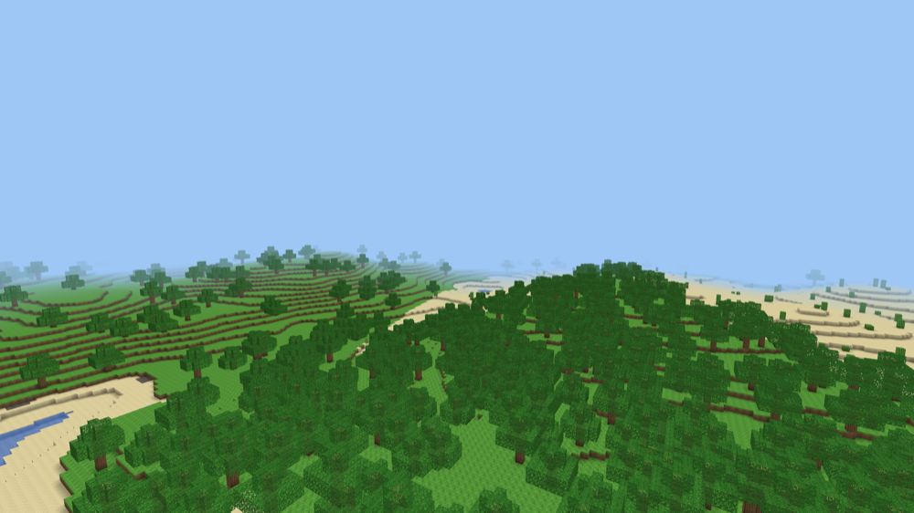

# GTI voxel sandbox



An original block-building sandbox game written in GTI: an endless chunked
voxel world with biomes, caves, ores, trees and water. You can walk, fly, break
and place blocks, and every frame is profiled. It exists to show that GTI can
carry a real-time game and to measure that against other languages and against
commercial voxel games.

Everything that defines the game is GTI source. That covers world generation and
noise, chunk storage, meshing with ambient occlusion and greedy merging, the
procedural pixel-art textures, player physics, ray casting, the renderer's
policy (culling, sorting, passes), the bitmap-font HUD, the profiler and its
reports, PNG encoding and the benchmarks. Only two native boundaries remain:

- **GLFW** (the repository's `packages/glfw`) opens the window and handles
  input.
- **OpenGL 4.1 core** draws. Its entry points are declared directly against
  `OpenGL.framework` in `src/render/gl.gti`, with no C shim or loader.

The textures, tile art and the bitmap font are generated or defined in this
example. No third-party game assets are used.

## Build and run

From this directory (macOS arm64; prepare GLFW once with
`python3 ../../packages/prepare.py glfw` from the repository root):

```sh
gti run voxel-sandbox --release
```

Options:

| Option | Meaning |
| --- | --- |
| `--seed N` | world seed (default 1337) |
| `--render-distance R` | view radius in chunks, 2–32 (default 10) |
| `--no-vsync` | uncapped frame rate |
| `--fullscreen`, `--size WxH` | window mode / size |
| `--budget-ms MS` | per-frame CPU budget for chunk meshing |
| `--threads T`, `--batch N` | chunk-generation workers (1/2/4/8, default 4) and chunks per frame (default 8) |
| `--benchmark [--seconds S]` | scripted flight benchmark (vsync off), writes a report |
| `--report PATH` | profile report path (JSON plus a per-frame CSV) |
| `--screenshot SECONDS PATH` | save a PNG of the frame at that time |
| `--no-overlay` | start with the F3 debug overlay hidden |

Controls: WASD to move, the mouse to look, space to jump (or rise while
flying), shift to descend, ctrl to sprint, F to toggle flying. Left click
breaks a block and right click places one. 1–9, Q and E select the block, F3
toggles the debug overlay, F2 saves a screenshot, and Esc releases the mouse
(press it again to quit).

## Structure

| Path | Owns |
| --- | --- |
| `src/world/block.gti` | block ids, texture tiles, material rules |
| `src/world/chunk.gti` | 16×128×16 chunk storage and coordinates |
| `src/world/noise.gti` | deterministic seeded noise |
| `src/world/worldgen.gti` | terrain, biomes, caves, ores, trees, water |
| `src/world/world.gti` | loaded chunks, block edits, mesh building |
| `src/world/mesher.gti` | face culling, ambient occlusion, greedy merging, packed vertices |
| `src/render/gl.gti` | raw OpenGL declarations |
| `src/render/renderer.gti` | chunk GPU buffers, shaders, frustum culling, water pass, GPU timers |
| `src/render/textures.gti` | procedural 16×16 tile art and a PNG encoder |
| `src/render/hud.gti` | bitmap-font text, crosshair, hotbar |
| `src/core/math.gti` | vectors, matrices, frustum |
| `src/core/profiler.gti` | zones, counters, frame-time statistics, reports |
| `src/game/*.gti` | window/input, player physics and ray casting, game loop |
| `src/bench/flight.gti` | deterministic benchmark camera path |
| `src/bench/headless*.gti` | `voxel-bench`, the windowless generation/meshing benchmark |
| `bench/reference/` | C++ port of the benchmark kernels for comparison |
| `bench/compare.py` | GTI vs C++ runner |

Tests: `gti test game-tests`, `gti test world-tests`, `gti test core-tests`.

## Profiling and benchmarks

See [docs/PROFILING.md](docs/PROFILING.md) for the zones, the report format and
how to compare fairly with other engines.

```sh
gti run voxel-sandbox --release -- --benchmark --render-distance 12 --report profiles/rd12.json
gti run voxel-bench --release -- --radius 8 --reps 5
python3 bench/compare.py
```

## Results (2026-11-26)

These were measured on a Mac with an Apple M4 Pro, macOS, GTI 0.494.0 `--release`. Other
jobs were running on the machine (load average about 9), so treat absolute
numbers as indicative.

**Kernels, GTI vs C++** (`bench/compare.py --runs 5`: seed 1337, radius 8,
289 chunks, median per chunk, checksums identical). The C++ port is the same
algorithm built with `clang++ -O3 -ffp-contract=off`. It has no bounds or
overflow checks, while the GTI build keeps GTI's checked integer arithmetic.

| Phase, 1 thread | GTI µs/chunk | C++ µs/chunk | GTI/C++ |
| --- | ---: | ---: | ---: |
| Generate | 493 | 437 | 1.13× |
| Mesh (face culling) | 204 | 144 | 1.42× |
| Mesh (greedy) | 525 | 418 | 1.26× |

Parallel generation scales the same in both languages: 3.8× on 4 threads and
5.4× on 8 threads in GTI, versus 3.9× and 5.2× in C++.

**Game, flight benchmark** (render distance 12, 3200×1766 framebuffer, vsync
off, 4 generation workers): about 300–410 fps average depending on machine
load. Median frame time is about 2 ms, the 1% low is about 70–85 fps and GPU
time about 1.2 ms per frame. The full view distance is generated and meshed
0.8 s after start. CPU-side game work is under 1 ms per frame; most of the
rest is waiting for the GPU in `swap`.
